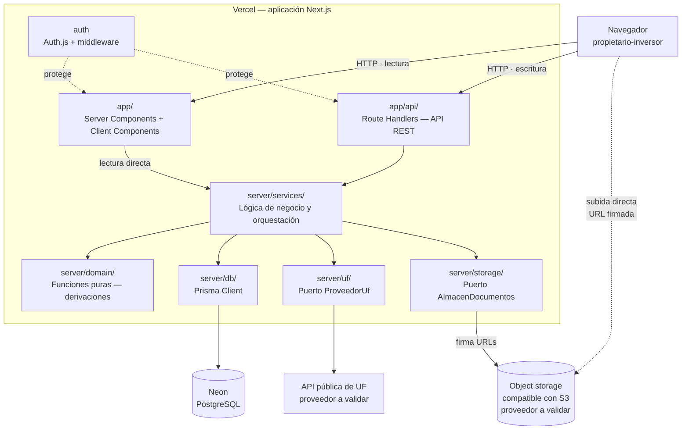
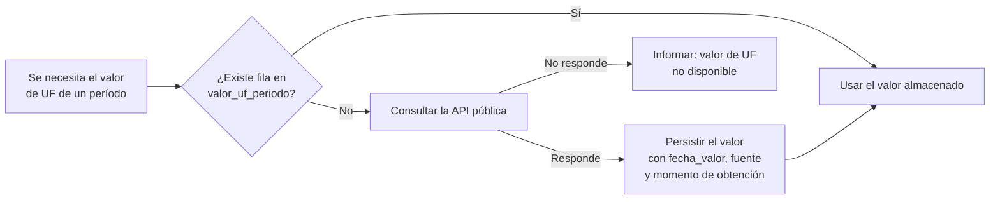
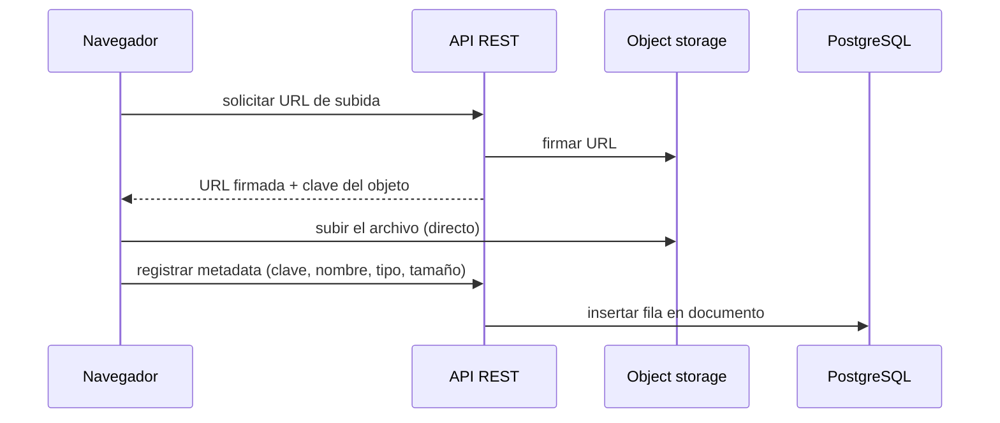
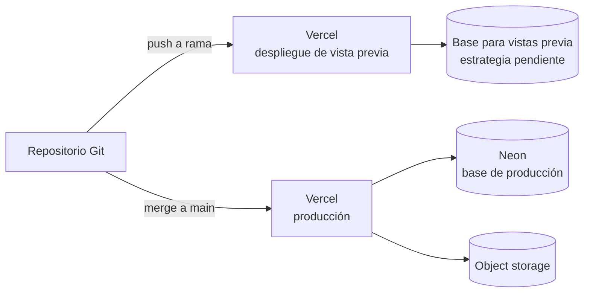
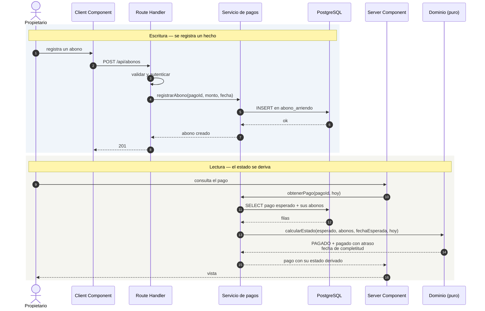

# RealtyTrack — Arquitectura

## 1. Propósito y alcance

Este documento define la arquitectura del MVP de RealtyTrack: qué componentes existen, qué
responsabilidad tiene cada uno y por qué.

> **Todo lo descrito aquí es arquitectura diseñada y propuesta, no implementada.**
> Entrega 1 es exclusivamente documental: no hay código de aplicación, ni despliegue real,
> ni tests ejecutados. Lo que sigue es el diseño que guiará las entregas siguientes.

Es el cuarto eslabón de la cadena documental: [product.md](product.md) fija el problema,
[user-stories.md](user-stories.md) los criterios verificables, [data-model.md](data-model.md)
la representación de los datos, y aquí se resuelve cómo se organiza el software que los
sostiene.

**Cómo leer este documento.** Toda afirmación es una decisión confirmada o una decisión
técnica justificada, salvo las marcadas explícitamente como *propuesta a validar*, que están
pendientes y no deben tratarse como cerradas. §21 las recoge todas clasificadas.

---

## 2. Visión general y principios rectores

RealtyTrack es una **aplicación full-stack única**: un repositorio, un despliegue, una base
de datos.

La razón es el producto, no la moda técnica. Es un sistema de **usuario único**, con una
cartera de unas pocas propiedades, cuyo patrón de uso es registro manual y consulta mensual.
No hay concurrencia relevante, ni volumen, ni múltiples clientes que consuman la misma API.
Cualquier forma de distribución añadiría operación y modos de fallo sin resolver ningún
problema real.

Cinco principios gobiernan las decisiones que siguen:

1. **La lógica de negocio vive en un solo sitio.** Ni en los componentes de React, ni en los
   controladores, ni repartida en consultas. `CLAUDE.md` lo exige y la testabilidad lo
   confirma.
2. **Lo derivado se deriva.** `data-model.md` §6 lista lo que el sistema calcula en lugar de
   almacenar. La arquitectura no puede introducir ninguna forma de persistencia —columna,
   tabla, vista materializada o caché— para esos valores.
3. **El sistema no inventa datos.** Si el valor de la UF no está disponible, se informa; no
   se estima, no se interpola, no se arrastra el mes anterior.
4. **Lo que depende de la fecha actual se calcula en cada consulta.** El estado de un pago
   cambia por el paso del tiempo, no por una escritura.
5. **La solución más simple que cumpla el requisito.** Sin capas especulativas ni patrones
   "por si acaso".

---

## 3. Stack

| Pieza | Elección | Por qué |
|---|---|---|
| Aplicación | **Next.js (App Router)** + TypeScript | Un solo despliegue para UI y API. El producto tiene un único consumidor: su propia interfaz |
| UI | **React** + **Tailwind CSS** | Tailwind evita mantener una capa de estilos propia en un proyecto de una sola persona |
| API | **REST** mediante Route Handlers | Confirmado por `CLAUDE.md`; el `readme.md` §4 exige documentar endpoints en OpenAPI |
| Persistencia | **PostgreSQL** en **Neon** | PostgreSQL está confirmado. Neon aporta un plano gestionado, escalado a cero y agrupación de conexiones |
| Acceso a datos | **Prisma** | Esquema versionado, migraciones reproducibles y tipos generados desde el esquema |
| Archivos | **Object storage compatible con S3** | Regla explícita de `CLAUDE.md`: nunca binarios en PostgreSQL |
| Autenticación | **Auth.js**, proveedor de credenciales, estrategia JWT | `product.md` §6.7 pide acceso protegido de usuario único; `CLAUDE.md` añade JWT |
| Despliegue | **Vercel** | Integración directa con Next.js y con el repositorio |
| Externo | **API pública chilena de UF** | El sistema obtiene el valor, no lo calcula |

**Nota de trazabilidad.** Una versión anterior de `CLAUDE.md` fijaba un backend separado en
NestJS. Esa decisión se revirtió: la aplicación es full-stack en Next.js, y `CLAUDE.md`
§Stack está actualizado en consecuencia. El motivo es que un servicio backend independiente
duplicaría despliegue, contrato y configuración para servir a un único consumidor.

---

## 4. Diagrama de componentes



Dos rasgos que el diagrama hace visibles:

- **La UI lee llamando a los servicios directamente**, sin dar un rodeo por HTTP contra su
  propio proceso. Las escrituras sí pasan por la API REST (§8).
- **El binario de un documento nunca atraviesa la aplicación**: viaja del navegador al
  object storage mediante una URL firmada (§13).

---

## 5. Capas y responsabilidades

Cuatro capas, con una regla que las gobierna: **la lógica de negocio vive en una sola de
ellas**.

| Capa | Responsabilidad | Prohibido |
|---|---|---|
| **UI** — `app/` | Presentar y capturar | Cualquier cálculo financiero |
| **API** — `app/api/` | Validar la entrada, autenticar, llamar al servicio, traducir errores a HTTP | Lógica de negocio; acceso directo a Prisma |
| **Servicios** — `server/services/` | Orquestar: leer, aplicar reglas, escribir. Incluye las **agregaciones mensuales** y la **regla de caja** | Conocer HTTP o React |
| **Dominio** — `server/domain/` | Funciones **puras** sin entrada/salida: las **reglas de negocio** —estado del pago, fecha de completitud, monto vigente del contrato, conversión UF → CLP— | Tocar Prisma, la red o el reloj del sistema |

`data-model.md` §6 lista todo lo que el sistema deriva, pero **no todo se deriva en el mismo
sitio**. El reparto está en §10.1: las agregaciones mensuales se resuelven consultando
PostgreSQL desde los servicios; las reglas con precedencia se resuelven en funciones puras
del dominio. Ninguna de las dos cosas se almacena.

**La regla de caja es responsabilidad explícita de los servicios y sus consultas**, no del
dominio puro: es la que decide qué filas entran en el mes, y por tanto vive donde se
consulta. Debe respetar sin excepción las fechas que `data-model.md` §7.1 fija —
`abono_arriendo.fecha_recepcion`, `movimiento_financiero.fecha`,
`credito_registro_mensual.fecha_pago_dividendo` y `aporte_capital.fecha` — y nunca
`credito_registro_mensual.periodo`, que es la mensualidad hipotecaria (§10.5).

### 5.1 Por qué el dominio se separa de los servicios

Las reglas que hay que probar con más rigor —la precedencia de los cuatro estados de un
pago, la fecha de completitud, el monto vigente ante un reajuste retroactivo— son funciones
de datos a datos. Aisladas y puras se prueban con tablas de casos, sin base de datos ni
dobles de prueba.

Es la traducción arquitectónica de lo que `CLAUDE.md` exige para las entregas siguientes:
*lógica de negocio en servicios testeables, sin cálculo financiero dentro de componentes
React*.

### 5.2 La fecha actual se inyecta, nunca se lee

El estado de un pago depende de qué día es hoy. Si una función de dominio consultara el
reloj del sistema, sus pruebas dependerían del día en que se ejecutan y los casos límite de
HU02 dejarían de ser verificables.

Por eso **la fecha de referencia es un parámetro** de toda función de dominio que la
necesite. Quien la obtiene es la capa de servicios.

### 5.3 Sin capa de repositorios

Los servicios usan Prisma Client directamente. Interponer repositorios sobre un ORM que ya
abstrae la base de datos sería una indirección sin beneficio para un MVP de este tamaño: dos
lugares que mantener sincronizados a cambio de nada.

### 5.4 Generación de los pagos esperados

`product.md` §7.1 establece que *el pago esperado lo genera el sistema desde el contrato
vigente*, y `data-model.md` §4.8 exige que sean **filas persistidas**, no una derivación al
vuelo: los abonos necesitan una clave foránea estable a la que apuntar.

Es la única escritura del sistema sin un acto humano que la dispare, así que conviene fijar
quién la hace y cuándo.

| Aspecto | Decisión |
|---|---|
| Responsable | La **capa de servicios**. No es una función de dominio: escribe |
| Momento | **Antes de operar sobre los pagos de un período** —consultarlos o registrar un abono—, el servicio garantiza que existen las filas correspondientes a los contratos vigentes en ese período |
| Idempotencia | La operación se puede repetir sin efecto. `UNIQUE (contrato_id, periodo)` impide duplicados |
| Sin trabajo programado | No hay cron ni tarea periódica que las cree por adelantado |
| Sin generación desde la UI | Ningún componente dispara la creación; la garantiza el servicio |

**Meses sin contrato vigente no generan nada**, y esa ausencia no es impago (HU02 CL15).

**Esto no contradice §19.** Lo que aquel diagrama afirma es que la escritura no calcula ni
almacena el *estado* del pago; garantizar que existan las filas esperadas de un período es
otra cosa, y sigue sin persistir ningún dato derivado.

**Los reajustes retroactivos no son generación, sino recálculo.** Registrar un reajuste con
vigencia pasada recalcula explícitamente el `monto_esperado_clp` de los períodos afectados,
tal como describe `data-model.md` §4.8. Los estados de esos pagos no se tocan: se derivan
después, en la siguiente lectura, a partir del monto corregido.

---

## 6. Estructura de carpetas

```
app/
  (auth)/login/              pantalla de acceso
  propiedades/               cartera y detalle de propiedad
  contratos/                 contratos, reajustes, pagos y abonos
  creditos/                  registro mensual de dividendo y saldo
  dashboard/                 flujo financiero mensual de cartera
  api/                       Route Handlers — API REST
server/
  domain/                    funciones puras: reglas de negocio con precedencia
  services/                  orquestación, agregaciones mensuales y regla de caja
  db/                        Prisma Client y utilidades de consulta
  uf/                        puerto ProveedorUf e implementación
  storage/                   puerto AlmacenDocumentos e implementación
  errors/                    errores de dominio tipados
prisma/
  schema.prisma              esquema, espejo de data-model.md
  migrations/                migraciones versionadas
  seed.ts                    carga inicial controlada y anonimizada
```

La estructura sigue las capas de §5, no un patrón importado.

**`server/` es una convención, no una frontera que el framework imponga.** El nombre de una
carpeta no impide que un Client Component importe lo que hay dentro; si lo hiciera, el código
—y con él credenciales o consultas— acabaría en el paquete que se envía al navegador.

Por eso los módulos exclusivamente de servidor **protegen su frontera de forma explícita**,
marcándose con `server-only` donde corresponda, de modo que cualquier importación desde el
cliente falle en tiempo de compilación en lugar de filtrarse en silencio. Aplica a los
módulos de acceso a datos, a los que manejan credenciales y a los servicios.

---

## 7. Frontend

Las vistas se derivan de las historias documentadas, no de una idea previa de aplicación:

| Vista | Historia | Qué muestra |
|---|---|---|
| Cartera | HU01 | Listado de propiedades |
| Detalle de propiedad | HU01 · HU02 · HU03 | Crédito, contrato vigente, pagos, egresos, aportes y documentos |
| Registro mensual del crédito | HU01 | Dividendo pagado y saldo informado por el banco |
| Contratos y reajustes | HU02 | Contrato, arrendatario, garantía e histórico de montos |
| Pagos y abonos | HU02 | Esperado frente a recibido, con estado y calificación |
| Dashboard mensual | HU03 | Ingresos, egresos, flujo neto antes de aportes y aportes |

**Server Components por defecto.** El dashboard y los listados son lectura pura; producirlos
en el servidor evita enviar al navegador lógica de agregación que no debe estar ahí. Los
Client Components se reservan para formularios y filtros.

**Ningún cálculo financiero en los componentes.** Los importes llegan ya calculados desde la
capa de servicios. Un componente formatea y presenta; no suma, no compara contra fechas, no
deriva estados.

### 7.1 Regla de caché

Las vistas que muestran estado de pagos **no pueden cachearse estáticamente**.

El estado de un pago depende de la fecha actual: un pago *pendiente* pasa a *vencido* sin
que nadie escriba nada. Una página cacheada seguiría mostrándolo como pendiente. Esas rutas
se declaran dinámicas, y las que dependen de datos escritos se revalidan tras cada mutación.

---

## 8. API REST

Los Route Handlers de `app/api/**/route.ts` implementan la API REST que `CLAUDE.md` confirma
y que el `readme.md` §4 documentará en formato OpenAPI.

### 8.1 Toda escritura pasa por REST

**No se usan Server Actions.** Un único camino de mutación significa un solo lugar donde
validar la entrada, autenticar y traducir errores a HTTP — y, sobre todo, que lo documentado
en OpenAPI es exactamente lo que la aplicación usa, no un contrato paralelo que se
desincroniza.

La lectura es deliberadamente asimétrica:

```
Escritura:  Client Component ──fetch──> Route Handler ──> Service ──> …
Lectura:    Server Component ─────────────────────────> Service ──> …
```

Lo que hace segura la asimetría es que la lógica vive en los servicios: ambos caminos
ejecutan el mismo código, y ninguno puede saltarse una regla que el otro aplica.

### 8.2 Responsabilidad de un Route Handler

Cuatro cosas, y ninguna más: validar el cuerpo y los parámetros con un esquema, comprobar la
sesión, invocar el servicio, y traducir el resultado o el error a HTTP. Un handler que
contenga una condición de negocio está mal colocado.

### 8.3 Cómo se diseña la API

**Por casos de uso, no como CRUD de tablas.** Las entidades de `data-model.md` orientan qué
datos hacen falta, pero no obligan a exponer un recurso por entidad: son dos planos
distintos, y confundirlos produciría una API que obliga al cliente a orquestar varias
llamadas para completar una acción que el producto entiende como una sola.

Un ejemplo de la diferencia: registrar un reajuste de arriendo es **una** operación desde el
punto de vista del producto —HU02 E3 y E5—, aunque en el modelo suponga escribir en
`contrato_monto` y recalcular los `pago_esperado` de los períodos afectados. La API expone
el reajuste; no obliga a insertar una fila y luego actualizar pagos uno a uno.

Las capacidades que la API debe cubrir se derivan de `product.md` §5 y de las historias:

| Capacidad | Operaciones que la API expone |
|---|---|
| Gestión de propiedades | Alta, consulta y edición de una propiedad y sus datos de compra |
| Gestión del crédito | Registrar el crédito de una propiedad; registrar el dividendo pagado y el saldo de una mensualidad; consultar la serie histórica |
| Contratos y arriendos | Registrar un contrato con su arrendatario; **registrar un reajuste**; consultar el histórico de contratos y montos |
| Pagos de arriendo | Consultar los pagos esperados de un período con su estado derivado; **registrar un abono** |
| Egresos y aportes | Registrar y consultar movimientos financieros y aportes de capital, con el vínculo opcional entre ellos |
| Documentos | Obtener una URL de subida, registrar la metadata, listar y obtener una URL de lectura |
| Consulta financiera | Dashboard mensual de cartera y vista mensual de una propiedad |

La forma concreta de cada recurso y sus rutas se fijarán al escribir la especificación. Los
tres endpoints representativos que exige el `readme.md` §4 se elegirán entonces, entre los
que mejor muestren esta orientación a capacidades.

---

## 9. Persistencia y acceso a datos

PostgreSQL alojado en Neon, accedido mediante Prisma. El esquema de `prisma/schema.prisma`
es el espejo directo de [data-model.md](data-model.md): trece entidades, con sus claves,
restricciones y enumeraciones.

### 9.1 Los importes se manejan como `Prisma.Decimal`

`data-model.md` §2 prohíbe la coma flotante para cifras financieras. Prisma mapea `NUMERIC`
a `Decimal`, y **ese es el tipo con el que se opera en el servidor**: sumas, comparaciones y
conversiones UF → CLP se hacen sobre `Decimal`. Convertir a `number` en cualquier punto
intermedio reintroduciría exactamente el error que el modelo evita.

**Al cruzar JSON** —respuestas de la API y datos enviados al cliente— los importes se
serializan mediante una **representación sin pérdida, preferentemente `string`**.

Este es el punto donde la regla se rompe con más facilidad, y conviene decir por qué:
`JSON.stringify` no sabe serializar un `Decimal`, y la salida por defecto invita a
convertirlo a número para "arreglarlo". Ese arreglo es precisamente el fallo. La
serialización a `string` debe ser explícita y estar en un único lugar.

### 9.2 Conexiones

Las funciones serverless abren muchas conexiones cortas, algo que PostgreSQL lleva mal. Neon
expone dos cadenas de conexión con propósitos distintos:

| Cadena | Uso |
|---|---|
| *Pooled* | La aplicación en ejecución |
| Directa | Migraciones y tareas administrativas |

Son **dos variables de entorno distintas** (§16), no una reutilizada.

### 9.3 Migraciones

Prisma Migrate, con las migraciones versionadas en el repositorio. Aplicarlas es un paso
deliberado, nunca encadenado al build (§15).

### 9.4 Sin vistas materializadas

Una vista materializada es persistencia de datos derivados. `data-model.md` §11 lo prohíbe
expresamente y esta arquitectura no introduce ninguna excepción. Las vistas no
materializadas son admisibles: no almacenan nada.

---

## 10. Cálculos derivados

Es la sección de mayor riesgo del documento: es donde una arquitectura descuidada rompería
el modelo de datos sin que nadie lo note hasta que las cifras dejen de cuadrar.

### 10.1 Reparto entre agregación en PostgreSQL y funciones puras

| Qué | Dónde | Por qué |
|---|---|---|
| Totales mensuales: ingresos, egresos, aportes, flujo neto | **Agregación en PostgreSQL** | Evita traer filas al proceso solo para sumarlas |
| Reglas con precedencia: estado del pago, fecha de completitud, calificaciones | **Funciones puras de TypeScript** | Hay que probarlas contra los casos límite de HU02; expresadas como consulta quedarían opacas |
| Monto vigente del contrato en un mes | **Funciones puras** sobre las filas de `contrato_monto` | Misma razón |
| Conversión UF → CLP | **Funciones puras**, con el valor del período como parámetro | Mantiene la conversión trazable y comprobable |

### 10.2 Cómo se expresa la agregación

Se usan las operaciones `aggregate` y `groupBy` de Prisma **siempre que basten**, que es el
caso de la mayoría de los totales mensuales: conservan el tipado y devuelven `Decimal`.

**SQL específico queda reservado** para las consultas donde realmente aporte —agregaciones
que Prisma no exprese con claridad, o que de otro modo exigirían varias pasadas—, y en esos
casos se documenta el motivo junto a la consulta.

SQL crudo **no es una regla arquitectónica**: es una herramienta que se justifica caso a
caso.

### 10.3 Prohibiciones heredadas del modelo de datos

Ninguna de estas existe, y ninguna debe introducirse:

- tabla de resumen mensual o de cierre;
- vista materializada;
- columna con el estado del pago, la fecha de completitud, el monto recibido, el saldo
  actual del crédito o el equivalente en CLP de un importe en UF;
- caché de resultados del dashboard.

La estabilidad del histórico proviene de que el valor de UF de un período no cambia una vez
almacenado (§12), **no** de congelar cifras calculadas.

### 10.4 Un solo servicio de dashboard

La vista de cartera y la vista de propiedad se alimentan del **mismo servicio**, con distinto
alcance. Dos implementaciones de la misma cifra acabarían divergiendo.

### 10.5 Período de origen y mes de caja

La arquitectura respeta la separación de `data-model.md` §7 sin excepciones:

- el dividendo se imputa al flujo de caja por `fecha_pago_dividendo`, **nunca** por
  `periodo`;
- los ingresos se imputan por `fecha_recepcion` del abono;
- los rótulos de correspondencia temporal —*"Correspondiente a marzo 2026"*— se derivan al
  presentar y no se almacenan en ningún campo de texto.

---

## 11. Autenticación y seguridad

`product.md` §6.7 pide acceso protegido con email y contraseña, sin registro público ni
perfiles. `CLAUDE.md` añade JWT.

### 11.1 Mecanismo

**Auth.js con proveedor de credenciales y estrategia JWT.** Delega en una librería
establecida la gestión de la sesión y su cookie —creación, protección y lectura—, que es la
parte del camino crítico que no conviene escribir a mano.

| Elemento | Decisión |
|---|---|
| Contraseña | Hash con Argon2id |
| Verificación de la contraseña | **Código propio**, dentro del `authorize` del proveedor de credenciales. Auth.js no la cubre |
| Sesión | JWT en cookie `httpOnly` + `Secure` + `SameSite` |
| Protección de rutas | Middleware de Next: todo protegido salvo la pantalla de acceso |
| Alta del usuario | Por seed. **No existe endpoint de registro** |

Conviene ser explícito en el segundo punto: adoptar Auth.js no significa que la comprobación
de la contraseña deje de ser responsabilidad del proyecto. Sigue siéndolo.

**Fuera de alcance por decisión de producto**: registro público, invitaciones, perfiles,
roles y recuperación de contraseña. El MVP es de usuario único.

### 11.2 Otras prácticas de seguridad

- Ningún secreto en el repositorio ni en el cliente (§16).
- Bucket de documentos **privado**; el acceso es siempre por URL firmada de vida corta
  (§13).
- Validación de toda entrada en el borde de la API, antes de llegar a los servicios.
- Las respuestas de error no exponen detalles internos (§17).
- Los datos reales del Excel se cargan **anonimizados** (§14), regla de `CLAUDE.md`.

---

## 12. Integración con la API de UF

`product.md` §7.1 es tajante: el valor de la UF se obtiene de una API pública chilena, y el
sistema **no lo estima ni lo calcula**.

### 12.1 Puerto `ProveedorUf`

Una interfaz con una sola operación —obtener el valor de la UF para una fecha concreta— y
una implementación detrás.

La abstracción está justificada y no es especulativa: el proveedor concreto **está sin
decidir** (*propuesta a validar*), y aislarlo permite documentar y construir la arquitectura
sin cerrarlo.

### 12.2 Flujo



**Una vez almacenado, el valor de un período no se sobrescribe** (`data-model.md` §4.12). Es
lo que sostiene el criterio de éxito 4: consultar dos veces un mes anterior produce las
mismas cifras aunque la UF haya cambiado entre ambas consultas.

### 12.3 Momento de la consulta

**Bajo demanda**, sin trabajo programado. Una tarea periódica sería infraestructura adicional
para adelantar un dato que puede obtenerse cuando hace falta.

### 12.4 Qué ocurre si la API falla

Si la API no responde y el período no tiene valor almacenado, el sistema **informa que el
valor de UF no está disponible**. No se arrastra el mes anterior, no se interpola y no se
inventa. Es una regla de producto, no una preferencia técnica: mostrar una cifra estimada
como si fuera real es peor que no mostrarla.

**Cómo se informa depende de para qué hacía falta la UF**, y la distinción importa porque no
todas las consultas la necesitan igual:

| Caso | Comportamiento |
|---|---|
| La UF solo aporta un **equivalente opcional** en CLP | **Degradación parcial**: la operación tiene éxito, se muestra el valor en UF y el equivalente en CLP se marca como no disponible |
| El **resultado principal** de la operación no puede producirse sin la UF | La operación falla y se informa como error de dependencia externa (§17) |

El primer caso es el habitual: `product.md` §6.5 establece que el equivalente en CLP
acompaña al valor en UF *"cuando sea útil"*, sin reemplazarlo. Que falte no invalida la
consulta — el saldo del crédito en UF sigue siendo el dato principal y sigue siendo
correcto. Tumbar la vista de un mes entero por un dato accesorio sería peor que mostrarlo
incompleto y decirlo.

### 12.5 La regla del día de referencia sigue abierta

`data-model.md` §8.4 deja pendiente **qué día del mes representa a cada período**, porque la
convención afecta al resultado financiero. **Este documento no la cierra.**

La arquitectura la respeta del único modo posible: la firma del puerto recibe una fecha, de
modo que la convención vive en **un solo punto configurable** y cambiarla no obliga a tocar
la integración.

---

## 13. Almacenamiento de documentos

`data-model.md` §4.13: PostgreSQL guarda solo metadata; el binario vive en object storage.

### 13.1 Puerto `AlmacenDocumentos`

Definido contra la **API de S3**, con tres operaciones: URL firmada de subida, URL firmada de
lectura y borrado. El bucket es **privado**; ningún objeto es accesible públicamente.

La interfaz S3 es una decisión confirmada —`CLAUDE.md` §Stack y `data-model.md` §4.13 exigen
compatibilidad con S3—. El proveedor concreto es *propuesta a validar*: Cloudflare R2, AWS S3
o Backblaze B2 la satisfacen.

### 13.2 Subida directa desde el navegador

El navegador pide una URL firmada, sube el archivo **directamente al bucket**, y solo
entonces la API registra la metadata.

La razón es que **el binario nunca atraviesa el runtime de Next.js**. Eso desacopla el tamaño
de los documentos de los límites de payload, memoria y tiempo de ejecución del entorno de
ejecución, sean los que sean y cambien como cambien. Subir el archivo *a través* de la API
ataría el tamaño máximo de un contrato escaneado a la configuración de la plataforma.



### 13.3 Objeto huérfano

Si el proceso se interrumpe entre la subida y el registro de la metadata, queda un objeto en
el bucket sin fila que lo referencie.

Para un MVP de usuario único basta con **reconocerlo**: no justifica una máquina de estados
ni un proceso de reconciliación. Si llegara a molestar, un script de limpieza que compare
claves contra la tabla lo resuelve.

---

## 14. Carga histórica inicial

Los datos históricos reales de las tres propiedades se cargan mediante un **script de seed
controlado y anonimizado** (`prisma/seed.ts`), ejecutado a mano.

**No es una funcionalidad del producto.** `product.md` §8 excluye expresamente el importador
de Excel, y este documento no lo reintroduce por la puerta de atrás. El seed es una
herramienta de desarrollo.

Nombres de arrendatarios, RUT, direcciones, montos reales y documentos se anonimizan **antes**
de entrar al repositorio, según la regla de `CLAUDE.md`.

Es lo que hace verificable el criterio de éxito 10 de `product.md` §10.

---

## 15. Infraestructura y despliegue

> Diseño propuesto. En Entrega 1 no existe despliegue real.



| Aspecto | Decisión |
|---|---|
| Alojamiento | Vercel, conectado al repositorio |
| Vistas previa | Cada PR genera un despliegue propio |
| Producción | Despliegue desde `main` |
| Base de datos | Neon |

### 15.1 Migraciones

Aplicar migraciones es un **paso deliberado** sobre la base correspondiente, no un comando
encadenado al build. Ligar la migración al build es un problema conocido cuando hay
despliegues concurrentes: dos builds simultáneos pueden intentar migrar a la vez.

### 15.2 Aislamiento de datos en vistas previa — *pendiente*

**No se cierra en este documento.** Las opciones son una base de desarrollo compartida por
todos los despliegues de vista previa, o el *branching* de Neon con una base por PR.

La elección se hará en la fase de implementación, cuando exista despliegue real y se conozcan
las necesidades concretas de las pruebas sobre vistas previa.

---

## 16. Variables de entorno y secretos

| Variable | Propósito |
|---|---|
| Cadena de conexión *pooled* | Acceso de la aplicación a PostgreSQL |
| Cadena de conexión directa | Migraciones y tareas administrativas |
| Secreto de firma de sesión | Firma del JWT de Auth.js |
| Credenciales del object storage | Clave, secreto, región y bucket |
| URL base del proveedor de UF | Endpoint de la API pública |

**Reglas**

- Los secretos se gestionan en las variables de entorno de la plataforma, con valores
  distintos por entorno.
- `.env.local` **nunca** se versiona. Se versiona un `.env.example` con los nombres y sin
  valores.
- **Ninguna credencial usa el prefijo público** de Next.js: ese prefijo incrusta el valor en
  el paquete que se envía al navegador. Solo lo usan valores que puedan ser públicos.
- Ningún secreto en el repositorio, coherente con la regla de anonimización de `CLAUDE.md`.

---

## 17. Tratamiento de errores

Los servicios lanzan **errores de dominio tipados** —regla de negocio incumplida, recurso
inexistente, conflicto, dependencia externa no disponible— y la capa API los traduce a HTTP
en **un único punto**, con un cuerpo de respuesta uniforme.

| Situación | Respuesta |
|---|---|
| Entrada inválida | 400 |
| Sin sesión | 401 |
| Recurso inexistente | 404 |
| Regla de negocio incumplida | 409 |
| Valor de UF no disponible, **y sin él no hay resultado principal** | 503, con mensaje explícito |
| Fallo inesperado | 500, sin detalles internos |

**El 503 se reserva para las operaciones cuyo resultado principal no puede producirse sin la
UF.** No es la respuesta habitual ante una UF ausente.

Cuando la UF solo aportaba un **equivalente opcional en CLP**, la operación **tiene éxito** y
la respuesta incluye el valor en UF con el equivalente marcado como no disponible (§12.4). La
interfaz lo presenta así: el importe en UF, y en lugar del equivalente, la indicación de que
no está — no un cero, no una estimación, no el valor del mes anterior.

La regla de fondo es la misma en ambos casos: **es preferible informar de que el dato no está
a mostrar una cifra inventada**. Lo que cambia es si la ausencia invalida la respuesta
entera o solo una parte accesoria de ella.

Los errores se registran en los logs de la plataforma. Un servicio de observabilidad externo
queda fuera del MVP.

---

## 18. Estrategia de testing

> Entrega 1 **documenta** esta estrategia. No implementa tests ni aporta evidencias de
> ejecución; eso corresponde a las entregas siguientes.

| Nivel | Qué cubre | Por qué ahí |
|---|---|---|
| **Unitario sobre el dominio** | Precedencia de los cuatro estados y sus calificaciones · fecha de completitud, incluidos abonos del mismo día · monto vigente ante reajuste retroactivo · imputación al mes de caja · conversión UF → CLP | Es donde vive el riesgo real, y son funciones puras: se prueban con tablas de casos, sin base de datos |
| **Integración de servicios** | Las invariantes de `data-model.md` §5.1 que la base no impone: no solapamiento de contratos, documento coherente con su propiedad, monto esperado alineado con `contrato_monto` | Requieren PostgreSQL real; un doble no las verificaría |
| **API** | Códigos de estado, validación de entrada y control de acceso | Es el contrato de la capa REST |
| **Extremo a extremo** | Un recorrido por HU01, HU02 y HU03 | *Propuesta a validar*: el valor está en los dos primeros niveles |

**Los casos límite de `user-stories.md` son directamente los casos de prueba.** Se
escribieron con esa forma a propósito: HU02 CL11 a CL15, HU01 CL10 a CL12 y HU03 CL12 a CL14
se traducen a tablas de casos sin necesidad de reinterpretarlos.

La arquitectura está construida para que esto sea posible: si las derivaciones vivieran en
componentes de React o en consultas dispersas, este nivel de prueba no existiría.

---

## 19. Diagrama de secuencia: registrar un abono y consultar el estado

Este flujo explica en un solo dibujo por qué el estado del pago no se almacena.



Obsérvese que **la escritura no calcula ni guarda ningún estado**. El estado aparece en la
lectura, a partir del monto esperado, los abonos y la fecha de referencia. Por eso un pago
pasa de *pendiente* a *vencido* sin que nadie escriba nada, y por eso un reajuste retroactivo
recalcula los estados sin un proceso que los actualice.

---

## 20. Trazabilidad

| Componente | Capacidad del MVP | Historia |
|---|---|---|
| Vistas de propiedades y crédito | 1 · 2 | HU01 |
| Registro mensual del crédito | 2 | HU01 |
| Vistas de contratos, montos y pagos | 3 · 4 | HU02 |
| Dominio: estado del pago y fecha de completitud | 4 | HU02 |
| Dominio: monto vigente del contrato | 3 | HU02 |
| Servicio de dashboard y agregación mensual | 5 | HU03 |
| Dominio: conversión UF → CLP | 2 · 5 | HU01 · HU03 |
| Integración con la API de UF | 2 · 5 | HU01 · HU03 |
| Puerto de object storage y subida directa | Documentos (transversal) | HU01 · HU02 |
| Auth.js y middleware | Acceso protegido (transversal) | — |
| Seed anonimizado | — | Criterio de éxito 10 |

---

## 21. Decisiones

### 21.1 Confirmadas por los documentos

Usuario único · PostgreSQL · API REST · el valor de la UF se obtiene de una API pública y no
se estima · documentos en object storage compatible con S3, solo metadata en la base · el
sistema no reproduce la lógica del banco ni calcula amortizaciones · el dividendo no se
duplica como movimiento financiero · lo derivado sigue derivado · carga inicial por proceso
controlado y anonimizado, sin importador.

### 21.2 Decisiones técnicas de este documento

| Decisión | Justificación |
|---|---|
| Aplicación full-stack en Next.js, un solo despliegue | Un único consumidor de la API; separar procesos añadiría operación sin beneficio |
| Cuatro capas con la lógica en servicios y dominio | Testabilidad, y la regla de `CLAUDE.md` sobre componentes React |
| Funciones de dominio puras, con la fecha inyectada | Sin esto los casos límite de HU02 no son verificables |
| Sin capa de repositorios | Indirección sobre una abstracción que ya existe |
| Toda escritura por REST; lectura directa a servicios | Un solo camino de mutación; OpenAPI documenta lo que se usa |
| `Prisma.Decimal` en el servidor, `string` al cruzar JSON | Evita la coma flotante que `data-model.md` §2 prohíbe |
| Dos cadenas de conexión, *pooled* y directa | Las funciones serverless y las migraciones tienen necesidades opuestas |
| Agregación con Prisma; SQL específico solo donde aporte | Conserva tipado y `Decimal`; SQL crudo no es una regla |
| Rutas dinámicas para lo que depende de la fecha actual | Una página cacheada mostraría estados obsoletos |
| Auth.js con credenciales y estrategia JWT | Delega la gestión de sesión; cumple lo que pide `CLAUDE.md` |
| Puerto `ProveedorUf` y puerto `AlmacenDocumentos` | Los proveedores concretos están sin decidir |
| Consulta de UF bajo demanda, sin trabajo programado | Menos infraestructura para el mismo resultado |
| Subida directa al bucket por URL firmada | El binario no atraviesa el runtime de la aplicación |
| Errores de dominio tipados, traducidos en un único punto | Un solo lugar donde decidir el código HTTP |
| Migraciones como paso deliberado, fuera del build | Evita colisiones entre despliegues concurrentes |
| Pirámide de pruebas apoyada en el dominio puro | Es donde está el riesgo, y donde probar es barato |

### 21.3 Propuestas a validar

| # | Propuesta | Estado |
|---|---|---|
| V1 | **Proveedor concreto de object storage** — R2, S3 o B2 | La interfaz está cerrada (§13.1); el proveedor no |
| V2 | **API concreta de UF** | El puerto la aísla (§12.1) |
| V3 | **Día de la UF que representa a cada período** | Abierta en `data-model.md` §8.4; **este documento no la cierra** (§12.5) |
| V4 | **Aislamiento de datos en vistas previa** | Pendiente para la fase de implementación (§15.2) |
| V5 | **Observabilidad externa** | Fuera del MVP; los logs de la plataforma bastan (§17) |
| V6 | **Pruebas extremo a extremo** | El valor está en los niveles unitario y de integración (§18) |

---

## 22. Alternativas descartadas

Se documentan para que no reaparezcan en los tickets ni en la implementación:

| Alternativa | Por qué se descarta |
|---|---|
| Microservicios, colas, Kafka, SQS, Redis, Kubernetes | Un usuario, unas pocas propiedades, sin concurrencia ni volumen. Añadirían operación y modos de fallo sin resolver ningún problema del producto |
| CQRS y event sourcing | El producto ya distingue hechos registrados de derivaciones, sin necesidad de un bus de eventos |
| Backend separado en NestJS | Duplicaría despliegue, contrato y configuración para un único consumidor |
| Server Actions para los formularios | Segundo camino de escritura; lo documentado en OpenAPI dejaría de ser lo que la aplicación usa |
| Object storage sin compatibilidad S3 | `CLAUDE.md` y `data-model.md` §4.13 exigen compatibilidad con S3 |
| Capa de repositorios sobre Prisma | Indirección sobre una abstracción que ya existe |
| Vistas materializadas o tabla de resumen mensual | Persistencia de datos derivados: prohibida por `data-model.md` §11 |
| Caché de resultados del dashboard | Mismo motivo, y el estado depende de la fecha actual |
| Segunda base de datos o almacén analítico | Un solo esquema cubre todas las consultas del MVP |
| Binarios en PostgreSQL | Regla explícita de `CLAUDE.md` |
| Importador de Excel | Excluido por `product.md` §8 |
| Servicio de autenticación externo de terceros | Infraestructura y coste para un único usuario |
| Tabla de amortización o simulación del crédito | Fuera de alcance por decisión de producto |
| Trabajo programado para precargar la UF | Infraestructura adicional para adelantar un dato que se obtiene bajo demanda |

---

## 23. Referencias

- [product.md](product.md) — problema, alcance, funcionalidades y reglas de negocio
- [user-stories.md](user-stories.md) — HU01, HU02 y HU03 con sus criterios de aceptación
- [data-model.md](data-model.md) — entidades, restricciones y reglas de derivación
- `CLAUDE.md` — contexto del proyecto, stack y reglas de trabajo
