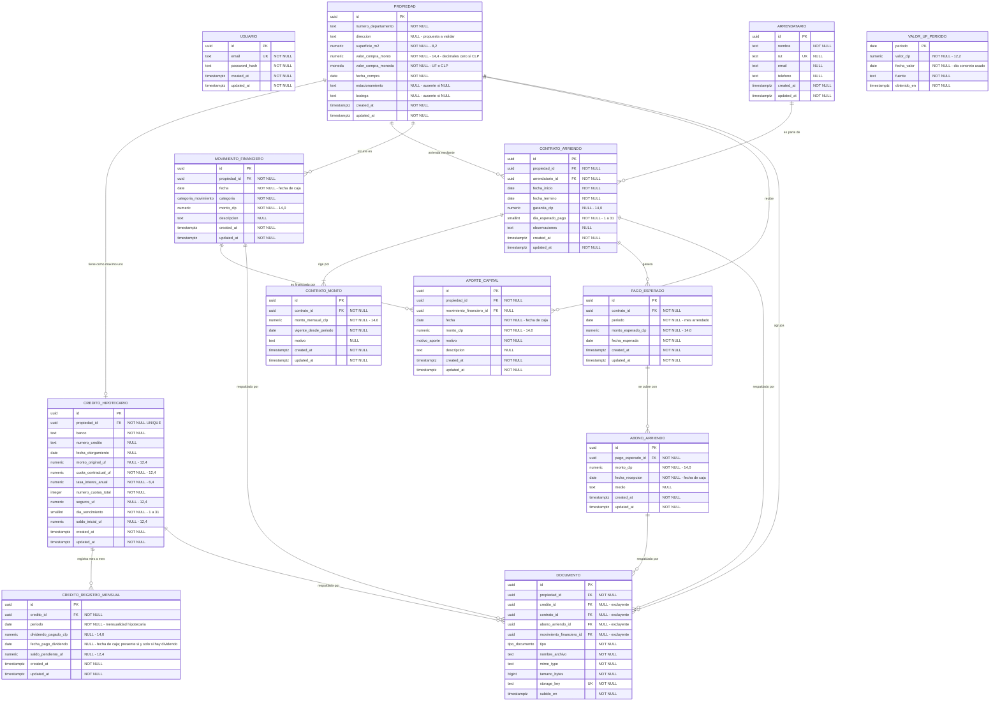

# RealtyTrack — Modelo de datos

## 1. Propósito y alcance

Este documento define el **modelo de datos lógico del MVP**: qué entidades existen, qué
atributos tienen, cómo se relacionan, qué se persiste y qué se deriva.

Es el tercer eslabón de la cadena documental: [product.md](product.md) fija el problema y
las reglas de negocio, [user-stories.md](user-stories.md) las convierte en criterios
verificables, y aquí se resuelve cómo representarlas en PostgreSQL.

`product.md` §7.3 dejó seis preguntas abiertas para este documento. Todas quedan resueltas:

| Pregunta abierta | Resolución | Sección |
|---|---|---|
| Cómo se materializa el histórico de montos de arriendo | Entidad `contrato_monto`; el monto inicial es su primera fila | §4.7 |
| Cómo se representan los abonos frente al pago esperado | `abono_arriendo` N : 1 `pago_esperado`; el total recibido se deriva | §4.9 · §6 |
| Cómo se conserva la serie mensual de dividendo y saldo | Entidad `credito_registro_mensual`, una fila por crédito y mensualidad | §4.4 |
| Cómo se asocia el valor de UF a cada período mensual | Entidad `valor_uf_periodo`, un valor por período que no se sobrescribe | §4.12 · §8 |
| Cómo se vinculan un egreso y el aporte que lo financia | FK nulable `aporte_capital.movimiento_financiero_id` | §4.11 |
| Qué categorías de movimiento se fijan | ENUM cerrado con valor `OTRO` | §4.10 |

**Alcance.** Modelo lógico: entidades, atributos, tipos, restricciones y reglas de
derivación. No incluye migraciones, DDL definitivo, índices de rendimiento ajustados a
medición, endpoints, servicios ni componentes.

**Cómo leer este documento.** Toda afirmación es una regla de negocio confirmada en
`product.md` o una decisión técnica justificada, salvo las marcadas explícitamente como
*propuesta a validar*, que están pendientes de confirmación y no deben tratarse como
cerradas. Lo declarado fuera de alcance no existe en el modelo y no debe añadirse sin una
decisión de producto previa.

---

## 2. Convenciones

**Identificadores.** Toda entidad tiene una clave primaria `id UUID`. Las claves foráneas
se nombran `<entidad>_id`.

**Nomenclatura.** Tablas y columnas en español, `snake_case`, singular para la tabla
(`propiedad`, no `propiedades`). *Propuesta a validar*: mantener el español en el esquema
aunque el código sea TypeScript. Se elige por coherencia con el vocabulario de dominio, que
es el que usan `product.md` y `user-stories.md`.

**Importes.** Siempre `NUMERIC`, nunca `FLOAT` ni `DOUBLE PRECISION`: la coma flotante
introduce errores de redondeo inaceptables en cifras financieras.

| Unidad | Tipo | Motivo |
|---|---|---|
| CLP | `NUMERIC(14,0)` | el peso chileno no tiene subunidad; los importes son enteros |
| UF | `NUMERIC(12,4)` | la UF se expresa habitualmente con cuatro decimales |
| Valor de la UF en CLP | `NUMERIC(12,2)` | dos decimales, como lo publica la fuente oficial |
| Importe de **moneda variable** | `NUMERIC(14,4)` | una sola columna que puede contener UF o CLP necesita una precisión común |

La última fila aplica a un único caso: `propiedad.valor_compra_monto` (§4.2), cuya moneda es
un dato del registro y no una constante del modelo. La precisión es la unión de ambas
convenciones —catorce dígitos para el rango del peso, cuatro decimales para la UF—, de modo
que ninguna de las dos unidades pierde información. **Cuando la moneda es CLP, la parte
decimal debe ser cero**, y así se valida: el peso no tiene subunidad y un valor de compra con
centavos indicaría un error de captura.

Las conversiones UF → CLP son **derivadas** (§8) y se redondean solo al presentarlas.

**Período mensual.** Se representa como `DATE` normalizada al **día 1 del mes**, con
`CHECK (EXTRACT(DAY FROM periodo) = 1)`. Marzo de 2026 es `2026-03-01`. Se prefiere a
`CHAR(7)` `'2026-03'` y al par `(anio, mes)` porque ordena correctamente, admite rangos y
funciona con las funciones de fecha nativas sin conversiones.

Esta convención afecta solo a la **representación** del período. Qué valor de UF representa
a ese período es una cuestión distinta y sigue abierta (§8).

**Fechas y marcas de tiempo.** Los hechos del dominio llevan `DATE` —ocurren un día, no un
instante—. Los metadatos técnicos llevan `TIMESTAMPTZ`. Toda entidad registrable tiene
`created_at` y `updated_at TIMESTAMPTZ NOT NULL DEFAULT now()`.

**Enumeraciones.** Tipos `ENUM` de PostgreSQL, no tablas catálogo. Cada enumeración abierta
por naturaleza incluye un valor `OTRO`. Añadir un valor es una migración, no un rediseño.

**Borrado.** Borrado físico, sin `deleted_at`. El MVP es de usuario único y no requiere
papelera ni auditoría.

---

## 3. Diagrama del modelo de datos



`USUARIO` y `VALOR_UF_PERIODO` no tienen relaciones: el primero solo guarda credenciales
—el MVP es de usuario único, así que ninguna entidad de dominio lleva `usuario_id`— y el
segundo es una tabla de referencia que se consulta por período.

---

## 4. Entidades

### 4.1 `usuario`

Credenciales del único usuario del sistema.

| Atributo | Tipo | Nulo | Restricción | Descripción |
|---|---|---|---|---|
| `id` | `UUID` | No | PK | |
| `email` | `TEXT` | No | `UNIQUE` | Identificador de acceso |
| `password_hash` | `TEXT` | No | | Hash de la contraseña, nunca la contraseña |
| `created_at`, `updated_at` | `TIMESTAMPTZ` | No | | |

**Por qué no hay `usuario_id` en el resto del modelo.** El MVP es de usuario único
(`product.md` §7.2). Propagar la FK a las trece tablas añadiría trabajo en cada consulta
para expresar algo que ya es cierto por construcción. Si algún día hubiera multiusuario,
añadir la columna es una migración; anticiparla ahora sería sobreingeniería.

### 4.2 `propiedad`

Una unidad de la cartera. Raíz de la que cuelga todo lo demás.

| Atributo | Tipo | Nulo | Restricción | Descripción |
|---|---|---|---|---|
| `id` | `UUID` | No | PK | |
| `numero_departamento` | `TEXT` | No | | Identificación de la unidad |
| `direccion` | `TEXT` | Sí | | *Propuesta a validar*. `product.md` §6.1 no la exige; se incluye nulable porque el modelo es para N propiedades y las tres iniciales comparten edificio por circunstancia, no por diseño |
| `superficie_m2` | `NUMERIC(8,2)` | No | `> 0` | |
| `valor_compra_monto` | `NUMERIC(14,4)` | No | `> 0`; parte decimal cero si la moneda es `CLP` | Valor de adquisición. Precisión común a ambas unidades (§2) |
| `valor_compra_moneda` | `ENUM moneda` | No | `UF` \| `CLP` | En Chile la compra suele pactarse en UF; fijarla a CLP perdería el dato original |
| `fecha_compra` | `DATE` | No | | |
| `estacionamiento` | `TEXT` | Sí | | Identificación del estacionamiento. `NULL` = la propiedad no tiene |
| `bodega` | `TEXT` | Sí | | Identificación de la bodega. `NULL` = la propiedad no tiene |
| `created_at`, `updated_at` | `TIMESTAMPTZ` | No | | |

Estacionamiento y bodega son **columnas nulables**, no una entidad `unidad_anexa`: son
opcionales (HU01 E2) y el producto no les atribuye ningún dato propio más allá de su
identificación.

Añadir una propiedad es insertar una fila: no hay nada en el esquema que dependa de cuántas
haya (HU01 E3).

### 4.3 `credito_hipotecario`

Condiciones contractuales del crédito de una propiedad. **Opcional**: una propiedad sin
crédito es válida (HU01 CL10).

| Atributo | Tipo | Nulo | Restricción | Descripción |
|---|---|---|---|---|
| `id` | `UUID` | No | PK | |
| `propiedad_id` | `UUID` | No | FK → `propiedad`, **`UNIQUE`** | Un crédito por propiedad |
| `banco` | `TEXT` | No | | |
| `numero_credito` | `TEXT` | Sí | | Dato contractual |
| `fecha_otorgamiento` | `DATE` | Sí | | |
| `monto_original_uf` | `NUMERIC(12,4)` | Sí | `> 0` | Monto pactado |
| `cuota_contractual_uf` | `NUMERIC(12,4)` | No | `> 0` | **En UF**: es la cuota pactada, no el desembolso |
| `tasa_interes_anual` | `NUMERIC(6,4)` | No | `>= 0` | Porcentaje anual |
| `numero_cuotas_total` | `INTEGER` | No | `> 0` | |
| `seguros_uf` | `NUMERIC(12,4)` | Sí | `>= 0` | Seguros asociados a la cuota, en UF |
| `dia_vencimiento` | `SMALLINT` | No | `BETWEEN 1 AND 31` | Día de vencimiento de la cuota |
| `saldo_inicial_uf` | `NUMERIC(12,4)` | Sí | `>= 0` | Saldo informado al registrar el crédito |
| `created_at`, `updated_at` | `TIMESTAMPTZ` | No | | |

**No existe columna de saldo vigente.** El saldo actual se deriva del registro mensual más
reciente (§6). Una columna `saldo_actual` sería un segundo lugar donde la verdad puede
contradecirse.

**No existe tabla de amortización.** El sistema no reproduce la lógica del banco: guarda
hechos registrados, no cálculos propios (`product.md` §6.2, §8).

`UNIQUE(propiedad_id)` fija la relación 1 : 0..1. Si en el futuro una propiedad necesitara
más de un crédito, retirar la restricción es una migración no destructiva.

### 4.4 `credito_registro_mensual`

Serie mensual del crédito: lo que el usuario registra cada mes a partir de la información
del banco. **Es lo que hace consultable el saldo de un mes anterior.**

| Atributo | Tipo | Nulo | Restricción | Descripción |
|---|---|---|---|---|
| `id` | `UUID` | No | PK | |
| `credito_id` | `UUID` | No | FK → `credito_hipotecario` | |
| `periodo` | `DATE` | No | día 1 del mes | **Mensualidad hipotecaria** a la que corresponde el registro |
| `dividendo_pagado_clp` | `NUMERIC(14,0)` | Sí | `> 0` | **En CLP**: el desembolso real constatado en la cartola |
| `fecha_pago_dividendo` | `DATE` | Sí | Obligatoria si hay dividendo; nula si no lo hay | **Fecha de caja**: cuándo ocurrió la salida efectiva de dinero |
| `saldo_pendiente_uf` | `NUMERIC(12,4)` | Sí | `>= 0` | **En UF**: saldo informado por el banco. Puede llegar a cero al liquidarse |
| `created_at`, `updated_at` | `TIMESTAMPTZ` | No | | |

**Restricciones**

| Restricción | Motivo |
|---|---|
| `UNIQUE (credito_id, periodo)` | Un registro por crédito y mensualidad |
| `CHECK (dividendo_pagado_clp IS NOT NULL OR saldo_pendiente_uf IS NOT NULL)` | Se admite saldo, dividendo o ambos, pero **nunca una fila con ambos nulos**: no registraría ningún hecho |
| `CHECK ((dividendo_pagado_clp IS NULL) = (fecha_pago_dividendo IS NULL))` | La fecha existe **si y solo si** hay dividendo: la fecha determina la imputación al flujo de caja, de modo que sin ella el dividendo no pertenecería a ningún mes, y sin dividendo no hay salida de caja que fechar |

**`periodo` y `fecha_pago_dividendo` son datos funcionales distintos, y ninguno sustituye
al otro.** `periodo` identifica la mensualidad hipotecaria; `fecha_pago_dividendo`
identifica cuándo salió el dinero. Un dividendo de la mensualidad de marzo pagado el 3 de
abril pertenece al histórico hipotecario de **marzo** y al flujo de caja de **abril** (§7).

**La ausencia de fila significa *no registrado*.** El sistema no estima, no proyecta y no
arrastra el valor del mes anterior (HU01 CL11, CL12).

En la misma fila conviven dos unidades deliberadamente: el dividendo en CLP porque es un
desembolso real, el saldo en UF porque es el dato que informa el banco.

### 4.5 `arrendatario`

La persona que arrienda. Entidad propia, reutilizable entre contratos sucesivos.

| Atributo | Tipo | Nulo | Restricción | Descripción |
|---|---|---|---|---|
| `id` | `UUID` | No | PK | |
| `nombre` | `TEXT` | No | | |
| `rut` | `TEXT` | Sí | `UNIQUE` | Nulable porque puede registrarse antes de disponer del dato |
| `email` | `TEXT` | Sí | | |
| `telefono` | `TEXT` | Sí | | |
| `created_at`, `updated_at` | `TIMESTAMPTZ` | No | | |

Se prefiere a denormalizar los datos en el contrato por tres razones: el mismo arrendatario
puede figurar en contratos sucesivos, el RUT admite `UNIQUE`, y la anonimización previa al
versionado que exige `CLAUDE.md` queda acotada a una sola tabla.

### 4.6 `contrato_arriendo`

Contrato de arriendo de una propiedad. Una propiedad puede tener contratos sucesivos, con
períodos sin arrendatario entre ellos.

| Atributo | Tipo | Nulo | Restricción | Descripción |
|---|---|---|---|---|
| `id` | `UUID` | No | PK | |
| `propiedad_id` | `UUID` | No | FK → `propiedad` | |
| `arrendatario_id` | `UUID` | No | FK → `arrendatario` | |
| `fecha_inicio` | `DATE` | No | | |
| `fecha_termino` | `DATE` | No | `>= fecha_inicio` | Una terminación anticipada se registra actualizando esta fecha |
| `garantia_clp` | `NUMERIC(14,0)` | Sí | `>= 0` | Información contractual |
| `dia_esperado_pago` | `SMALLINT` | No | `BETWEEN 1 AND 31` | Día del mes en que se espera el pago |
| `observaciones` | `TEXT` | Sí | | |
| `created_at`, `updated_at` | `TIMESTAMPTZ` | No | | |

**Sin columna de monto.** El monto vive en `contrato_monto` (§4.7), incluido el inicial.

**Sin columna `estado`.** `product.md` §6.3 enumera el «estado» entre la información del
contrato, y aquí **se materializa como vigencia derivada de `fecha_inicio` y
`fecha_termino`** (§6), no como columna persistida. La información no se pierde: se calcula.

El motivo es que una columna sería un segundo lugar donde la vigencia puede contradecir al
rango de fechas, y no aportaría nada que las fechas no digan ya — una terminación anticipada
se registra actualizando `fecha_termino`, y un contrato futuro, terminado o vigente se
distingue comparando su rango con la fecha de consulta.

**La garantía no es un ingreso.** Es información contractual y no figura en el flujo
mensual (HU02 E17). Su devolución, retención o uso está fuera de alcance.

**Restricción de negocio: los contratos de una misma propiedad no se solapan.** Se deduce
de que los contratos son sucesivos con períodos de vacancia entre ellos. Se implementa como
validación de aplicación. Una restricción `EXCLUDE USING gist (propiedad_id WITH =,
daterange(fecha_inicio, fecha_termino, '[]') WITH &&)` la impondría en la base de datos;
queda anotada como opción, no como requisito.

### 4.7 `contrato_monto`

Histórico de los montos aplicados a lo largo de un contrato. Una fila por monto vigente
desde un período.

| Atributo | Tipo | Nulo | Restricción | Descripción |
|---|---|---|---|---|
| `id` | `UUID` | No | PK | |
| `contrato_id` | `UUID` | No | FK → `contrato_arriendo` | |
| `monto_mensual_clp` | `NUMERIC(14,0)` | No | `> 0` | **En CLP**: los arriendos se manejan en pesos |
| `vigente_desde_periodo` | `DATE` | No | día 1 del mes | Primer período en que rige este monto |
| `motivo` | `TEXT` | Sí | | Por ejemplo, "monto inicial" o "reajuste anual" |
| `created_at`, `updated_at` | `TIMESTAMPTZ` | No | | |

`UNIQUE (contrato_id, vigente_desde_periodo)`. Todo contrato tiene **al menos una fila**.

**El monto inicial es la primera fila, no una columna del contrato.** Esta es la decisión
central de la entidad: hay una única fuente de verdad para el monto, y un reajuste deja de
ser un caso especial —es simplemente otra fila—. El contrato conserva su identidad, su
arrendatario y su garantía (HU02 E3).

**La vigencia se expresa en período mensual, no en fecha.** Todo el ciclo del arriendo es
mensual, y así se evita la pregunta del prorrateo a mitad de mes, que está fuera de alcance.

Un **reajuste retroactivo** es una fila con `vigente_desde_periodo` anterior al mes en
curso (HU02 E5). Sus efectos sobre los pagos ya generados se describen en §4.8 y §6.

### 4.8 `pago_esperado`

Lo que el sistema espera cobrar por arriendo en un período mensual. Se genera a partir del
contrato vigente.

| Atributo | Tipo | Nulo | Restricción | Descripción |
|---|---|---|---|---|
| `id` | `UUID` | No | PK | |
| `contrato_id` | `UUID` | No | FK → `contrato_arriendo` | |
| `periodo` | `DATE` | No | día 1 del mes | **Mes arrendado** al que corresponde el pago |
| `monto_esperado_clp` | `NUMERIC(14,0)` | No | `> 0` | Monto que regía en ese período |
| `fecha_esperada` | `DATE` | No | | Fecha en que se espera el pago |
| `created_at`, `updated_at` | `TIMESTAMPTZ` | No | | |

`UNIQUE (contrato_id, periodo)`.

**Se persiste, en lugar de derivarse al vuelo**, por dos razones: los abonos necesitan una
clave foránea estable a la que apuntar, y el producto exige que el pago esperado conserve el
monto correspondiente a su mes.

**`monto_esperado_clp` es un snapshot con invariante verificable**: debe coincidir con el
monto que `contrato_monto` da para ese período. Un reajuste retroactivo dispara un
**recálculo explícito** de los períodos afectados, tras el cual la invariante vuelve a
cumplirse. Modificar historia es legítimo: no existe cierre mensual ni inmutabilidad de
períodos (`product.md` §7.2).

**`fecha_esperada` se deriva de `dia_esperado_pago`** al generar la fila. Si el día no
existe en el mes —31 en febrero—, se usa el último día del mes.

**Sin `propiedad_id`.** Es alcanzable por `contrato_id`; denormalizarlo abriría la
posibilidad de que un pago apunte a una propiedad distinta de la de su contrato.

**Sin contrato vigente no hay fila**, y esa ausencia no significa impago: significa que no
se esperaba ingreso por arriendo (HU02 CL15).

### 4.9 `abono_arriendo`

Cada entrega de dinero recibida contra un pago esperado.

| Atributo | Tipo | Nulo | Restricción | Descripción |
|---|---|---|---|---|
| `id` | `UUID` | No | PK | |
| `pago_esperado_id` | `UUID` | No | FK → `pago_esperado` | |
| `monto_clp` | `NUMERIC(14,0)` | No | `> 0` | |
| `fecha_recepcion` | `DATE` | No | | **Fecha de caja**: cuándo entró el dinero |
| `medio` | `TEXT` | Sí | | Transferencia, depósito, efectivo |
| `created_at`, `updated_at` | `TIMESTAMPTZ` | No | | |

Un pago esperado admite **uno o varios abonos** (HU02 E6, E7). El total recibido es su suma,
y se deriva (§6).

**Sin restricción de tope.** Los abonos pueden exceder el monto esperado; el pago queda
cubierto y no se rechaza el registro (HU02 CL14).

El período de arriendo al que corresponde un abono **no se almacena**: se alcanza por
`pago_esperado.periodo` (§7). `medio` es un campo descriptivo y no es el lugar donde anotar
esa correspondencia.

### 4.10 `movimiento_financiero`

Egresos e inversiones de una propiedad.

| Atributo | Tipo | Nulo | Restricción | Descripción |
|---|---|---|---|---|
| `id` | `UUID` | No | PK | |
| `propiedad_id` | `UUID` | No | FK → `propiedad` | |
| `fecha` | `DATE` | No | | **Fecha de caja** del egreso |
| `categoria` | `ENUM categoria_movimiento` | No | | Ver valores abajo |
| `monto_clp` | `NUMERIC(14,0)` | No | `> 0` | |
| `descripcion` | `TEXT` | Sí | | |
| `created_at`, `updated_at` | `TIMESTAMPTZ` | No | | |

Valores de `categoria_movimiento`: `REPARACION` · `EQUIPAMIENTO` · `SEGURO` ·
`CONTRIBUCIONES` · `GASTO_COMUN` · `GASTO_EXTRAORDINARIO` · `OTRO`.

**No existe la categoría `DIVIDENDO`.** El dividendo se registra en
`credito_registro_mensual` (§4.4); una categoría homónima aquí duplicaría la misma salida de
dinero, que es precisamente el error que `product.md` §6.4 advierte.

**No existe columna `tipo` (ingreso/egreso).** Toda fila representa uso de recursos de la
propiedad. Un `tipo` abriría una segunda vía de ingresos que competiría con los abonos y
permitiría contabilizar el mismo dinero dos veces.

`GASTO_COMUN` existe para el caso de vacancia en que los paga el propietario (HU03 CL13).
Una etiqueta de enumeración no convierte los gastos comunes en un módulo administrado por el
producto: su administración ordinaria sigue fuera de alcance.

### 4.11 `aporte_capital`

Capital propio que el propietario incorpora a una propiedad.

| Atributo | Tipo | Nulo | Restricción | Descripción |
|---|---|---|---|---|
| `id` | `UUID` | No | PK | |
| `propiedad_id` | `UUID` | No | FK → `propiedad` | |
| `movimiento_financiero_id` | `UUID` | Sí | FK → `movimiento_financiero` | Egreso o inversión que este aporte financia |
| `fecha` | `DATE` | No | | **Fecha de caja** del aporte |
| `monto_clp` | `NUMERIC(14,0)` | No | `> 0` | |
| `motivo` | `ENUM motivo_aporte` | No | `PIE_INICIAL` \| `CAPITAL_ADICIONAL` \| `COBERTURA_DEFICIT` \| `OTRO` | |
| `descripcion` | `TEXT` | Sí | | |
| `created_at`, `updated_at` | `TIMESTAMPTZ` | No | | |

**Entidad separada del egreso, y no una categoría de movimiento.** Un egreso es uso de
recursos de la propiedad; un aporte es dinero propio que entra. Financiar una remodelación
con capital propio genera **dos registros**: el egreso por la remodelación y el aporte que
lo financia (HU03 E5). Tratar el aporte como egreso duplicaría la salida de dinero y
borraría el resultado del período.

**El vínculo `movimiento_financiero_id` es opcional y nunca afecta al cálculo.** Da
trazabilidad —qué inversión financió este aporte— sin entrar en el flujo neto antes de
aportes, que se calcula solo con ingresos y egresos (§6). Un movimiento puede estar
financiado por varios aportes; un aporte financia como máximo uno. Se descarta una relación
N:M con montos parciales por sobreingeniería: el producto no pide repartir un aporte entre
varios egresos.

### 4.12 `valor_uf_periodo`

Valor de la UF asociado a cada período mensual. Tabla de referencia.

| Atributo | Tipo | Nulo | Restricción | Descripción |
|---|---|---|---|---|
| `periodo` | `DATE` | No | **PK**, día 1 del mes | Período al que se aplica el valor |
| `valor_clp` | `NUMERIC(12,2)` | No | `> 0` | Valor de una UF en pesos |
| `fecha_valor` | `DATE` | No | | **Día concreto** cuyo valor se tomó |
| `fuente` | `TEXT` | No | | API pública chilena de la que se obtuvo |
| `obtenido_en` | `TIMESTAMPTZ` | No | | Cuándo se consultó |

**Regla de negocio decisiva: una vez almacenado, el valor de un período no se sobrescribe
por una consulta posterior a la API.** Esto es lo que hace que consultar dos veces un mes
anterior, sin modificar sus datos, produzca las mismas cifras aunque la UF haya cambiado
entre ambas consultas (`product.md` §10, criterio 4; HU03 E9) — y lo consigue **sin cierre
mensual ni inmutabilidad de períodos**.

`fecha_valor`, `fuente` y `obtenido_en` hacen auditable cualquier conversión histórica: se
sabe exactamente qué valor se usó y de dónde salió.

La regla que decide **qué día representa al período** es una *propuesta a validar*: ver §8.

### 4.13 `documento`

Metadata de los archivos asociados a una propiedad. **PostgreSQL no guarda binarios**: el
archivo vive en object storage compatible con S3, referenciado por `storage_key`.

| Atributo | Tipo | Nulo | Restricción | Descripción |
|---|---|---|---|---|
| `id` | `UUID` | No | PK | |
| `propiedad_id` | `UUID` | No | FK → `propiedad` | **Obligatorio**: todo documento pertenece a una propiedad |
| `credito_id` | `UUID` | Sí | FK → `credito_hipotecario` | Vínculo específico, excluyente |
| `contrato_id` | `UUID` | Sí | FK → `contrato_arriendo` | Vínculo específico, excluyente |
| `abono_arriendo_id` | `UUID` | Sí | FK → `abono_arriendo` | Vínculo específico, excluyente |
| `movimiento_financiero_id` | `UUID` | Sí | FK → `movimiento_financiero` | Vínculo específico, excluyente |
| `tipo` | `ENUM tipo_documento` | No | | Ver valores abajo |
| `nombre_archivo` | `TEXT` | No | | Nombre original |
| `mime_type` | `TEXT` | No | | |
| `tamano_bytes` | `BIGINT` | No | `> 0` | |
| `storage_key` | `TEXT` | No | `UNIQUE` | Clave del objeto en el almacenamiento |
| `subido_en` | `TIMESTAMPTZ` | No | | |

Valores de `tipo_documento`: `ESCRITURA` · `CONTRATO_HIPOTECARIO` · `CONTRATO_ARRIENDO` ·
`COMPROBANTE_PAGO` · `FACTURA` · `OTRO`.

**Restricciones**

| Restricción | Motivo |
|---|---|
| `CHECK`: a lo sumo una de las cuatro FK opcionales es no nula | Un documento respalda un solo hecho |
| Validación de aplicación: la entidad vinculada pertenece a `propiedad_id` | Para el abono, la ruta es `abono → pago_esperado → contrato → propiedad` |

**Qué respalda cada vínculo**

| Vínculo | Hecho respaldado |
|---|---|
| `credito_id` | Contrato hipotecario y documentación del crédito |
| `contrato_id` | Contrato de arriendo firmado y sus anexos |
| `abono_arriendo_id` | Comprobante de transferencia: respalda el dinero **efectivamente recibido** |
| `movimiento_financiero_id` | Factura o boleta del egreso |

**El comprobante de arriendo se ancla al abono, no al pago esperado.** El pago esperado es
una expectativa que el sistema genera; el abono es el hecho que el comprobante acredita. El
pago esperado sigue siendo alcanzable por navegación desde el abono, así que no se pierde
nada al no tener un vínculo directo.

**`propiedad_id` obligatorio** garantiza que cualquier documento se localice partiendo de su
propiedad con una sola consulta (`product.md` §10, criterio 9), y el vínculo específico
resuelve el problema de que "saber que se pagó una reparación y encontrar la factura de esa
reparación" sean dos búsquedas distintas (`product.md` §1).

Se descarta la asociación polimórfica `(entidad_tipo, entidad_id)`, que sacrificaría la
integridad referencial para ahorrar cuatro columnas nulables, y también cuatro tablas de
unión, que no aportarían nada sobre las FK directas.

---

## 5. Relaciones y cardinalidades

| Origen | Cardinalidad | Destino | Tipo | Nota |
|---|---|---|---|---|
| `propiedad` | 1 : 0..1 | `credito_hipotecario` | Identificante opcional | `UNIQUE(propiedad_id)` |
| `credito_hipotecario` | 1 : 0..N | `credito_registro_mensual` | Composición | Serie mensual |
| `propiedad` | 1 : 0..N | `contrato_arriendo` | Composición | Contratos sucesivos |
| `arrendatario` | 1 : 0..N | `contrato_arriendo` | Asociación | Reutilizable |
| `contrato_arriendo` | 1 : 1..N | `contrato_monto` | Composición | Mínimo el monto inicial |
| `contrato_arriendo` | 1 : 0..N | `pago_esperado` | Composición | Uno por período vigente |
| `pago_esperado` | 1 : 0..N | `abono_arriendo` | Composición | |
| `propiedad` | 1 : 0..N | `movimiento_financiero` | Composición | |
| `propiedad` | 1 : 0..N | `aporte_capital` | Composición | |
| `movimiento_financiero` | 1 : 0..N | `aporte_capital` | Asociación opcional | Trazabilidad del financiamiento |
| `propiedad` | 1 : 0..N | `documento` | Composición | Obligatoria |
| `credito_hipotecario` | 1 : 0..N | `documento` | Asociación opcional | Excluyente |
| `contrato_arriendo` | 1 : 0..N | `documento` | Asociación opcional | Excluyente |
| `abono_arriendo` | 1 : 0..N | `documento` | Asociación opcional | Excluyente |
| `movimiento_financiero` | 1 : 0..N | `documento` | Asociación opcional | Excluyente |

### 5.1 Restricciones que la base de datos no impone

Se validan en la capa de aplicación y se comprueban con tests:

1. **Los contratos de una misma propiedad no se solapan en el tiempo.**
2. **La entidad vinculada de un documento pertenece a su `propiedad_id`.**
3. **`monto_esperado_clp` coincide con el monto que `contrato_monto` da para su período.**
   Se restablece tras cada recálculo por reajuste.
4. **El primer `contrato_monto` de un contrato tiene `vigente_desde_periodo` igual al mes
   de `fecha_inicio`**, y ninguna fila tiene vigencia anterior al inicio del contrato.
5. **`pago_esperado.periodo` cae dentro de la vigencia de su contrato.**

### 5.2 Índices previstos

Además de los que crean PK y `UNIQUE`: FK de cada tabla, y los que sirven la consulta por
mes, que es el patrón dominante — `abono_arriendo(fecha_recepcion)`,
`movimiento_financiero(propiedad_id, fecha)`, `aporte_capital(propiedad_id, fecha)`,
`credito_registro_mensual(fecha_pago_dividendo)`, `contrato_arriendo(propiedad_id,
fecha_inicio)`.

---

## 6. Datos derivados

Se persisten **hechos registrados**. Todo lo que se puede calcular a partir de ellos se
deriva en el momento de la consulta y **no se almacena**.

| Derivado | Regla |
|---|---|
| Monto recibido de un pago | `SUM(abono_arriendo.monto_clp)` de sus abonos |
| Saldo pendiente de un pago | `max(0, monto_esperado_clp − recibido)` |
| **Estado del pago** | Precedencia de cuatro reglas (§6.1) |
| **Fecha de completitud** | Día en que el acumulado de abonos alcanza el esperado (§6.1) |
| Calificación *vencido con abonos parciales* | `estado = VENCIDO` y `recibido > 0` |
| Calificación *pagado con atraso* | `estado = PAGADO` y `fecha_completitud > fecha_esperada` |
| Período de arriendo de un abono | `abono_arriendo → pago_esperado → periodo` |
| Mensualidad hipotecaria de un dividendo | `credito_registro_mensual.periodo` |
| Mes de caja de un hecho | `date_trunc('month', <fecha real del hecho>)` |
| Monto vigente del contrato en un mes | Fila de `contrato_monto` con `max(vigente_desde_periodo) <= periodo` |
| Contrato vigente de una propiedad en un mes | Solapamiento de `[fecha_inicio, fecha_termino]` con el mes |
| Vacancia de una propiedad en un mes | Ausencia de contrato vigente |
| Saldo actual del crédito | `saldo_pendiente_uf` del `periodo` máximo registrado |
| Equivalente en CLP de un importe en UF | `monto_uf × valor_uf_periodo.valor_clp` del período |
| Ingresos recibidos del mes | `SUM(abono_arriendo.monto_clp)` con `fecha_recepcion` en el mes |
| Egresos del mes | `SUM(movimiento_financiero.monto_clp)` por `fecha` **+** `SUM(dividendo_pagado_clp)` por `fecha_pago_dividendo` |
| Flujo neto antes de aportes | Ingresos − egresos |
| Aportes del mes y acumulado | `SUM(aporte_capital.monto_clp)`, **excluidos** del flujo neto |
| Agregados del dashboard | Consulta sobre lo anterior |

### 6.1 Estado del pago de arriendo

Con `recibido` = suma de los abonos del pago, y *vencida* = `fecha_esperada < hoy`. Las
reglas se evalúan **en orden**; la primera que se cumple determina el estado:

| # | Condición | Estado | Calificación derivada |
|---|---|---|---|
| 1 | `recibido >= esperado` | `PAGADO` | ***pagado con atraso*** si `fecha_completitud > fecha_esperada` |
| 2 | `recibido < esperado` y fecha vencida | `VENCIDO` | ***vencido con abonos parciales*** si `recibido > 0` |
| 3 | `0 < recibido < esperado` y fecha no vencida | `PARCIALMENTE_PAGADO` | — |
| 4 | `recibido = 0` y fecha no vencida | `PENDIENTE` | — |

**Cuatro estados mutuamente excluyentes.** Las dos calificaciones matizan un estado; no lo
sustituyen ni añaden un quinto. Un pago vencido con abonos parciales se presenta como
`VENCIDO`, indicando explícitamente su total recibido y su saldo pendiente (HU02 CL11).

**Fecha de completitud.** Es **el día en que el acumulado de abonos alcanza el monto
esperado**. Se obtiene ordenando los abonos del pago por `fecha_recepcion` ascendente,
acumulando, y tomando la `fecha_recepcion` del primer abono cuyo acumulado alcanza o supera
`monto_esperado_clp`. Si el acumulado nunca lo alcanza, no hay fecha de completitud y el
pago no está en `PAGADO`.

Cuando varios abonos comparten la misma `fecha_recepcion`, el orden entre ellos se resuelve
por `created_at` y, en último término, por `id`. Ese desempate es **puramente técnico**:
sirve para que el cálculo sea determinista y no dependa del orden en que la base devuelva
las filas. Funcionalmente es indiferente cuál de los abonos del día se considere el que
completa el pago, porque la fecha de completitud es ese mismo día en todos los casos, y es
la fecha —no el abono— la que determina la calificación *pagado con atraso*.

**Por qué el estado no puede ser una columna.** Depende de la fecha actual: una columna
quedaría obsoleta por sí sola, sin que nadie edite nada, y *pendiente → vencido* dejaría de
ocurrir por el mero paso del tiempo.

**Por qué la fecha de completitud tampoco.** Derivarla es lo que la hace correcta ante un
reajuste retroactivo: si el reajuste **sube** el monto esperado, el acumulado puede dejar de
alcanzarlo y el pago abandona `PAGADO` por la regla 2 o la 3; si lo **baja**, la fecha se
adelanta sola al abono que ahora basta.

**El orden de las reglas resuelve por sí solo los casos límite**, sin necesidad de un
tratamiento especial para los reajustes:

| Caso | Resultado | Por qué |
|---|---|---|
| Abonos por 620.000 sobre un esperado de 600.000 (HU02 CL14) | `PAGADO` | La regla 1 no exige igualdad exacta |
| Pago cubierto cuya fecha ya pasó | `PAGADO`, *pagado con atraso* | La regla 1 se evalúa antes que la 2 |
| Reajuste retroactivo sube el esperado a 530.000 con 500.000 abonados y fecha vencida (HU02 CL12) | `VENCIDO`, *con abonos parciales*, saldo 30.000 | La regla 2 se evalúa antes que la 3 |
| El mismo caso con fecha no vencida (HU02 CL13) | `PARCIALMENTE_PAGADO`, saldo 30.000 | La regla 2 no aplica; decide la 3 |

### 6.2 Ejemplo

```
Pago esperado (marzo 2026):  600.000 CLP   fecha esperada: 05-03-2026
  abono 1   03-03-2026:      300.000 CLP   acumulado: 300.000  → PARCIALMENTE_PAGADO
  abono 2   04-03-2026:      200.000 CLP   acumulado: 500.000  → PARCIALMENTE_PAGADO
  abono 3   09-03-2026:      100.000 CLP   acumulado: 600.000  → PAGADO
Recibido: 600.000 · Saldo: 0 · Fecha de completitud: 09-03-2026
Estado: PAGADO — calificación: pagado con atraso (completado tras el 05-03-2026)
```

### 6.3 Tres cosas que no se almacenan, y por qué

1. **Los equivalentes en CLP de importes en UF.** El valor de la UF del período ya es
   estable, así que la conversión es reproducible en cualquier momento. Persistirla
   duplicaría la verdad y abriría la posibilidad de divergencia. La UF acompaña, nunca
   reemplaza (HU01 E5, E6; HU03 E8).
2. **Ningún resumen mensual.** El histórico es estable porque se conservan los datos
   registrados y el valor de UF del período, no porque se congelen resultados. No existe
   cierre mensual.
3. **Ninguna columna de "mes de caja".** El período de origen ya es explícito y el mes de
   caja se deriva de la fecha real del hecho.

---

## 7. Período de origen y mes de caja

El modelo distingue **dos dimensiones temporales** y conserva ambas. No compiten: un mismo
hecho pertenece a un período de origen y a un mes de caja, y el producto necesita las dos
lecturas.

### 7.1 Regla de caja, uniforme y sin excepciones

Todo hecho financiero se imputa al flujo del mes de su **fecha real**:

| Hecho | Fecha que lo imputa al mes de flujo |
|---|---|
| Abono de arriendo | `abono_arriendo.fecha_recepcion` |
| Egreso o inversión | `movimiento_financiero.fecha` |
| Dividendo hipotecario | `credito_registro_mensual.fecha_pago_dividendo` |
| Aporte de capital | `aporte_capital.fecha` |

`credito_registro_mensual.periodo` **no interviene en el flujo de caja**: identifica la
mensualidad hipotecaria a la que corresponde el registro, y es la clave por la que se
consulta la serie del crédito.

### 7.2 Período de origen

| Hecho | Dónde vive su período de origen |
|---|---|
| Abono de arriendo | `pago_esperado.periodo`, alcanzable por `abono_arriendo → pago_esperado` |
| Dividendo hipotecario | `credito_registro_mensual.periodo` |

### 7.3 Los dos casos de desfase

**Arriendo de marzo cobrado el 5 de abril de 2026.** Aparece en el *esperado vs recibido* de
marzo, porque su `pago_esperado.periodo` es marzo, y en los ingresos de caja de abril,
porque su `fecha_recepcion` cae en abril.

**Dividendo de la mensualidad de marzo pagado el 3 de abril de 2026.** Aparece en la serie
mensual del crédito de marzo, porque su `periodo` es marzo, y en los egresos de caja de
abril, porque su `fecha_pago_dividendo` cae en abril.

### 7.4 Referencia temporal derivada

Cuando el período de origen no coincide con el mes de caja, la aplicación puede rotularlo
automáticamente —*"Correspondiente a marzo 2026"*— **sin que nadie lo escriba**:

| Hecho | Período de origen | Condición para mostrar el rótulo |
|---|---|---|
| Abono | `abono_arriendo → pago_esperado → periodo` | Difiere del mes de `fecha_recepcion` |
| Dividendo | `credito_registro_mensual.periodo` | Difiere del mes de `fecha_pago_dividendo` |

Esta información **no se almacena como texto**. Los campos descriptivos
—`abono_arriendo.medio`, `movimiento_financiero.descripcion`— no son su sitio: si hubiera
que teclear "corresponde a marzo" para que el dato existiera, el modelo estaría incompleto y
el rótulo dependería de que alguien se acordara de escribirlo.

---

## 8. UF y CLP

### 8.1 Qué se guarda en cada unidad

| Dato | Unidad | Motivo |
|---|---|---|
| Cuota contractual del crédito | **UF** | Es lo pactado con el banco |
| Saldo pendiente del crédito | **UF** | Es lo que el banco informa |
| Monto original y seguros del crédito | **UF** | Datos contractuales |
| Dividendo efectivamente pagado | **CLP** | Es el desembolso real de la cartola, no una conversión |
| Monto de arriendo, abonos, egresos, aportes | **CLP** | Los arriendos y el flujo se manejan en pesos |
| Valor de compra de la propiedad | **UF o CLP** | Según lo pactado; la moneda es parte del dato |

Las métricas consolidadas del dashboard se expresan en CLP. Los datos contractuales del
crédito conservan su unidad en UF, y un equivalente en CLP puede acompañarlos **sin
reemplazarlos** (HU01 E5, E6; HU03 E8).

### 8.2 Cómo se asocia la UF al período

Una fila de `valor_uf_periodo` por período mensual. La conversión de un importe en UF
correspondiente a un período usa el `valor_clp` de ese período, y se calcula al consultar.

Se descarta almacenar una **serie diaria** de la UF: obligaría igualmente a decidir qué día
representa al mes, multiplicaría el volumen de datos y no la pide ninguna historia de
usuario — el histórico financiero se consulta por período mensual.

### 8.3 Por qué el histórico es estable sin cierre mensual

`product.md` §7.2 es explícito: no existe cierre, reapertura ni bloqueo de períodos, y un
mes anterior sigue siendo editable. La estabilidad viene de otro sitio.

El valor de la UF de un período **se almacena una vez y no se sobrescribe** por consultas
posteriores a la API. Como la conversión depende solo de ese valor y de los importes
registrados, consultar dos veces un mes anterior sin modificar sus datos produce siempre las
mismas cifras, aunque la UF haya cambiado entre ambas consultas (criterio de éxito 4;
HU03 E9). Una cifra histórica cambia únicamente si el usuario edita explícitamente algún
dato de ese mes (HU03 E10).

### 8.4 Regla del día de referencia — *propuesta a validar*

**Confirmado**: el valor efectivamente utilizado para cada período queda almacenado con su
`fecha_valor`, su `fuente` y el instante de obtención, y no cambia por consultas
posteriores.

**Pendiente de validación**: qué día del mes debe representar al período. La convención
afecta directamente al resultado financiero de cada mes, así que no se cierra en este
documento.

**Las tres opciones no son equivalentes en coste.** Las dos primeras son convenciones sobre
qué día se consulta a la API y qué valor se guarda en `fecha_valor`: el esquema actual las
soporta sin ninguna modificación. La tercera **no**: exigiría evolucionar el modelo hacia
valores diarios de la UF o hacia un valor de UF asociado a cada hecho, y por tanto abandonar
la premisa de "un valor por período" sobre la que está construida `valor_uf_periodo`.

| Opción | A favor | En contra | Impacto en el esquema |
|---|---|---|---|
| Día 1 del período | Siempre disponible y estable desde que empieza el mes | Se aleja del valor con que el banco informa el saldo a fin de mes | **Ninguno**: solo cambia qué día se consulta y se guarda en `fecha_valor` |
| Último día del mes | Más próximo al saldo informado por el banco | No existe mientras el mes está en curso; el valor del mes corriente cambia hasta que el mes cierra | **Ninguno**: misma tabla, distinta `fecha_valor` |
| Día del hecho convertido | Máxima fidelidad a cada operación | Rompe la premisa de un valor por período | **Cambio de modelo**: obligaría a una serie diaria de UF, o a asociar un valor de UF a cada hecho convertible. `valor_uf_periodo` dejaría de ser suficiente |

Si se eligiera la tercera opción habría que revisar además §8.2, que descarta explícitamente
la serie diaria, y §6, donde la conversión UF → CLP se define por período y no por hecho.

---

## 9. Trazabilidad

### 9.1 Entidades por historia de usuario

| Entidad | HU01 Propiedad y crédito | HU02 Contrato y pagos | HU03 Flujo financiero |
|---|:---:|:---:|:---:|
| `usuario` | — | — | — |
| `propiedad` | ● | ○ | ○ |
| `credito_hipotecario` | ● | | ○ |
| `credito_registro_mensual` | ● | | ● |
| `arrendatario` | | ● | |
| `contrato_arriendo` | | ● | ○ |
| `contrato_monto` | | ● | |
| `pago_esperado` | | ● | ○ |
| `abono_arriendo` | | ● | ● |
| `movimiento_financiero` | | | ● |
| `aporte_capital` | | | ● |
| `valor_uf_periodo` | ○ | | ● |
| `documento` | ● | ● | |

● la historia posee la entidad · ○ la consulta

### 9.2 Criterios de éxito de `product.md` §10

| # | Criterio | Cómo lo satisface el modelo |
|---|---|---|
| 1 | Registrar una propiedad sin modificar el sistema | `propiedad` no depende del tamaño de la cartera |
| 2 | Esperado vs ingresado en un mes | `pago_esperado.periodo` frente a la suma de sus abonos |
| 3 | Determinar el estado de un pago | Precedencia de §6.1 sobre datos ya registrados |
| 4 | Mismas cifras al reconsultar un mes | `valor_uf_periodo` no se sobrescribe (§8.3) |
| 5 | Flujo neto sin sumar a mano | Derivación de ingresos y egresos (§6) |
| 6 | Distinguir resultado de capital aportado | `aporte_capital` separado y excluido del flujo neto |
| 7 | Inversión y aporte por separado | Dos registros, vinculados por FK opcional (§4.11) |
| 8 | Saldo de un crédito en un mes anterior | `credito_registro_mensual` por `periodo` |
| 9 | Localizar un documento desde su propiedad | `documento.propiedad_id` obligatorio |
| 10 | Inicializar con datos históricos anonimizados | Todas las entidades admiten carga por seeds; sin importador |

---

## 10. Decisiones y supuestos

### 10.1 Decisiones confirmadas

| # | Decisión | Justificación |
|---|---|---|
| D1 | El dividendo se registra solo en `credito_registro_mensual`, sin categoría `DIVIDENDO` en `movimiento_financiero` | Un único punto de registro; una categoría homónima duplicaría la misma salida de dinero |
| D2 | `periodo` (mensualidad hipotecaria) y `fecha_pago_dividendo` (caja) son datos distintos, y el flujo imputa por la fecha de pago | Mantiene la regla de caja uniforme para los cuatro tipos de hecho |
| D3 | `arrendatario` es entidad propia | Reutilizable entre contratos sucesivos; RUT único; anonimización acotada a una tabla |
| D4 | Los ingresos del mes se imputan por `fecha_recepcion` | Coherente con el resto de la regla de caja. La vista esperado vs recibido usa `pago_esperado.periodo` |
| D5 | El monto inicial del arriendo es la primera fila de `contrato_monto` | Única fuente de verdad; el reajuste deja de ser un caso especial |
| D6 | La vigencia del monto se expresa en período mensual | Evita el prorrateo intramensual, fuera de alcance |
| D7 | `pago_esperado` se persiste con el monto del mes como snapshot | Los abonos necesitan una FK estable; el reajuste retroactivo dispara un recálculo explícito |
| D8 | El estado del pago y la fecha de completitud se derivan | Dependen de la fecha actual y del monto esperado vigente |
| D9 | El comprobante de arriendo se vincula al abono, no al pago esperado | El comprobante acredita un hecho, no una expectativa |
| D10 | `aporte_capital.movimiento_financiero_id` opcional, sin efecto en el cálculo | Da trazabilidad sin contaminar el flujo neto antes de aportes |
| D11 | `UNIQUE(propiedad_id)` en el crédito | Un crédito por propiedad; retirarlo sería una migración no destructiva |
| D12 | Vigencia del contrato derivada de las fechas, sin columna `estado` | Una terminación anticipada se registra actualizando `fecha_termino` |
| D13 | Categorías, tipos y motivos como `ENUM` con valor `OTRO` | Añadir un valor es una migración, no un rediseño |
| D14 | Valor de compra con moneda explícita | En Chile la compra suele pactarse en UF |

### 10.2 Propuestas a validar

| # | Propuesta | Qué está en juego |
|---|---|---|
| P1 | **Regla del día de referencia de la UF** (§8.4) | Afecta al resultado financiero de cada mes. Dos de las tres opciones no cuestan nada en el esquema; la tercera obligaría a cambiar el modelo |
| P2 | `propiedad.direccion` como campo nulable | `product.md` §6.1 no lo exige; se propone porque el modelo es para N propiedades |
| P3 | Nomenclatura en español para tablas y columnas | Coherencia con el vocabulario de dominio frente a la convención habitual del stack |

---

## 11. Fuera del modelo

Lo siguiente **no existe** en el modelo de datos y no debe añadirse sin una decisión previa.
Cada exclusión evita una fuente concreta de error o de complejidad injustificada:

| No existe | Motivo |
|---|---|
| Tabla de resumen mensual o de cierre | No hay cierre (`product.md` §8); sería una caché que puede divergir del dato |
| Columnas para estado del pago, fecha de completitud, monto recibido, saldo actual del crédito o equivalentes en CLP | Quedan obsoletas por sí solas |
| Columna `periodo_caja` o equivalente | El mes de caja se deriva de la fecha real del hecho |
| Un quinto estado del pago | *Vencido con abonos parciales* y *pagado con atraso* son calificaciones derivadas |
| Rótulos de correspondencia temporal como texto libre | Son derivables de la relación con el pago esperado |
| Tablas catálogo para categorías, tipos, motivos o bancos | Las enumeraciones bastan para un usuario único y un puñado de valores |
| Documentos polimórficos o EAV | Sacrificaría la integridad referencial a cambio de cuatro columnas nulables |
| Entidades `moneda` y `tipo_cambio` genéricas | Hay dos unidades y una conversión mensual |
| Tabla de amortización o desarrollo del crédito | El sistema no reproduce la lógica del banco |
| Entidad `garantia` con movimientos | Es un atributo del contrato; su gestión está fuera de alcance |
| `usuario_id` en las entidades de dominio, roles, permisos | Usuario único |
| Auditoría, event sourcing, borrado lógico, versionado | Fuera de las necesidades del MVP |
| Serie diaria de UF | El histórico se consulta por mes |
| Tabla dimensión de períodos | El período se deriva de una fecha |
| Entidad genérica para estacionamiento y bodega | Dos columnas nulables bastan |
| Columna `tipo` (ingreso/egreso) en `movimiento_financiero` | Abriría una segunda vía de ingresos que competiría con los abonos |
| `propiedad_id` denormalizado en `pago_esperado` o `abono_arriendo` | Alcanzable por la relación; denormalizarlo permitiría incoherencias |
| Binarios en PostgreSQL | Los archivos viven en object storage; la base guarda metadata |

---

## 12. Referencias

- [product.md](product.md) — problema, alcance, funcionalidades y reglas de negocio
- [user-stories.md](user-stories.md) — HU01, HU02 y HU03 con sus criterios de aceptación
- `CLAUDE.md` — contexto del proyecto, stack y reglas de trabajo
