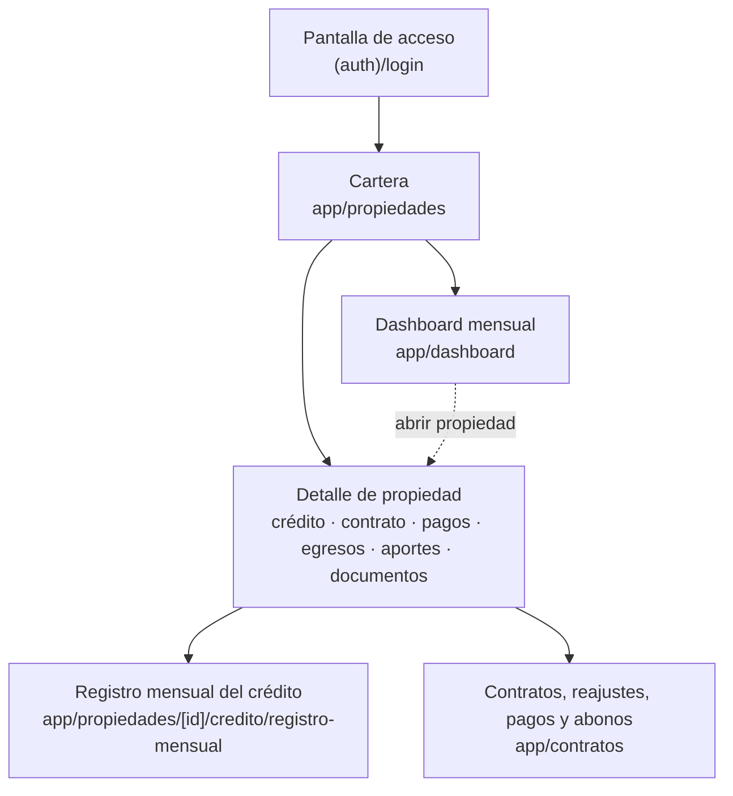
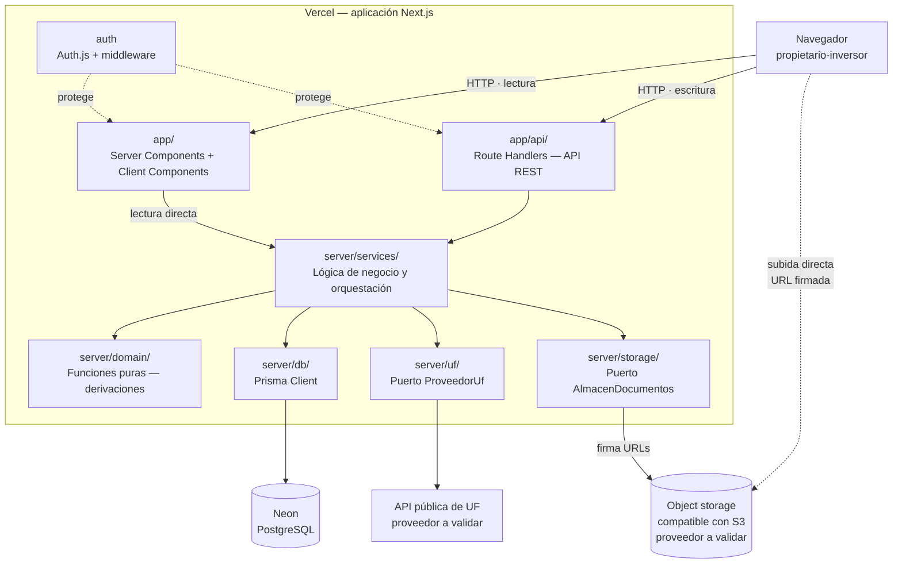
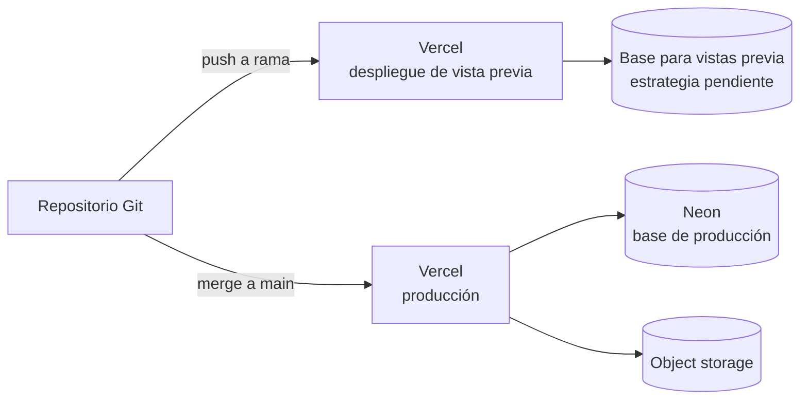
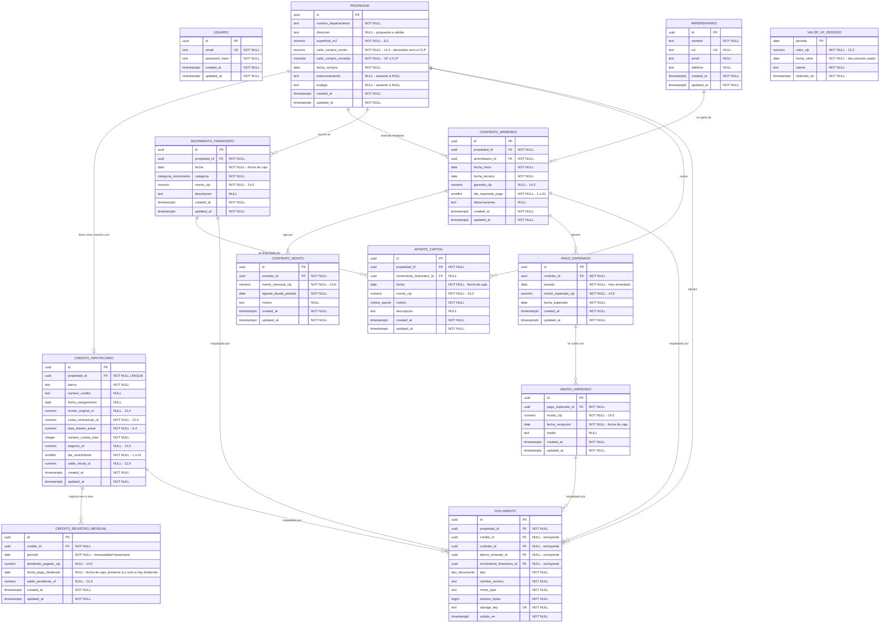
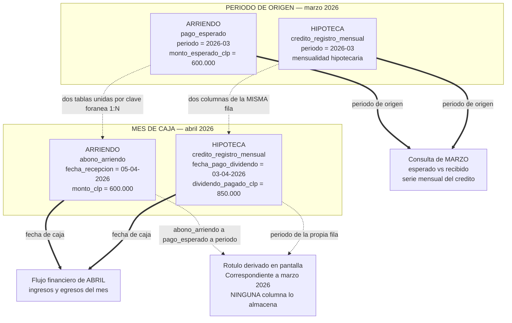

## Índice

0. [Ficha del proyecto](#0-ficha-del-proyecto)
1. [Descripción general del producto](#1-descripción-general-del-producto)
2. [Arquitectura del sistema](#2-arquitectura-del-sistema)
3. [Modelo de datos](#3-modelo-de-datos)
4. [Especificación de la API](#4-especificación-de-la-api)
5. [Historias de usuario](#5-historias-de-usuario)
6. [Tickets de trabajo](#6-tickets-de-trabajo)
7. [Pull requests](#7-pull-requests)

---

> **Nota sobre el estado de esta entrega.** Entrega 1 es exclusivamente documental
> (`CLAUDE.md`): no existe código de aplicación, despliegue real, tests ejecutados
> ni interfaz funcionando. Lo que sigue es diseño y documentación propuestos, que
> guiarán la implementación en las entregas siguientes. Cada sección lo deja
> explícito donde corresponde. El detalle técnico completo vive en `docs/`; este
> documento lo resume e integra, sin duplicarlo.

## 0. Ficha del proyecto

### **0.1. Tu nombre completo:**

Eliana Rodriguez

### **0.2. Nombre del proyecto:**

RealtyTrack

### **0.3. Descripción breve del proyecto:**

Aplicación web personal para centralizar y consultar el estado financiero y
contractual de una cartera de propiedades de inversión en Chile —propiedades,
créditos hipotecarios, contratos de arriendo, pagos, egresos y aportes de
capital—, evolucionando un proceso hoy basado en hojas de cálculo y
consolidación manual.

### **0.4. URL del proyecto:**

Pendiente. Entrega 1 es exclusivamente documental: no existe despliegue de la
aplicación.

### 0.5. URL o archivo comprimido del repositorio

`https://github.com/elianasaraith/feature-entrega-1-ESRF.git`

Esta entrega se desarrolla en la rama `feature/entrega-1-ESRF` —rama de
trabajo, no parte de la URL del repositorio—; la rama por defecto del remoto
es `main`.

---

## 1. Descripción general del producto

### **1.1. Objetivo:**

RealtyTrack está dirigido a un **propietario-inversor individual** que
autogestiona su propia cartera de propiedades de inversión: es a la vez
dueño, administrador y quien consulta la información, sin equipo ni terceros
involucrados.

Hoy cada propiedad acumula seis dimensiones de información —datos de la
propiedad, crédito hipotecario, contrato de arriendo, pagos mensuales,
egresos e inversiones, y documentación de respaldo— repartidas en hojas de
cálculo, cartolas bancarias, contratos en PDF y comprobantes sueltos, sin que
ninguna fuente sepa de las otras. El costo no está en registrar un dato, sino
en consolidarlo: responder qué pasó financieramente en un mes exige cruzar
varias fuentes a mano, y ese cruce no queda registrado para la próxima vez.

El objetivo del producto es ofrecer una **fuente única** donde el estado
financiero y contractual de cada propiedad quede registrado y sea consultable
por período mensual, sin consolidación manual. No automatiza la gestión
inmobiliaria ni sustituye al banco: centraliza y hace consultable la
información que hoy está dispersa, y hace explícita la diferencia entre lo
que se esperaba y lo que ocurrió.

Detalle completo: [docs/product.md](docs/product.md) §1–§3.

### **1.2. Características y funcionalidades principales:**

1. **Gestión de propiedades** — alta y consulta de cada propiedad de la
   cartera, con sus datos físicos y de compra; diseñado para N propiedades.
2. **Gestión de créditos hipotecarios** — condiciones contractuales en UF y
   registro mensual del dividendo pagado (CLP) y el saldo pendiente (UF),
   conservando la serie histórica.
3. **Gestión de contratos y arriendos** — contrato con su arrendatario e
   histórico de montos y reajustes, sin perder la identidad del contrato.
4. **Registro y control de pagos, ingresos y gastos** — pago esperado frente
   a abonos recibidos, con cuatro estados derivados (pendiente, parcialmente
   pagado, pagado, vencido); egresos e inversiones por propiedad; aportes de
   capital como concepto separado del gasto que financian.
5. **Dashboard financiero e histórico mensual** — ingresos, egresos, flujo
   neto antes de aportes, aportes acumulados, saldo de créditos y estado de
   las obligaciones de arriendo, a nivel de cartera y por propiedad, estable
   frente a variaciones posteriores de la UF.
6. **Almacenamiento de documentos** (transversal) — cada documento asociado a
   su propiedad y, cuando corresponde, al crédito, contrato o abono que
   respalda.
7. **Acceso protegido** (transversal) — usuario único, email y contraseña.

Detalle completo: [docs/product.md](docs/product.md) §5–§6.

### **1.3. Diseño y experiencia de usuario:**

Entrega 1 no incluye interfaz implementada, por lo que esta sección no
contiene capturas ni video. El siguiente diagrama resume el **flujo de
navegación previsto**, construido a partir de las vistas ya definidas en
[docs/architecture.md](docs/architecture.md) §7 y la estructura de `app/` de
§6:



Las vistas de consulta se complementarán con los formularios de registro
previstos (alta de propiedad, crédito, contrato, reajuste, abono, movimiento,
aporte). Ningún cálculo financiero pertenece a la UI: los importes llegan ya
derivados desde la capa de servicios (`docs/architecture.md` §7).

### **1.4. Instrucciones de instalación:**

Entrega 1 no incluye código de aplicación: no hay todavía una aplicación
ejecutable que instalar. Esta sección se completará con comandos verificados
en las entregas siguientes, una vez exista implementación.

Como referencia, el stack objetivo (`docs/architecture.md` §3) es:

- Next.js (App Router) + TypeScript — aplicación full-stack, un único
  despliegue
- React + Tailwind CSS
- API REST mediante Route Handlers de Next.js
- PostgreSQL en Neon, acceso con Prisma
- Auth.js (proveedor de credenciales, sesión JWT)
- Object storage compatible con S3 (proveedor concreto *propuesta a validar*)
- Vercel para el despliegue

La instalación prevista incluirá: instalar dependencias, configurar las
variables de entorno (`docs/architecture.md` §16), aplicar las migraciones de
Prisma y ejecutar el script de seed anonimizado (`docs/architecture.md` §14)
— sin importador de datos, por decisión de producto.

---

## 2. Arquitectura del Sistema

### **2.1. Diagrama de arquitectura:**



*(Diagrama propuesto para el MVP; no implementado en Entrega 1. Fuente
versionable: [docs/diagrams/architecture.mmd](docs/diagrams/architecture.mmd).)*

RealtyTrack es una **aplicación full-stack única** —un repositorio, un
despliegue, una base de datos—, organizada en cuatro capas (UI, API,
servicios, dominio) con la regla de que la lógica de negocio vive en una sola
de ellas (`docs/architecture.md` §5).

No sigue un patrón de microservicios ni CQRS/event sourcing: es un **monolito
por capas**. La justificación es el propio producto (`docs/architecture.md`
§2): un usuario único, una cartera de pocas propiedades, sin concurrencia
relevante ni múltiples consumidores de la API. Cualquier forma de
distribución añadiría operación sin resolver ningún problema real del
producto.

**Beneficios.** Un solo despliegue y una sola fuente de lógica de negocio
—sin contratos duplicados entre servicios—; operación simple para un
proyecto de una sola persona.

**Déficits reconocidos.** Menor aislamiento entre componentes, y ausencia de
despliegue o escalado independiente por servicio. Se acepta porque el
producto no lo necesita: la alternativa —por ejemplo, un backend separado en
NestJS, descartada en `docs/architecture.md` §22— duplicaría despliegue,
contrato y configuración para servir a un único consumidor.

### **2.2. Descripción de componentes principales:**

| Componente | Tecnología | Responsabilidad |
|---|---|---|
| UI (`app/`) | React (Server + Client Components), Tailwind CSS | Presentar y capturar; ningún cálculo financiero |
| API (`app/api/`) | Route Handlers de Next.js, REST | Validar entrada, autenticar, invocar el servicio, traducir errores a HTTP |
| Servicios (`server/services/`) | TypeScript | Orquestar: leer, aplicar reglas, escribir; agregaciones mensuales y regla de caja |
| Dominio (`server/domain/`) | TypeScript, funciones puras | Reglas con precedencia: estado del pago, fecha de completitud, monto vigente, conversión UF→CLP |
| Persistencia (`server/db/`) | Prisma + PostgreSQL (Neon) | Acceso a datos, tipado generado desde el esquema |
| Integración UF (`server/uf/`) | Puerto `ProveedorUf` | Obtener el valor de la UF por fecha; proveedor concreto *propuesta a validar* |
| Documentos (`server/storage/`) | Puerto `AlmacenDocumentos`, API S3 | URL firmada de subida/lectura, borrado; proveedor concreto *propuesta a validar* |
| Autenticación (`auth`) | Auth.js, JWT, middleware | Sesión de usuario único; protege UI y API |

Detalle: [docs/architecture.md](docs/architecture.md) §3, §5.

### **2.3. Descripción de alto nivel del proyecto y estructura de ficheros**

```
app/
  (auth)/login/     pantalla de acceso
  propiedades/      cartera, detalle de propiedad y su crédito (propiedades/[id]/credito)
  contratos/        contratos, reajustes, pagos y abonos
  dashboard/        flujo financiero mensual de cartera
  api/              Route Handlers — API REST
server/
  domain/           funciones puras: reglas de negocio con precedencia
  services/         orquestación, agregaciones mensuales y regla de caja
  db/               Prisma Client y utilidades de consulta
  uf/               puerto ProveedorUf e implementación
  storage/          puerto AlmacenDocumentos e implementación
  errors/           errores de dominio tipados
prisma/
  schema.prisma     esquema, espejo de docs/data-model.md
  migrations/       migraciones versionadas
  seed.ts           carga inicial controlada y anonimizada
```

La estructura sigue las capas de §2.2 (`docs/architecture.md` §5), no un
patrón importado. `server/` es una convención de organización, no una
frontera que Next.js imponga por sí solo: los módulos exclusivamente de
servidor se marcan con `server-only`, de modo que una importación accidental
desde el cliente falle en tiempo de compilación en vez de filtrarse en
silencio (`docs/architecture.md` §6).

### **2.4. Infraestructura y despliegue**

> Diseño propuesto; no existe despliegue real en Entrega 1.



| Aspecto | Decisión prevista |
|---|---|
| Alojamiento | Vercel, conectado al repositorio |
| Vistas previa | Cada PR genera un despliegue propio |
| Producción | Despliegue desde `main` |
| Base de datos | Neon (PostgreSQL) |
| Migraciones | Paso deliberado, no encadenado al build |

Pendiente de decisión (*propuesta a validar*): aislamiento de datos entre
despliegues de vista previa —base compartida vs. Neon *branching* por PR—
(`docs/architecture.md` §15.2).

Detalle: [docs/architecture.md](docs/architecture.md) §15.

### **2.5. Seguridad**

Prácticas de seguridad **previstas** para el MVP, no implementadas en
Entrega 1:

- Acceso protegido con Auth.js: proveedor de credenciales, sesión JWT en
  cookie `httpOnly` + `Secure` + `SameSite`.
- Contraseña con hash Argon2id; verificación propia dentro del `authorize`
  del proveedor —Auth.js no la cubre—.
- Middleware de Next.js que protege toda ruta salvo la pantalla de acceso;
  usuario único creado por seed, sin endpoint de registro.
- Bucket de documentos privado; el acceso es siempre por URL firmada de vida
  corta, nunca público.
- Ningún secreto en el repositorio ni en el cliente: sin prefijo público de
  Next.js en credenciales; `.env.local` nunca se versiona.
- Validación de toda entrada en el borde de la API, antes de llegar a los
  servicios.
- Datos reales de las propiedades anonimizados antes de versionar (nombres,
  RUT, direcciones, montos, documentos), cargados por un script de seed
  controlado, no por un importador.

Detalle: [docs/architecture.md](docs/architecture.md) §11, §16.

### **2.6. Tests**

> Entrega 1 documenta la estrategia de pruebas; no ejecuta tests ni aporta
> evidencia de ejecución.

| Nivel | Qué cubriría | Por qué ahí |
|---|---|---|
| Unitario sobre el dominio | Precedencia de los cuatro estados del pago y sus calificaciones, fecha de completitud, monto vigente ante reajuste retroactivo, conversión UF→CLP | Funciones puras; se prueban con tablas de casos, sin base de datos |
| Integración de servicios | Invariantes que la base no impone: no solapamiento de contratos, documento coherente con su propiedad, monto esperado alineado con `contrato_monto` | Requieren PostgreSQL real |
| API | Códigos de estado, validación de entrada, control de acceso | Es el contrato de la capa REST |
| Extremo a extremo | Un recorrido por HU01, HU02 y HU03 | *Propuesta a validar*: el valor está en los dos primeros niveles |

Los casos límite ya documentados en
[docs/user-stories.md](docs/user-stories.md) (HU01 CL10–CL12, HU02 CL11–CL15,
HU03 CL12–CL14) están escritos para traducirse directamente en casos de
prueba, sin reinterpretarlos.

Detalle: [docs/architecture.md](docs/architecture.md) §18.

---

## 3. Modelo de Datos

### **3.1. Diagrama del modelo de datos:**



*(Modelo lógico propuesto; no implementado en Entrega 1. Fuente versionable:
[docs/diagrams/data-model.mmd](docs/diagrams/data-model.mmd).)*

`USUARIO` y `VALOR_UF_PERIODO` no tienen relaciones: el primero solo guarda
credenciales de un usuario único, y el segundo es una tabla de referencia
consultada por período.

### **3.2. Descripción de entidades principales:**

| Entidad | Propósito | Claves | Restricción destacada |
|---|---|---|---|
| `usuario` | Credenciales del único usuario del sistema | PK `id`; `email` UNIQUE | Sin `usuario_id` en el resto del modelo: el MVP es de usuario único |
| `propiedad` | Unidad de la cartera; raíz de la que cuelga todo lo demás | PK `id` | `valor_compra_monto NUMERIC(14,4)` con `valor_compra_moneda` explícita (UF o CLP) |
| `credito_hipotecario` | Condiciones contractuales del crédito de una propiedad | PK `id`; FK `propiedad_id` | `UNIQUE(propiedad_id)` — como máximo un crédito por propiedad |
| `credito_registro_mensual` | Serie mensual del dividendo pagado y el saldo informado por el banco | PK `id`; FK `credito_id` | `UNIQUE(credito_id, periodo)`; dos `CHECK` — no ambos datos nulos; `fecha_pago_dividendo` presente si y solo si hay dividendo |
| `arrendatario` | Persona que arrienda, reutilizable entre contratos sucesivos | PK `id`; `rut` UNIQUE nulable | — |
| `contrato_arriendo` | Contrato de arriendo de una propiedad, con su vigencia y garantía | PK `id`; FK `propiedad_id`, `arrendatario_id` | Sin columna `estado`: la vigencia se deriva de `fecha_inicio`/`fecha_termino` |
| `contrato_monto` | Histórico de los montos aplicados a lo largo de un contrato | PK `id`; FK `contrato_id` | `UNIQUE(contrato_id, vigente_desde_periodo)`; el monto inicial es su primera fila, no una columna del contrato |
| `pago_esperado` | Lo que se espera cobrar por arriendo en un período mensual | PK `id`; FK `contrato_id` | `UNIQUE(contrato_id, periodo)`; snapshot del monto vigente en ese mes, recalculado ante un reajuste retroactivo |
| `abono_arriendo` | Cada entrega de dinero recibida contra un pago esperado | PK `id`; FK `pago_esperado_id` | Sin tope: los abonos pueden exceder el monto esperado sin rechazar el registro |
| `movimiento_financiero` | Egresos e inversiones de una propiedad | PK `id`; FK `propiedad_id` | `ENUM categoria_movimiento` sin valor `DIVIDENDO`, para no duplicar esa salida de dinero |
| `aporte_capital` | Capital propio que el propietario incorpora a una propiedad | PK `id`; FK `propiedad_id`; FK opcional `movimiento_financiero_id` | Nunca entra en el flujo neto antes de aportes |
| `valor_uf_periodo` | Valor de la UF asociado a cada período mensual | PK `periodo` | No se sobrescribe por una consulta posterior a la API, una vez almacenado |
| `documento` | Metadata de los archivos; el binario vive en object storage | PK `id`; FK `propiedad_id` obligatoria + 4 FK específicas opcionales | `CHECK`: a lo sumo una de las cuatro FK opcionales es no nula |

Detalle exhaustivo de cada atributo, tipo y restricción:
[docs/data-model.md](docs/data-model.md) §4.

El modelo distingue además **dos dimensiones temporales** que conviven sin
competir: el período de origen de un hecho (por ejemplo,
`credito_registro_mensual.periodo`, la mensualidad hipotecaria) y el mes de
caja en que realmente ocurrió (por ejemplo, `fecha_pago_dividendo`). El
siguiente diagrama, con un ejemplo marzo → abril, resume esa separación
(detalle completo en [docs/data-model.md](docs/data-model.md) §7):



*(Fuente versionable:
[docs/diagrams/financial-flow.mmd](docs/diagrams/financial-flow.mmd).)*

---

## 4. Especificación de la API

La API es REST (`docs/architecture.md` §8), diseñada **por caso de uso**, no
como CRUD por entidad. De las capacidades que cubre (`docs/architecture.md`
§8.3), estos tres endpoints se documentan como representativos porque cada
uno ilustra una regla de diseño distinta del modelo: una operación de
producto que orquesta varias escrituras, la frontera entre lo que se escribe
y lo que se deriva, y la agregación mensual que respeta la regla de caja.

Estos son los contratos propuestos para el MVP; no hay una API implementada
en Entrega 1. Donde el detalle exacto de un campo no está fijado por
`docs/architecture.md` o `docs/data-model.md`, se marca explícitamente como
**contrato API propuesto de Entrega 1**, para no presentarlo como una
decisión ya cerrada.

### 4.1 `POST /api/contratos/{contratoId}/reajustes`

Registrar un reajuste del monto de arriendo. Escribe una nueva fila en
`contrato_monto` y recalcula explícitamente el `monto_esperado_clp` de los
`pago_esperado` afectados por su vigencia, incluida vigencia retroactiva
(`docs/data-model.md` §4.7–§4.8; `docs/architecture.md` §5.4, §8.3).

```yaml
paths:
  /api/contratos/{contratoId}/reajustes:
    post:
      summary: Registrar un reajuste del monto de arriendo
      parameters:
        - name: contratoId
          in: path
          required: true
          schema: { type: string, format: uuid }
      requestBody:
        required: true
        content:
          application/json:
            schema:
              type: object
              required: [monto_mensual_clp, vigente_desde_periodo]
              properties:
                monto_mensual_clp: { type: string, description: "CLP, > 0, representación sin pérdida (docs/architecture.md §9.1)" }
                vigente_desde_periodo: { type: string, format: date, description: "Día 1 del mes" }
                motivo: { type: string, nullable: true }
      responses:
        "201": { description: "Reajuste registrado; incluye los períodos de pago_esperado recalculados" }
        "400": { description: "Entrada inválida, incluida vigente_desde_periodo anterior al inicio del contrato (docs/data-model.md §5.1)" }
        "404": { description: "Contrato inexistente" }
```

Ejemplo:

`POST /api/contratos/6f2b2e2a-.../reajustes`

```json
{ "monto_mensual_clp": "530000", "vigente_desde_periodo": "2026-02-01", "motivo": "reajuste anual" }
```

Respuesta `201`:

```json
{
  "contrato_monto": { "id": "...", "monto_mensual_clp": "530000", "vigente_desde_periodo": "2026-02-01" },
  "periodos_recalculados": ["2026-02-01", "2026-03-01"]
}
```

`periodos_recalculados` es **contrato API propuesto de Entrega 1**:
`docs/architecture.md` §5.4 confirma que el recálculo ocurre; no fija todavía
la forma exacta de la respuesta.

### 4.2 `POST /api/pagos-esperados/{pagoEsperadoId}/abonos`

Registrar un abono contra un pago esperado. Inserta una fila en
`abono_arriendo`; no escribe ningún estado — el estado del pago se deriva en
la respuesta a partir del monto esperado, los abonos y la fecha de
referencia (`docs/data-model.md` §6.1; `docs/architecture.md` §19).

```yaml
paths:
  /api/pagos-esperados/{pagoEsperadoId}/abonos:
    post:
      summary: Registrar un abono contra un pago esperado
      parameters:
        - name: pagoEsperadoId
          in: path
          required: true
          schema: { type: string, format: uuid }
      requestBody:
        required: true
        content:
          application/json:
            schema:
              type: object
              required: [monto_clp, fecha_recepcion]
              properties:
                monto_clp: { type: string, description: "CLP, > 0, sin tope frente al monto esperado; representación sin pérdida (docs/architecture.md §9.1)" }
                fecha_recepcion: { type: string, format: date }
                medio: { type: string, nullable: true }
      responses:
        "201": { description: "Abono registrado, con el estado derivado del pago tras aplicarlo" }
        "400": { description: "Entrada inválida" }
        "404": { description: "Pago esperado inexistente" }
```

Ejemplo:

`POST /api/pagos-esperados/9c1e.../abonos`

```json
{ "monto_clp": "300000", "fecha_recepcion": "2026-03-03", "medio": "transferencia" }
```

Respuesta `201`:

```json
{
  "abono": { "id": "...", "monto_clp": "300000", "fecha_recepcion": "2026-03-03" },
  "pago_esperado": {
    "monto_esperado_clp": "600000",
    "monto_recibido_clp": "300000",
    "estado": "PARCIALMENTE_PAGADO",
    "calificacion": null
  }
}
```

Devolver el pago junto al abono es **contrato API propuesto de Entrega 1**;
lo confirmado por los documentos fuente es que `estado` y
`monto_recibido_clp` son campos derivados, nunca columnas
(`docs/data-model.md` §6, §6.1).

### 4.3 `GET /api/dashboard?periodo=YYYY-MM`

Consultar el flujo financiero de la cartera en un período mensual.
Agregación en PostgreSQL que respeta la regla de caja: ingresos por
`fecha_recepcion`, egresos por `fecha` / `fecha_pago_dividendo` — nunca por
`periodo` (`docs/data-model.md` §7; `docs/architecture.md` §10).

```yaml
paths:
  /api/dashboard:
    get:
      summary: Consultar el flujo financiero de la cartera en un período mensual
      parameters:
        - name: periodo
          in: query
          required: true
          schema: { type: string, pattern: "^[0-9]{4}-(0[1-9]|1[0-2])$", example: "2026-03" }
      responses:
        "200": { description: "Agregados del período, en cero si no hay movimientos" }
        "401": { description: "Sin sesión" }
```

Ejemplo:

`GET /api/dashboard?periodo=2026-03`

Respuesta `200`:

```json
{
  "periodo": "2026-03",
  "ingresos_clp": "500000",
  "egresos_clp": "650000",
  "flujo_neto_antes_de_aportes_clp": "-150000",
  "aportes_mes_clp": "150000",
  "aportes_acumulados_clp": "4500000",
  "saldo_creditos_uf": "812.4"
}
```

El nombre exacto de cada campo y el desglose por propiedad son **contrato
API propuesto de Entrega 1**; las cifras y su regla de cálculo sí están
confirmadas por `docs/product.md` §6.5 y `docs/data-model.md` §6.

---

## 5. Historias de Usuario

**Historia de Usuario 1 — HU01: Administrar una propiedad y su crédito hipotecario**

Como propietario-inversor que autogestiona su cartera, quiero registrar cada
propiedad junto a su crédito hipotecario y su evolución mensual, para saber
en un solo lugar qué tengo y cuánto debo, sin recurrir a la cartola del banco
ni a una hoja de cálculo.

Criterios de aceptación representativos:

- Al registrar una propiedad con número de departamento, superficie, valor y
  fecha de compra, queda disponible y consultable en la cartera (Escenario 1).
- La cuota contractual y el saldo pendiente del crédito se presentan en UF;
  un equivalente en CLP puede acompañarlos sin reemplazarlos (Escenarios
  5–6).
- Al registrar el dividendo pagado (CLP) y el saldo pendiente (UF) de un mes,
  ambos quedan asociados a ese mes; un mes sin registro consta como no
  registrado, sin estimarlo ni arrastrar el mes anterior (Escenario 7; Caso
  límite 11).

Detalle íntegro (9 escenarios, 3 casos límite):
[docs/user-stories.md](docs/user-stories.md) — HU01.

**Historia de Usuario 2 — HU02: Gestionar contrato de arriendo y pagos mensuales**

Como propietario-inversor que autogestiona su cartera, quiero registrar el
contrato de arriendo de cada propiedad y controlar mes a mes lo que debía
cobrar frente a lo que efectivamente recibí, para detectar por mí mismo qué
está pendiente, parcial o vencido sin cruzar comprobantes a mano.

Criterios de aceptación representativos:

- Un reajuste de monto no crea un contrato nuevo: el contrato conserva su
  identidad, su arrendatario y su garantía, y el monto vigente cambia desde
  el mes indicado (Escenario 3).
- El estado de un pago se determina por precedencia a partir del monto
  esperado, los abonos recibidos y la fecha esperada: pendiente, parcialmente
  pagado, pagado o vencido (Escenarios 6–10).
- Un pago vencido con abonos parciales se presenta como vencido, indicando
  explícitamente el total recibido y el saldo pendiente — nunca como un
  quinto estado (Caso límite 11).
- Un reajuste retroactivo recalcula el monto esperado y, con él, el estado ya
  derivado de los pagos afectados (Escenario 5; Casos límite 12–13).

Detalle íntegro (13 escenarios, 5 casos límite):
[docs/user-stories.md](docs/user-stories.md) — HU02.

**Historia de Usuario 3 — HU03: Gestionar y consultar el flujo financiero mensual**

Como propietario-inversor que autogestiona su cartera, quiero consultar el
flujo financiero de un mes con los ingresos, los egresos y los aportes de
capital claramente separados, para saber cuál fue el resultado real del
período y cuánto capital propio he puesto, sin consolidar información a
mano.

Criterios de aceptación representativos:

- El flujo neto antes de aportes es el resultado del período: ingresos menos
  egresos; el aporte de capital se informa aparte y no lo neutraliza
  (Escenarios 3–4).
- Un mes histórico produce las mismas cifras en dos consultas sucesivas,
  aunque el valor de la UF cambie entre ambas (Escenario 9).
- El dashboard agrega la cartera y permite abrir cada propiedad por separado,
  sin ranking ni comparación entre propiedades (Caso límite 14).

Detalle íntegro (11 escenarios, 3 casos límite):
[docs/user-stories.md](docs/user-stories.md) — HU03.

---

## 6. Tickets de Trabajo

El backlog técnico completo (T01–T12,
[docs/work-tickets.md](docs/work-tickets.md)) se organiza **principalmente en
rebanadas verticales**, con tickets backend y capacidades transversales
cuando corresponde. Esta plantilla exige, en cambio, un ejemplo por capa
—backend, frontend, base de datos—. Para cumplir ambas cosas sin contradecirlas, esta sección no
fragmenta el backlog ni reclasifica ningún ticket: **selecciona, dentro de
tickets ya verticales, el trabajo que mejor ilustra cada capa**. T09 y T03
siguen siendo full-stack en `docs/work-tickets.md`; lo que sigue es un
recorte de lectura de cada uno, no un ticket nuevo.

### Ticket 1 (backend) — T06: Registro de abonos y estado del pago de arriendo

El ticket completo, sin recortar — es en sí mismo de tipo backend en
`docs/work-tickets.md` §4.6.

**Objetivo.** Registrar uno o varios abonos contra un pago esperado y derivar
su estado —cuatro estados excluyentes más dos calificaciones— sin persistir
ninguno de los dos.

**Historia relacionada.** HU02.

**Alcance.**
- Alta de uno o varios `abono_arriendo` contra un `pago_esperado`, sin tope
  sobre el monto esperado.
- Dominio puro que deriva monto recibido, saldo pendiente, estado
  (`PENDIENTE` · `PARCIALMENTE_PAGADO` · `VENCIDO` · `PAGADO`), fecha de
  completitud y las dos calificaciones, con la fecha de referencia inyectada,
  nunca leída del reloj del sistema.

**Criterios de aceptación:**
| # | Escenario | Resumen |
|---|---|---|
| AC1 | E6/E7 | Un abono o la suma de varios que alcanza el esperado deja el pago en `PAGADO` |
| AC2 | E8/E9/E10 | Pendiente sin abonos y sin vencer; parcial sin vencer; vencido sin abonos |
| AC3 | CL11 | Un pago con abonos parciales cuya fecha ya pasó queda `VENCIDO`, con su total recibido y saldo pendiente |
| AC4 | CL12/CL13 | Un reajuste que descubre un pago aplica la misma precedencia, sin tratamiento especial |
| AC5 | CL14 | Abonos que superan el monto esperado dejan el pago `PAGADO` |

**Entidades:** `abono_arriendo`; lee `pago_esperado`.

**Componentes y capas:** dominio (precedencia de estados, fecha de
completitud), API (Route Handler de abonos), persistencia (`abono_arriendo`
sin tope de monto).

**Dependencias:** T05 (`pago_esperado_id`).

**Fuera de alcance:** cobrar o ejecutar el pago; consolidación del ingreso en
el flujo del mes (T09); comprobante del abono como documento (T11, no
bloqueante).

**Estrategia de pruebas:** unitario de dominio — tabla de verdad completa de
las cuatro reglas de precedencia y las dos calificaciones.

Detalle íntegro: [docs/work-tickets.md](docs/work-tickets.md) §4.6.

### Ticket 2 (frontend) — Interfaz del dashboard financiero mensual

Corresponde a la **capa frontend de T09** — Dashboard financiero mensual,
full-stack en `docs/work-tickets.md` §4.9. No es un ticket independiente: el
servicio de agregación mensual que esta interfaz consume sigue siendo
propiedad de T09.

**Objetivo de esta capa.** Presentar el flujo financiero mensual —ingresos,
egresos, flujo neto antes de aportes, aportes del mes y acumulados, saldo de
los créditos y estado de las obligaciones de arriendo del período
consultado— en la vista de cartera y en la vista por propiedad, consumiendo
los datos que ya entrega el servicio de agregación de T09. No calcula nada:
formatea y presenta.

**Historia relacionada.** HU03 (la misma de T09).

**Alcance de esta capa.**
- Vistas `app/dashboard/` (cartera) y la porción de `app/propiedades/[id]/`
  que muestra el resumen mensual.
- Selector del período mensual a consultar.
- Presentación de las cifras ya calculadas por el servicio de T09.
- Server Components por defecto; rutas dinámicas, sin caché estática, por la
  regla de `docs/architecture.md` §7.1 —el estado de un pago cambia con el
  paso del tiempo, sin que nadie escriba nada—.

**Criterios de aceptación** (los escenarios de HU03 que son de presentación
pura):
| # | Escenario | Resumen |
|---|---|---|
| AC1 | E1 | Los ingresos ya calculados se muestran en la vista de cartera |
| AC2 | E3 | El flujo neto ya calculado se presenta sin recalcularlo en el componente |
| AC3 | CL12 | La vista presenta cifras en cero cuando el mes no tiene movimientos |
| AC4 | CL14 | La vista de cartera no ordena ni puntúa propiedades entre sí |

**Entidades:** ninguna propia — consume la salida del servicio de T09.

**Componentes y capas:** solo UI (`app/dashboard/`, componentes de
presentación); ningún servicio ni dominio propio.

**Dependencias:** el servicio de agregación de T09, que esta interfaz
consume sin poseerlo.

**Fuera de alcance:** cualquier cálculo financiero; la agregación mensual en
sí (la posee el servicio de T09); la derivación del estado del pago (la
posee T06) — esta capa la presenta, no la calcula.

**Estrategia de pruebas:** pruebas de presentación —formato de cifras,
selector de período, estado vacío de CL12—; no repite las pruebas de
integración de la agregación, que ya cubre T09.

Ticket de origen, con el alcance full-stack completo:
[docs/work-tickets.md](docs/work-tickets.md) §4.9.

### Ticket 3 (base de datos) — Persistencia e invariantes del registro mensual hipotecario

Corresponde a la **capa de base de datos de T03** — Registro mensual de
dividendo y saldo del crédito, full-stack en `docs/work-tickets.md` §4.3. No
es un ticket independiente: el servicio y la consulta del histórico por
período siguen siendo propiedad de T03.

**Objetivo de esta capa.** Definir el esquema de `credito_registro_mensual`
—columnas, tipos, restricciones— y la separación entre `periodo`
(mensualidad hipotecaria) y `fecha_pago_dividendo` (fecha de caja), que
`docs/data-model.md` §4.4 exige sin excepción.

**Historia relacionada.** HU01 (la misma de T03).

**Alcance de esta capa.**
- Migración Prisma de `credito_registro_mensual`: `id`, `credito_id` FK,
  `periodo DATE` (día 1 del mes), `dividendo_pagado_clp NUMERIC(14,0)`
  nulable, `fecha_pago_dividendo DATE` nulable, `saldo_pendiente_uf
  NUMERIC(12,4)` nulable, `created_at`/`updated_at`.
- `UNIQUE (credito_id, periodo)`.
- `CHECK (dividendo_pagado_clp IS NOT NULL OR saldo_pendiente_uf IS NOT NULL)`.
- `CHECK ((dividendo_pagado_clp IS NULL) = (fecha_pago_dividendo IS NULL))`: la fecha
  de pago existe si y solo si hay dividendo.
- Índice para la consulta por mes de caja: `(fecha_pago_dividendo)`.

**Criterios de aceptación** (derivados de las restricciones de
`docs/data-model.md` §4.4):
| # | Regla | Resultado esperado |
|---|---|---|
| AC1 | Ambos campos de hecho nulos | El `CHECK` rechaza la fila |
| AC2 | Dividendo sin `fecha_pago_dividendo`, o fecha sin dividendo | El `CHECK` rechaza la fila |
| AC3 | Mismo `credito_id` y `periodo` dos veces | `UNIQUE` rechaza el segundo registro |
| AC4 | Fila válida, con uno o ambos datos presentes | Se acepta |

**Entidades:** `credito_registro_mensual` únicamente.

**Componentes y capas:** `prisma/schema.prisma`, `prisma/migrations/` — nada
de `server/services`, `server/domain` ni `app/`.

**Dependencias:** T02 (`credito_hipotecario` debe existir para la FK
`credito_id`).

**Fuera de alcance:** el servicio de lectura/escritura y la consulta del
histórico (los posee T03); la API que los expone; la UI de registro mensual;
el saldo actual derivado, que no vive en el esquema.

**Estrategia de pruebas:** integración a nivel de esquema — los dos `CHECK`
y el `UNIQUE` rechazan exactamente las filas de AC1–AC3.

Ticket de origen, con el alcance full-stack completo:
[docs/work-tickets.md](docs/work-tickets.md) §4.3.

---

## 7. Pull Requests

Pendiente para las siguientes entregas. Entrega 1 es exclusivamente
documental —no hay código de aplicación ni pull requests propias de este
trabajo todavía—, coherente con `CLAUDE.md`. Las únicas fusiones visibles en
el historial de este repositorio (`#107`, `#111`) corresponden a trabajo de
otros colaboradores sobre el repositorio base, ya revertido, y no son pull
requests de esta entrega.
