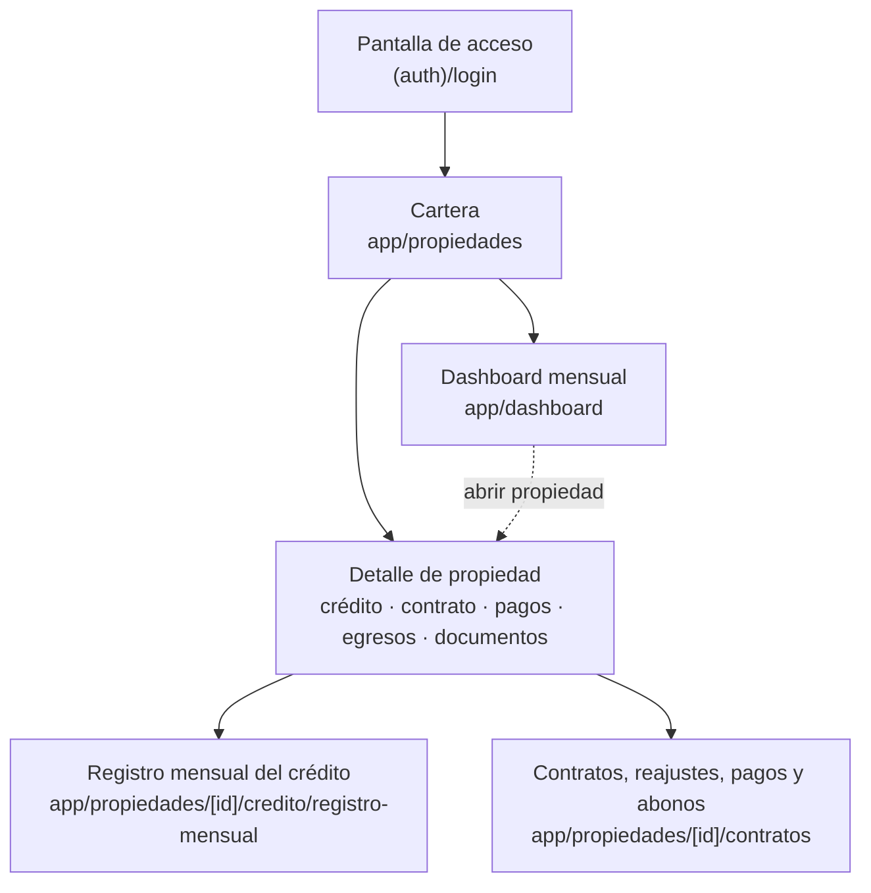
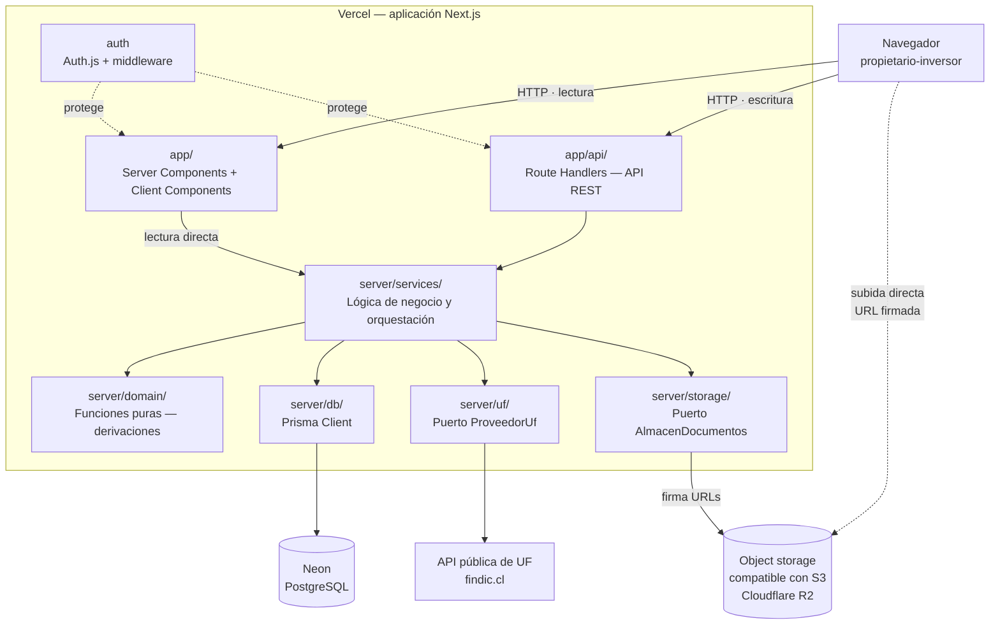
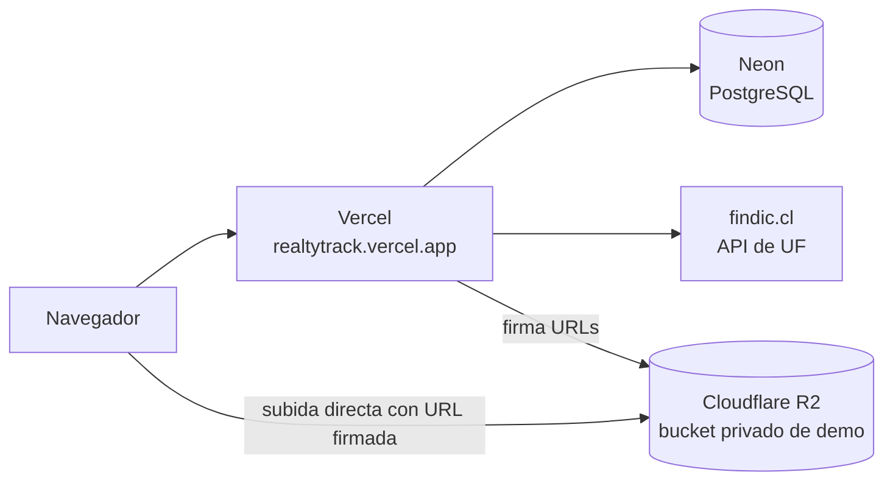
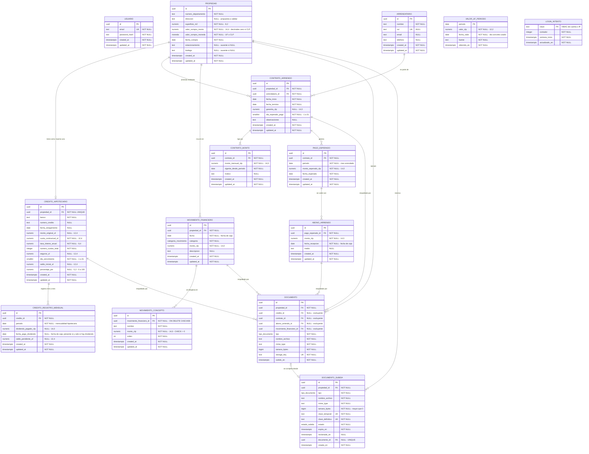
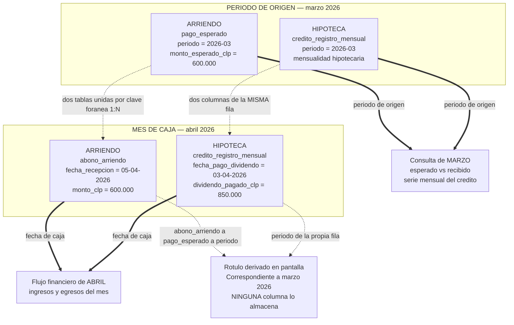

## Índice

0. [Ficha del proyecto](#0-ficha-del-proyecto)
1. [Descripción general del producto](#1-descripción-general-del-producto)
2. [Arquitectura del sistema](#2-arquitectura-del-sistema)
3. [Modelo de datos](#3-modelo-de-datos)
4. [Especificación de la API](#4-especificación-de-la-api)
5. [Historias de usuario](#5-historias-de-usuario)
6. [Tickets de trabajo](#6-tickets-de-trabajo)
7. [Pull requests](#7-pull-requests)

---

> **Estado del proyecto (entrega final).** El MVP está **implementado y desplegado** en
> <https://realtytrack.vercel.app> (Vercel, PostgreSQL en Neon y Cloudflare R2): acceso de
> usuario único, propiedades, créditos hipotecarios y su registro mensual, contratos, montos y
> reajustes, pagos de arriendo, movimientos financieros, dashboard con histórico, equivalentes
> con la UF y documentos. El ticket de aportes de capital (T08) se canceló por decisión de
> producto. Lo que sigue siendo propuesta o carece de evidencia se marca en cada sección. El
> detalle técnico vive en `docs/`; este documento lo resume e integra.

---

## 0. Ficha del proyecto

### **0.1. Tu nombre completo:**

Eliana Rodriguez

### **0.2. Nombre del proyecto:**

RealtyTrack

### **0.3. Descripción breve del proyecto:**

Aplicación web personal para centralizar y consultar el estado financiero y
contractual de una cartera de propiedades de inversión en Chile —propiedades,
créditos hipotecarios, contratos de arriendo, pagos y egresos—,
evolucionando un proceso hoy basado en hojas de cálculo y
consolidación manual.

### **0.4. URL del proyecto:**

**Demo en producción:** <https://realtytrack.vercel.app>

- **Credenciales:** el acceso es de usuario único y no hay registro. El email y la
  contraseña de demostración **se entregan por separado a los evaluadores** y no están en el
  repositorio.
- **Datos:** exclusivamente **ficticios** (seed de demostración: 3 propiedades, 6 meses de
  histórico y 17 abonos). Los documentos se guardan en un bucket de R2 independiente para la
  demo.
- **Al probar:** el entorno es compartido y los cambios persisten; no ingrese datos ni
  documentos reales. Tras 5 intentos de acceso a una cuenta en 15 minutos, el login se
  bloquea temporalmente.

El video [`realtytrack-entrega2.mp4`](realtytrack-entrega2.mp4), en la raíz, es evidencia de
la **entrega anterior** (Entrega 2) y no muestra el rediseño ni todas las funcionalidades
actuales.

### 0.5. URL o archivo comprimido del repositorio

`https://github.com/elianasaraith/feature-entrega-1-ESRF.git`

La **entrega final** está en la rama `final-project-esrf`, integrada en `main` mediante el
PR #1 (sección 7). Las ramas `feature/entrega-1-ESRF` y `feature/entrega-2-ESRF` conservan
las entregas anteriores.

---

## 1. Descripción general del producto

### **1.1. Objetivo:**

RealtyTrack está dirigido a un **propietario-inversor individual** que
autogestiona su propia cartera de propiedades de inversión: es a la vez
dueño, administrador y quien consulta la información, sin equipo ni terceros
involucrados.

Hoy cada propiedad acumula seis dimensiones de información —datos de la
propiedad, crédito hipotecario, contrato de arriendo, pagos mensuales,
egresos e inversiones, y documentación de respaldo— repartidas en hojas de
cálculo, cartolas bancarias, contratos en PDF y comprobantes sueltos, sin que
ninguna fuente sepa de las otras. El costo no está en registrar un dato, sino
en consolidarlo: responder qué pasó financieramente en un mes exige cruzar
varias fuentes a mano, y ese cruce no queda registrado para la próxima vez.

El objetivo del producto es ofrecer una **fuente única** donde el estado
financiero y contractual de cada propiedad quede registrado y sea consultable
por período mensual, sin consolidación manual. No automatiza la gestión
inmobiliaria ni sustituye al banco: centraliza y hace consultable la
información que hoy está dispersa, y hace explícita la diferencia entre lo
que se esperaba y lo que ocurrió.

Detalle completo: [docs/product.md](docs/product.md) §1–§3.

### **1.2. Características y funcionalidades principales:**

1. **Gestión de propiedades** — alta y consulta de cada propiedad de la
   cartera, con sus datos físicos y de compra; diseñado para N propiedades.
2. **Gestión de créditos hipotecarios** — condiciones contractuales en UF y
   registro mensual del dividendo pagado (CLP) y el saldo pendiente (UF),
   conservando la serie histórica.
3. **Gestión de contratos y arriendos** — contrato con su arrendatario e
   histórico de montos y reajustes, sin perder la identidad del contrato.
4. **Registro y control de pagos, ingresos y gastos** — pago esperado frente
   a abonos recibidos, con cuatro estados derivados (pendiente, parcialmente
   pagado, pagado, vencido); egresos e inversiones por propiedad.
5. **Dashboard financiero e histórico mensual** — ingresos, egresos, flujo
   neto, saldo de créditos y estado de
   las obligaciones de arriendo, a nivel de cartera y por propiedad, estable
   frente a variaciones posteriores de la UF.
6. **Almacenamiento de documentos** (complementaria y transversal) — cada documento asociado a
   su propiedad y, cuando corresponde, al crédito, contrato o abono que
   respalda.
7. **Acceso protegido** (complementaria y transversal) — usuario único, email y contraseña.

Detalle completo: [docs/product.md](docs/product.md) §5–§6.

### **1.3. Diseño y experiencia de usuario:**

**Rediseño (implementado, validado localmente y archivado):** sistema de diseño propio con tokens en `app/globals.css` (sidebar azul marino `#14283F`, acción `#2563EB`, positivo `#059669`, advertencia `#D97706`, negativo `#DC2626`), componentes compartidos en `app/_ui/` (AppShell con sidebar responsive y menú móvil, PageHeader/Breadcrumbs, Button, Card/StatCard, Badge de estado de pago, FormField/Input/Select, DataTable, EmptyState/LoadingState/ErrorState, Alert, ConfirmDialog), formatos CLP/UF/fecha en `app/_lib/format.ts`, iconos con `lucide-react` y gráficos con `recharts` (ingresos/egresos y flujo neto del histórico de 6/12 meses). Navegación contextual por propiedad (Resumen · Crédito · Contratos · Movimientos · Documentos), páginas `error` y `not-found` propias y documentos con arrastrar y soltar. Solo presentación: sin cambios en API, reglas ni cálculos financieros.

**Estado:** la interfaz está implementada para acceso (`/login`), propiedades,
crédito hipotecario con su registro mensual, contratos y montos de arriendo
(`app/propiedades/**`, `app/(auth)/login`). La interfaz actual puede recorrerse en la demo
(sección 0.4); este documento no incluye capturas. También están implementadas las vistas de abonos
(pagos del contrato), de movimientos financieros —con registro simple o desglosado en
conceptos— y del dashboard; la vista de documentos (`/propiedades/[id]/documentos`)
también está implementada. El siguiente diagrama resume el **flujo de navegación**:



Los formularios de registro (propiedad, crédito, contrato, reajuste, abono y movimiento)
forman parte de estas vistas. Ningún cálculo financiero pertenece a la UI: los importes
llegan ya derivados desde la capa de servicios (`docs/architecture.md` §7).

### **1.4. Instrucciones de instalación:**

Para evaluar el producto **no hace falta instalar nada**: use la demo de la sección 0.4.
Las instrucciones siguientes son para ejecutarlo en local.

**Stack implementado** (`package.json`): Next.js 16 (App Router) + React 19 +
TypeScript, Tailwind CSS 4, Route Handlers como API REST, Prisma 6 sobre
PostgreSQL, Auth.js (`next-auth` 5 beta, proveedor de credenciales con sesión JWT),
`argon2` para el hash de la contraseña, Zod 4 para validar entradas, y pruebas con el
ejecutor nativo `node --test` (+ `tsx`), y la API pública de UF de findic.cl (consultada
con `fetch` nativo). Producción: Vercel, Neon (PostgreSQL) y Cloudflare R2 (API S3).

**Requisitos previos:** Git, Node.js (desarrollado con 23.11; Next.js 16 exige 20.9 o
superior y `npm test` necesita una versión que admita `--env-file-if-exists`) con npm, y
Docker con Docker Compose para la base de datos local.

```bash
git clone https://github.com/elianasaraith/feature-entrega-1-ESRF.git
cd feature-entrega-1-ESRF
git checkout final-project-esrf
```

**1. Instalar dependencias**

```bash
npm install
```

**2. Configurar variables de entorno.** Copia la plantilla y completa los valores
(`.env` está ignorado por Git; nunca lo versiones):

```bash
cp .env.example .env
```

Variables que usa el código (solo nombres; los valores nunca se versionan):

| Variable | Cuándo se necesita |
|---|---|
| `DATABASE_URL`, `DIRECT_URL` | Siempre: conexión a PostgreSQL (aplicación y migraciones) |
| `AUTH_SECRET` | Secreto de sesión de Auth.js; obligatorio en producción |
| `SEED_USER_EMAIL`, `SEED_USER_PASSWORD` | Usuario único que crean los seeds locales |
| `APP_ORIGINS` | Orígenes confiables para mutaciones; obligatoria en producción (en local, sin ella se admite `http://localhost:3000`) |
| `S3_ENDPOINT`, `S3_REGION`, `S3_BUCKET`, `S3_ACCESS_KEY_ID`, `S3_SECRET_ACCESS_KEY`, `DOCUMENT_UPLOAD_SECRET` | Solo para documentos (ver «Configuración de documentos») |
| `UF_API_BASE_URL` | Opcional; por defecto `https://findic.cl/api/uf`, sin API key |
| `TEST_DATABASE_URL` | Pruebas de integración y E2E; base exclusiva de pruebas |
| `DEMO_SEED_TARGET_HOST`, `DEMO_USER_EMAIL`, `DEMO_USER_PASSWORD` | Solo para el seed de demostración |

Para la base local de Docker Compose la URL tiene la forma
`postgresql://realtytrack:<contraseña de docker-compose.yml>@localhost:5436/realtytrack`.

**3. Iniciar PostgreSQL con Docker Compose** (PostgreSQL 16, puerto `5436`, base y
usuario `realtytrack`; la contraseña de desarrollo local está en `docker-compose.yml`):

```bash
docker compose up -d db
```

**4. Aplicar las migraciones de Prisma**

```bash
npx prisma migrate deploy
npm run db:verify        # opcional: comprueba la conexión Prisma↔PostgreSQL
```

**5. Cargar los seeds** (datos ficticios; el usuario solo se crea si no existe):

```bash
npm run db:seed          # usuario único + 3 propiedades ficticias (ejecutar una sola vez)
# o bien, solo el usuario:
npm run db:seed:user
```

**6. Iniciar la aplicación**

```bash
npm run dev              # http://localhost:3000 → redirige a /login
```

Inicia sesión en local con `SEED_USER_EMAIL` / `SEED_USER_PASSWORD`. Otros scripts: `npm run build`,
`npm start`, `npm run lint`.

**7. Ejecutar las pruebas**

```bash
npm test
```

Las pruebas unitarias no requieren base de datos. Las de integración **solo escriben en
`TEST_DATABASE_URL`**, que debe apuntar a una base distinta de `DATABASE_URL` y
`DIRECT_URL` (`tests/setup/test-db.ts` lo verifica); si no está definida o no puede
comprobarse el aislamiento, esas pruebas se omiten. Para ejecutarlas, crea una base
aparte —por ejemplo `docker compose exec db createdb -U realtytrack realtytrack_test`—,
aplícale las migraciones con `DATABASE_URL` y `DIRECT_URL` apuntando a ella y define
`TEST_DATABASE_URL` en `.env`. Las pruebas E2E y los resultados de la validación final están en
la sección 2.6.

**Seed de demostración (mantenimiento del entorno de demo; no es necesario para evaluar).**
`npm run db:seed:demo` ejecuta `prisma/seed-demo.ts` cargando `.env.production.local`
(ignorado por Git), con `DATABASE_URL`, `DEMO_SEED_TARGET_HOST`, `DEMO_USER_EMAIL` y
`DEMO_USER_PASSWORD` (12 caracteres como mínimo). Carga solo datos ficticios, con fechas
relativas al día de ejecución, y es repetible (ids deterministas y *upsert*). Se niega a
ejecutarse si el destino es local, si el host no coincide con el confirmado o si la base
contiene propiedades ajenas a la demo; si ya existe un usuario, no cambia sus credenciales.
Se ejecutó con éxito en Neon: 3 propiedades, 6 meses de histórico y 17 abonos.

**Estado funcional.** Implementado: acceso de usuario único (T12), propiedades (T01),
crédito hipotecario (T02) y su registro mensual (T03), arrendatarios y contratos (T04),
montos, reajustes y pagos esperados (T05), abonos con estado de pago derivado (T06) y
movimientos financieros como egresos manuales (T07: migración
`20261109120000_add_movimiento_financiero` aplicada, suite completa con 199 pruebas sin
fallos ni omisiones, build correcto y revisión manual de la interfaz) y dashboard
financiero (T09: `/dashboard` y resumen mensual en el detalle de la propiedad; su
equivalente en CLP del saldo en UF se añadió después con T10). Los conteos de pruebas
citados por ticket son históricos, de cuando se cerró cada uno.
**Ampliación de T07 — gasto simple o desglosado:** un movimiento puede registrarse como un
único monto o desglosado en 1 a 50 conceptos, cada uno con nombre y monto en CLP. La suma de
los conceptos es el total del movimiento, calculado en el servidor y guardado en
`movimiento_financiero.monto_clp`; los conceptos son una entidad hija
(`movimiento_concepto`, migración `20261116120000_add_movimiento_concepto`) y no
movimientos independientes. El dashboard (T09) lee solo el monto del movimiento, por lo que un
gasto desglosado se cuenta una sola vez, sin cambios en sus fórmulas. Editar un gasto
desglosado sin enviar sus conceptos los conserva; solo `conceptos: []` lo convierte en simple.
Los movimientos anteriores siguen siendo gastos simples, sin migración de datos. Verificado por
el usuario con PostgreSQL local: pruebas unitarias, de integración (servicio, API y T09)
y `npm run build` correctos, y la consulta de integridad sin filas inconsistentes en
`realtytrack_test`. Revisión visual **parcial**: se confirmó la conversión de un gasto simple en
uno desglosado con tres conceptos y total de 150.000 CLP; los demás flujos de la interfaz
siguen pendientes de revisión manual.
**Cancelado:** aportes de capital (T08), por decisión de producto; el gasto se registra una
sola vez, como egreso.
**Integración con la UF (T10) — implementada.** El valor de la UF se obtiene de la API pública
de findic.cl (`GET /api/uf/{dd-mm-yyyy}`) bajo un puerto `ProveedorUf` intercambiable, y se
guarda una vez por período en `valor_uf_periodo` (migración
`20261118120000_add_valor_uf_periodo`), con la fecha del valor, la fuente y el momento de
obtención. La **referencia de cada período es el día 1 del mes**. Un valor ya almacenado no se
sobrescribe, ni siquiera ante consultas concurrentes (inserción idempotente), de modo que un
mes anterior da las mismas cifras aunque la UF cambie después. Sin valor almacenado, el valor
se consulta bajo demanda; si el proveedor no tiene datos (`serie: []`) o falla, no se estima,
ni se interpola, ni se usa otro período: el equivalente queda `null` y la interfaz muestra
«No disponible» sin interrumpir la funcionalidad principal. El cliente valida la respuesta
(fecha exacta, valor positivo, 2 decimales como máximo), usa un timeout de 5 s y convierte el
valor a `Decimal`; las conversiones UF → CLP se hacen en el servidor con `Decimal`, sin
`number`, y no se persisten. Se consultan como máximo 6 períodos a la vez, y tras 6 fallos
consecutivos del proveedor una misma ejecución deja de iniciar consultas (las ya iniciadas
terminan y conservan sus valores válidos).

Los equivalentes en CLP son **informativos y opcionales**; el monto original sigue siendo la UF:

| Importe en UF | UF utilizada | Dónde se ve |
|---|---|---|
| Cuota contractual | Mes actual | Crédito |
| Saldo inicial | Mes de `fecha_otorgamiento` (si falta, «Sin fecha de otorgamiento») | Crédito |
| Último saldo registrado y saldo de cada mes | `periodo` del propio registro | Crédito y registro mensual |
| Saldo de crédito del dashboard | Mes consultado (se conserva el período original del saldo) | Dashboard |

Los campos añadidos a las respuestas son opcionales (`cuotaContractualClp`, `saldoInicialClp`,
`ultimoSaldo`, `equivalenteClp`): los contratos anteriores no cambian y los cálculos
financieros de T07 y T09 (ingresos, dividendos, egresos, flujo neto, estados de pago, y el
gasto desglosado contado una sola vez) no se modifican; la ficha de propiedad no consulta la UF.
El error de dependencia externa (503) para operaciones cuyo resultado principal dependa de la
UF **no está implementado**: ninguna lo necesita todavía.

*Verificación histórica de T10 (ejecutada por el usuario en su entorno local):* `npm test` con 352 pruebas, 0
fallidas y 0 omitidas; TypeScript y ESLint sin errores; `npm run build` correcto; consulta real
a findic.cl (`01-03-2026` → 39796.31; `01-01-2030` → `serie: []`) y del cliente
(`ok` y `sin-datos`); revisión visual del crédito, el registro mensual y el dashboard, con
proveedor sin datos y proveedor inaccesible, la persistencia en `valor_uf_periodo` y los JSON
de los GET. **Salvedad:** el escenario de crédito sin `fecha_otorgamiento` tiene cobertura
automatizada, pero **no se comprobó visualmente**. Detalle: `docs/work-tickets.md` §4.10.

**Ampliaciones posteriores (implementadas y verificadas: pruebas automatizadas, build y validación manual):**
- *Dashboard:* histórico de 6 meses (hasta 12) por `GET /api/dashboard/historico`, saldo
  hipotecario consolidado (UF, equivalente en CLP, estados completo/parcial/sin saldos) y
  navegación entre meses; sin gráficos (`docs/work-tickets.md` §4.9).
- *Arrendatarios:* edición (`PUT /api/arrendatarios/{id}`); sin eliminación.
- *Montos de arriendo:* corrección y eliminación de reajustes, y alta de reajustes, solo si no
  cambian pagos con abonos (422 en caso contrario); el escenario con abonos queda pendiente de
  decisión de negocio (`docs/work-tickets.md` §4.5).
- *Documentos (T11 + `seguridad-mvp`):* subida directa a un bucket privado S3-compatible (Cloudflare R2),
  URLs firmadas de 5 minutos, token de subida de un solo uso y validación del objeto real (tamaño,
  `Content-Type`, firma de formato); PDF, JPEG, PNG y WebP, máximo 20 MB. **Subida en dos fases:** el navegador
  solo escribe en una clave temporal (`tmp/…`); el backend valida el objeto, fija su ETag y lo promueve a la
  clave definitiva, sobre la que el navegador nunca tiene permiso de escritura (una URL firmada reutilizada no
  puede modificar un documento registrado). Cuotas de la demostración: 50 documentos y 200 MB por propiedad,
  1 GB global. Subida, descarga y eliminación física se validaron contra R2 real al cerrar T11; la
  carga con el flujo actual se **validó manualmente contra R2 real desde la aplicación desplegada en
  Vercel**.

**Configuración de documentos (Cloudflare R2).** Variables de entorno **solo de servidor** (nunca
`NEXT_PUBLIC_*`): `S3_ENDPOINT` (`https://<cuenta>.r2.cloudflarestorage.com`), `S3_REGION`
(`auto`), `S3_BUCKET`, `S3_ACCESS_KEY_ID`, `S3_SECRET_ACCESS_KEY`. En R2: bucket **privado** (sin
acceso público), un token de API S3 con lectura y escritura limitadas a ese bucket y una regla
CORS que permita `PUT` desde el origen de la aplicación con la cabecera `Content-Type`. Sin
estas variables la aplicación funciona y las operaciones de documentos responden 503.

**Configuración adicional de `seguridad-mvp`:**

- *Migraciones:* las **17 migraciones** del repositorio, incluidas
  `20261125120000_add_login_intento` y `20261125120100_add_documento_subida`, están **aplicadas en
  Neon**.
- *Variables:* `DOCUMENT_UPLOAD_SECRET` (secreto de los tokens de subida; valor aleatorio largo,
  distinto de `AUTH_SECRET` y de las credenciales de R2) y `APP_ORIGINS` (sin ella, en producción
  toda mutación de la API se rechaza). `S3_ENDPOINT` debe estar definida también **en el build**
  (alimenta el `connect-src` de la CSP; si cambia hay que reconstruir). `AUTH_SECRET` es obligatorio
  en producción (sin él el acceso se cierra).
- *Cloudflare R2:* se requiere CORS con `PUT` desde cada origen de `APP_ORIGINS` y la cabecera
  `Content-Type`, y se recomienda una regla *Lifecycle* que expire el prefijo `tmp/` a 1 día
  (la activación de esta regla no tiene evidencia registrada).
- *Build:* `npm run build` ejecuta `prisma generate && next build`.

---

## 2. Arquitectura del Sistema

### **2.1. Diagrama de arquitectura:**



*(Arquitectura implementada y desplegada: Vercel, Neon y Cloudflare R2, con la API de UF de
findic.cl. Fuente versionable: [docs/diagrams/architecture.mmd](docs/diagrams/architecture.mmd).)*

RealtyTrack es una **aplicación full-stack única** —un repositorio, un
despliegue, una base de datos—, organizada en cuatro capas (UI, API,
servicios, dominio) con la regla de que la lógica de negocio vive en una sola
de ellas (`docs/architecture.md` §5).

No sigue un patrón de microservicios ni CQRS/event sourcing: es un **monolito
por capas**. La justificación es el propio producto (`docs/architecture.md`
§2): un usuario único, una cartera de pocas propiedades, sin concurrencia
relevante ni múltiples consumidores de la API. Cualquier forma de
distribución añadiría operación sin resolver ningún problema real del
producto.

**Beneficios.** Un solo despliegue y una sola fuente de lógica de negocio
—sin contratos duplicados entre servicios—; operación simple para un
proyecto de una sola persona.

**Déficits reconocidos.** Menor aislamiento entre componentes, y ausencia de
despliegue o escalado independiente por servicio. Se acepta porque el
producto no lo necesita: la alternativa —por ejemplo, un backend separado en
NestJS, descartada en `docs/architecture.md` §22— duplicaría despliegue,
contrato y configuración para servir a un único consumidor.

### **2.2. Descripción de componentes principales:**

| Componente | Tecnología | Responsabilidad |
|---|---|---|
| UI (`app/`, `app/_ui/`) | React (Server + Client Components), Tailwind CSS 4, lucide-react, recharts | Presentar y capturar; ningún cálculo financiero |
| API (`app/api/`) | Route Handlers de Next.js, REST | Validar entrada, autenticar, invocar el servicio, traducir errores a HTTP |
| Servicios (`server/services/`) | TypeScript | Orquestar: leer, aplicar reglas, escribir; agregaciones mensuales y regla de caja |
| Dominio (`server/domain/`) | TypeScript, funciones puras | Reglas con precedencia: estado del pago, fecha de completitud, monto vigente, conversión UF→CLP |
| Persistencia (`server/db/`) | Prisma + PostgreSQL (Neon) | Acceso a datos, tipado generado desde el esquema |
| Integración UF (`server/uf/`) | Puerto `ProveedorUf`, cliente findic.cl, servicio con persistencia idempotente | Obtener y conservar el valor de la UF por período (día 1), sin estimar; equivalentes en CLP opcionales |
| Documentos (`server/storage/`) | Puerto `AlmacenDocumentos`, API S3 | URL firmada de subida/lectura, borrado; proveedor: Cloudflare R2 |
| Autenticación (`auth`) | Auth.js, JWT, middleware | Sesión de usuario único; protege UI y API |

Detalle: [docs/architecture.md](docs/architecture.md) §3, §5.

### **2.3. Descripción de alto nivel del proyecto y estructura de ficheros**

```
app/
  (auth)/login/     pantalla de acceso                                  [implementado]
  _ui/ _lib/        sistema de diseño, AppShell, formatos               [implementado]
  propiedades/      cartera, detalle, crédito y registro mensual,
                    contratos y montos (propiedades/[id]/…)             [implementado]
  api/              Route Handlers — API REST                           [implementado]
  dashboard/        flujo financiero mensual de cartera                 [implementado]
server/
  auth/             verificación de credenciales y sesión requerida     [implementado]
  domain/           funciones puras: UF, vigencia de contrato, montos   [implementado]
  schemas/          validación Zod por entidad                          [implementado]
  services/         orquestación de propiedades, créditos, contratos    [implementado]
  db/               Prisma Client                                       [implementado]
  errors.ts         errores de dominio tipados → HTTP                   [implementado]
  uf/               puerto ProveedorUf, cliente findic.cl, servicio UF  [implementado]
  storage/          puerto de documentos y cliente S3 (Cloudflare R2)   [implementado]
prisma/
  schema.prisma     esquema, espejo de docs/data-model.md
  migrations/       migraciones versionadas
  seed.ts           carga local ficticia (usuario + propiedades)
  seed-user.ts      solo el usuario (lógica en seed-usuario.ts)
  seed-demo.ts      datos ficticios del entorno de demostración
tests/              unitarias e integración (node --test)
e2e/                pruebas extremo a extremo (Playwright)
openspec/           especificaciones y cambios archivados (Spec-Driven Development)
```

La estructura sigue las capas de §2.2 (`docs/architecture.md` §5), no un
patrón importado. `server/` es una convención de organización, no una
frontera que Next.js imponga por sí solo: los módulos exclusivamente de
servidor se marcan con `server-only`, de modo que una importación accidental
desde el cliente falle en tiempo de compilación en vez de filtrarse en
silencio (`docs/architecture.md` §6).

### **2.4. Infraestructura y despliegue**

**Implementado.** La aplicación está desplegada y operativa en
<https://realtytrack.vercel.app>.



| Aspecto | Estado |
|---|---|
| Alojamiento | Vercel (aplicación Next.js, un único despliegue) |
| Base de datos | Neon (PostgreSQL), con las 17 migraciones aplicadas |
| Documentos | Cloudflare R2, con un bucket independiente para la demo |
| Migraciones | Paso deliberado, no encadenado al build |
| Datos | Seed de demostración, exclusivamente ficticio |
| Verificación | Pruebas manuales satisfactorias en producción: carga de documentos contra R2 y edición de registros existentes |

Pendiente (*propuesta a validar*): aislamiento de datos de los despliegues de vista previa —base
compartida vs. Neon *branching*— (`docs/architecture.md` §15.2).

Detalle: [docs/architecture.md](docs/architecture.md) §15.

### **2.5. Seguridad**

**Implementado** (T12 y capas posteriores):

- Acceso protegido con Auth.js: proveedor de credenciales y sesión JWT.
- Contraseña con hash Argon2 (`argon2`); verificación propia en
  `server/auth/verify-credentials.ts`, con pruebas.
- `proxy.ts` protege toda ruta salvo la pantalla de acceso y cada Route Handler exige
  sesión (`requireSession`, 401 sin ella); usuario único creado por seed, sin endpoint
  de registro.
- Validación de entradas con Zod en el borde de la API y errores de dominio traducidos a
  HTTP en un único punto (`server/errors.ts`).
- Ningún secreto versionado: `.env*` está en `.gitignore` salvo `.env.example`.
- Pruebas de integración aisladas: solo escriben en `TEST_DATABASE_URL`, distinta de la
  base de desarrollo.

**Endurecimiento previo al despliegue público (`seguridad-mvp`, implementado y desplegado):**

- *Login:* límite persistente en PostgreSQL (serverless-safe) de **5 intentos por cuenta y 20 por IP cada
  15 minutos**, con reserva atómica del intento antes de verificar, claves HMAC (sin emails ni IP en claro), IP
  tomada solo de la cabecera de Vercel y cierre por defecto si PostgreSQL falla. Mensaje único y genérico;
  verificación Argon2id contra un hash de relleno cuando el email no existe (y también ante un intento
  bloqueado, para igualar el coste y evitar la enumeración por tiempos).
- *Sesión:* 8 horas **absolutas** (el JWT no puede renovarse más allá). Los layouts privados verifican la sesión
  por sí mismos, el matcher del proxy es exacto y cada Route Handler conserva `requireSession`.
- *CSRF:* toda mutación (API y páginas) exige un `Origin` de `APP_ORIGINS` (o `Sec-Fetch-Site: same-origin`);
  `/api/auth/*` conserva el CSRF propio de Auth.js. Cuerpo máximo de 1 MiB (413) y `.max()` en los textos libres.
- *Cabeceras:* CSP, HSTS, `nosniff`, `X-Frame-Options: DENY`, `Referrer-Policy`, `Permissions-Policy`; sin
  `X-Powered-By`. **Riesgo residual:** `script-src` mantiene `'unsafe-inline'` (hidratación de Next.js con Cache
  Components; una CSP con *nonce* obligaría a renderizado dinámico): la CSP no frenaría un XSS en línea; se
  compensa con `object-src 'none'`, `base-uri`, `form-action`, `frame-ancestors` y `connect-src` acotado.
- *Documentos:* subida en dos fases con promoción (ver §1.4), token de un solo uso con el secreto independiente
  `DOCUMENT_UPLOAD_SECRET`, cuotas con reservas y limpieza de temporales.
- Bucket de documentos privado; el acceso es siempre por URL firmada de vida corta, nunca público.
- Sin prefijo público de Next.js en credenciales.

**Riesgos residuales de dependencias (aceptados, documentados con la salida completa de `npm audit` en
[docs/architecture.md](docs/architecture.md) §11.4):** `deepmerge-ts`, `effect`, `@prisma/config`/`prisma`
(cadena del CLI de Prisma 6.19.3: no la carga el runtime de `@prisma/client`, sin `prisma.config.ts`, sin
`Schema.TemplateLiteral`) y `minimatch` (solo `npm run lint`). `npm audit` completo: 13 (8 moderadas, 5 altas).
El resultado filtrado (`--omit=dev --omit=optional --omit=peer`, 0) **no** prueba ausencia de vulnerabilidades.

**Limitaciones del MVP:** un tercero puede bloquear la cuenta 15 minutos; sin MFA ni revocación global de
sesiones; el límite de intentos cubre solo el login; limpieza de reservas oportunista (sin tarea programada).

**Verificaciones:** en producción las migraciones están aplicadas, la aplicación se compila y
despliega en Vercel y la carga de documentos se validó contra R2 real. **No hay evidencia
registrada** de comprobaciones específicas de la CSP en navegador, de cabeceras y cookies, de la
igualdad ETag/MD5 en R2 ni de escrituras concurrentes sobre la promoción. Detalle en
[docs/architecture.md](docs/architecture.md) §11.5.

**Regla de datos (vigente):** los datos reales de las propiedades se anonimizan antes de
versionar (nombres, RUT, direcciones, montos, documentos) y se cargan por un script de
seed controlado, no por un importador; los seeds del repositorio solo contienen datos ficticios.

Detalle: [docs/architecture.md](docs/architecture.md) §11, §13, §16.

### **2.6. Tests**

> **Estado real:** hay pruebas unitarias y de integración (`npm test`, `node --test`) para
> propiedades, créditos, contratos, pagos, movimientos, dashboard, UF, documentos, autenticación y
> seguridad, y **cinco pruebas extremo a extremo** con Playwright (`npm run test:e2e`). No hay
> pruebas de componentes de interfaz; la interfaz se verificó manualmente. La tabla describe la
> estrategia.

**Validación final** (ejecución local de la autora el 26-11-2026, sobre el código del commit
`60b4fb8`; horas de Chile):

| Comando | Resultado | Evidencia |
|---|---|---|
| `npm test` | **Todas las pruebas pasaron** (22:03). No se registra el conteo exacto | Confirmación de la autora y código de salida 0 en el registro local de npm. Una ejecución anterior (22:02) terminó con código 1; no se conserva la causa |
| `npm run test:e2e` (dos ejecuciones consecutivas) | **5 de 5 correctas en ambas** (22:03 y 22:05), sin otra ejecución E2E entre ellas | Confirmación de la autora y código de salida 0 de ambas en el registro local de npm. Reporte de Playwright de la segunda: 0 fallidas, 0 omitidas, 0 inestables (34 s); el de la primera fue sobrescrito |
| `npm run build` | Correcto (código de salida 0, 22:04, entre las dos ejecuciones E2E) | Registro local de npm y artefacto `.next/BUILD_ID` |

Los registros y reportes son locales y no se versionan. Los conteos citados por ticket en
`docs/work-tickets.md` y en la sección 1.4 son históricos.

| Nivel | Qué cubre la estrategia | Por qué ahí |
|---|---|---|
| Unitario sobre el dominio | Precedencia de los cuatro estados del pago y sus calificaciones, fecha de completitud, monto vigente ante reajuste retroactivo, conversión UF→CLP | Funciones puras; se prueban con tablas de casos, sin base de datos |
| Integración de servicios | Invariantes que la base no impone: no solapamiento de contratos, documento coherente con su propiedad, monto esperado alineado con `contrato_monto` | Requieren PostgreSQL real |
| API | Códigos de estado, validación de entrada, control de acceso | Es el contrato de la capa REST |
| Extremo a extremo | Un flujo principal completo: login, propiedad, contrato, pago, dashboard y cierre de sesión | Implementado con Playwright (cinco escenarios por área, no un recorrido por cada historia); el mayor valor sigue en los dos primeros niveles |

Los casos límite ya documentados en
[docs/user-stories.md](docs/user-stories.md) (HU01 CL10–CL12, HU02 CL11–CL15,
HU03 CL12–CL14) están escritos para traducirse directamente en casos de
prueba, sin reinterpretarlos.

#### Pruebas E2E (Playwright)

Cinco escenarios independientes con Chromium sobre la aplicación real (frontend, API y
PostgreSQL, sin mocks de servicios de negocio). Cada uno inicia sesión y crea su propia
propiedad:

| Escenario | Archivo | Aserciones principales |
|---|---|---|
| Credenciales inválidas | `flujo-principal.spec.ts` | Mensaje genérico y permanencia en `/login` |
| Flujo principal | `flujo-principal.spec.ts` | Propiedad → contrato con arrendatario nuevo → pago «Pagado» → ingreso y flujo neto en el dashboard → cierre de sesión (`/dashboard` redirige a `/login`, API 401) |
| Gestión hipotecaria | `hipoteca.spec.ts` | Crédito con 20 % de pie (600 UF sobre 3000 UF), edición a 25 % (750 UF) tras recargar, dividendo y saldo en el registro mensual |
| Gestión financiera | `finanzas.spec.ts` | Gasto de $120.000 persistido en el listado; dashboard de marzo 2025 con egresos $120.000 y flujo neto -$120.000; navegación de mes con selector, encabezado y cifras sincronizados |
| Gestión de arriendos | `arriendos.spec.ts` | Edición persistida del arrendatario; reajuste a $450.000 desde julio; 12 pagos esperados con $400.000 antes de julio y $450.000 desde julio |

Fechas deterministas (meses fijos del pasado salvo el flujo principal, que usa el mes en
curso) y meses distintos por escenario para que las cifras exactas del dashboard no se
contaminen. La UF se obtiene de un proveedor simulado local (`e2e/uf-stub.mjs`, puerto 3101,
sin red) y no se usa R2. Estado: **los cinco escenarios finalizaron correctamente**, en dos
ejecuciones consecutivas con 5 de 5 en ambas (ver «Validación final»). El entorno de desarrollo asistido por IA no
podía ejecutarlos. Los documentos no tienen prueba E2E.

- **Aislamiento y repetibilidad:** solo usa `TEST_DATABASE_URL`, que debe ser una base
  **exclusiva de pruebas** (distinta de `DATABASE_URL`/`DIRECT_URL` y con «test» o «e2e» en el
  nombre; si no, la ejecución aborta). Antes de cada ejecución vacía todas las tablas de esa
  base, incluido el contador de intentos de login, y siembra un usuario ficticio, por lo que
  puede repetirse y no hay fallos por el límite de intentos. **No la use con datos que quiera
  conservar.** Los datos y credenciales son ficticios (`e2e/datos.ts`).
- **Servidor:** Playwright levanta `next dev` en el puerto 3100 apuntando a la base de
  pruebas; detenga antes cualquier otro `next dev` de este directorio.

```bash
# una vez: dependencias y navegador
npm install
npm run test:e2e:install

# en .env (o en el entorno): una base exclusiva de pruebas
#   TEST_DATABASE_URL="postgresql://…/realtytrack_e2e_test"
npm run test:e2e:db     # lee .env, valida la guarda y aplica migraciones solo a TEST_DATABASE_URL
npm run test:e2e        # ejecuta la prueba (informe en playwright-report/)
```

Detalle: [docs/architecture.md](docs/architecture.md) §18.

---

## 3. Modelo de Datos

### **3.1. Diagrama del modelo de datos:**



*(Modelo implementado: las 15 entidades están en el esquema Prisma. Fuente versionable:
[docs/diagrams/data-model.mmd](docs/diagrams/data-model.mmd).)*

`USUARIO`, `VALOR_UF_PERIODO` y `LOGIN_INTENTO` no tienen relaciones: el primero solo guarda
credenciales de un usuario único, el segundo es una tabla de referencia consultada por período
y el tercero un contador de intentos de acceso.

### **3.2. Descripción de entidades principales:**

| Entidad | Propósito | Claves | Restricción destacada |
|---|---|---|---|
| `usuario` | Credenciales del único usuario del sistema | PK `id`; `email` UNIQUE | Sin `usuario_id` en el resto del modelo: el MVP es de usuario único |
| `propiedad` | Unidad de la cartera; raíz de la que cuelga todo lo demás | PK `id` | `valor_compra_monto NUMERIC(14,4)` con `valor_compra_moneda` explícita (UF o CLP) |
| `credito_hipotecario` | Condiciones contractuales del crédito de una propiedad | PK `id`; FK `propiedad_id` | `UNIQUE(propiedad_id)` — como máximo un crédito por propiedad |
| `credito_registro_mensual` | Serie mensual del dividendo pagado y el saldo informado por el banco | PK `id`; FK `credito_id` | `UNIQUE(credito_id, periodo)`; dos `CHECK` — no ambos datos nulos; `fecha_pago_dividendo` presente si y solo si hay dividendo |
| `arrendatario` | Persona que arrienda, reutilizable entre contratos sucesivos | PK `id`; `rut` UNIQUE nulable | — |
| `contrato_arriendo` | Contrato de arriendo de una propiedad, con su vigencia y garantía | PK `id`; FK `propiedad_id`, `arrendatario_id` | Sin columna `estado`: la vigencia se deriva de `fecha_inicio`/`fecha_termino` |
| `contrato_monto` | Histórico de los montos aplicados a lo largo de un contrato | PK `id`; FK `contrato_id` | `UNIQUE(contrato_id, vigente_desde_periodo)`; el monto inicial es su primera fila, no una columna del contrato (el monto inicial es opcional en el alta: sin él el contrato no tiene fila y no genera pagos esperados hasta registrar el primer monto, T05; propuesta a validar). Los reajustes agregan filas y nunca modifican las anteriores |
| `pago_esperado` | Lo que se espera cobrar por arriendo en un período mensual | PK `id`; FK `contrato_id` | `UNIQUE(contrato_id, periodo)`; `CHECK` monto > 0 y período día 1; snapshot del monto vigente en ese mes. Lo crea una sincronización explícita e idempotente (T05) y un reajuste solo actualiza `monto_esperado_clp` desde su período |
| `abono_arriendo` | Cada entrega de dinero recibida contra un pago esperado | PK `id`; FK `pago_esperado_id` | Sin tope: los abonos pueden exceder el monto esperado sin rechazar el registro |
| `movimiento_financiero` | Egresos e inversiones de una propiedad | PK `id`; FK `propiedad_id` | `ENUM categoria_movimiento` sin valor `DIVIDENDO`, para no duplicar esa salida de dinero. `monto_clp` es siempre el total del gasto: si está desglosado, es la suma de sus conceptos y las agregaciones no los suman de nuevo |
| `movimiento_concepto` | Concepto (nombre y monto) de un gasto desglosado; parte del movimiento, no un movimiento aparte | PK `id`; FK `movimiento_financiero_id` | `ON DELETE CASCADE`; `CHECK` monto > 0; sin conceptos = gasto simple (los movimientos existentes no se migran) |
| `valor_uf_periodo` | Valor de la UF asociado a cada período mensual (día 1) | PK `periodo` (día 1) | No se sobrescribe por una consulta posterior a la API, una vez almacenado; `CHECK` valor > 0 y período día 1; guarda `fecha_valor`, `fuente` y `obtenido_en` |
| `documento` | Metadata de los archivos; el binario vive en object storage | PK `id`; FK `propiedad_id` obligatoria + 4 FK específicas opcionales | `CHECK`: a lo sumo una de las cuatro FK opcionales es no nula |
| `documento_subida` | Reserva de un solo uso para la subida en dos fases | PK `id`; FK `propiedad_id`, `documento_id` | Claves temporal y definitiva únicas y distintas; estado y vencimiento |
| `login_intento` | Límite persistente de intentos de acceso | PK `clave` (HMAC) | Sin email ni IP en claro |

Detalle exhaustivo de cada atributo, tipo y restricción:
[docs/data-model.md](docs/data-model.md) §4.

El modelo distingue además **dos dimensiones temporales** que conviven sin
competir: el período de origen de un hecho (por ejemplo,
`credito_registro_mensual.periodo`, la mensualidad hipotecaria) y el mes de
caja en que realmente ocurrió (por ejemplo, `fecha_pago_dividendo`). El
siguiente diagrama, con un ejemplo marzo → abril, resume esa separación
(detalle completo en [docs/data-model.md](docs/data-model.md) §7):



*(Fuente versionable:
[docs/diagrams/financial-flow.mmd](docs/diagrams/financial-flow.mmd).)*

---

## 4. Especificación de la API

La API es REST (`docs/architecture.md` §8), diseñada **por caso de uso**, no
como CRUD por entidad. De las capacidades que cubre (`docs/architecture.md`
§8.3), estos tres endpoints se documentan como representativos porque cada
uno ilustra una regla de diseño distinta del modelo: una operación de
producto que orquesta varias escrituras, la frontera entre lo que se escribe
y lo que se deriva, y la agregación mensual que respeta la regla de caja.

Estos son contratos del MVP y los tres endpoints están **implementados**: 4.1 (T05), 4.2 (abonos,
T06) y 4.3 (dashboard, T09). Las cifras de verificación citadas corresponden al cierre de cada
ticket.

### 4.1 `POST /api/propiedades/{propiedadId}/contratos/{contratoId}/montos`

Registrar el primer monto o un reajuste del monto de arriendo (T05, **implementado**).
Escribe una nueva fila en `contrato_monto` —nunca modifica ni elimina las anteriores— y
actualiza `monto_esperado_clp` de los `pago_esperado` ya existentes desde su período, sin
alterar los meses anteriores (`docs/data-model.md` §4.7–§4.8). No crea pagos: eso lo hace la
operación explícita `POST .../pagos-esperados/sincronizar`, que genera los pagos faltantes
desde el mes de inicio hasta el mes en curso (o el de término), es idempotente y solo
actúa si el contrato tiene un monto registrado. No registra abonos ni calcula el estado del
pago (T06).

```yaml
paths:
  /api/propiedades/{propiedadId}/contratos/{contratoId}/montos:
    post:
      summary: Registrar el primer monto o un reajuste del monto de arriendo
      parameters:
        - name: propiedadId
          in: path
          required: true
          schema: { type: string, format: uuid }
        - name: contratoId
          in: path
          required: true
          schema: { type: string, format: uuid }
      requestBody:
        required: true
        content:
          application/json:
            schema:
              type: object
              required: [montoMensualClp, vigenteDesdePeriodo]
              properties:
                montoMensualClp: { type: string, description: "CLP entero > 0, hasta NUMERIC(14,0)" }
                vigenteDesdePeriodo: { type: string, description: "Mes en formato YYYY-MM; se almacena como día 1" }
                motivo: { type: string, nullable: true }
      responses:
        "201": { description: "Fila de contrato_monto creada" }
        "400": { description: "Entrada inválida (monto o período mal formado)" }
        "404": { description: "Propiedad o contrato inexistente, o el contrato no pertenece a la propiedad" }
        "409": { description: "Ya existe un monto para ese período" }
        "422": { description: "Primer monto distinto del mes de inicio, o período fuera de la vigencia del contrato" }
```

Ejemplo:

`POST /api/propiedades/3c1d…/contratos/6f2b…/montos`

```json
{ "montoMensualClp": "530000", "vigenteDesdePeriodo": "2026-09", "motivo": "reajuste anual" }
```

Respuesta `201`:

```json
{
  "id": "...",
  "montoMensualClp": "530000",
  "vigenteDesdePeriodo": "2026-09-01",
  "motivo": "reajuste anual",
  "createdAt": "..."
}
```

Verificado: `npm test` (144 pruebas, 0 fallidas), TypeScript, lint y revisión manual de
la interfaz de montos. El borrado y la edición de filas de monto no existen (405).

### 4.2 `POST /api/propiedades/{propiedadId}/contratos/{contratoId}/pagos-esperados/{pagoId}/abonos`

Registrar un abono contra un pago esperado (T06, **implementado**; ver el estado de
verificación en `docs/work-tickets.md` §4.6). Inserta una fila en `abono_arriendo`; no
escribe ningún estado: el estado, el saldo y la fecha de completitud se derivan al
consultar `GET .../contratos/{contratoId}/pagos-esperados` a partir del monto esperado,
los abonos y la fecha de referencia en Chile (`docs/data-model.md` §6.1). La misma ruta
base admite `GET` (listar) y, sobre `.../abonos/{abonoId}`, `PUT` (editar monto, fecha y
medio) y `DELETE` (borrado físico, 204). La validación de pertenencia propiedad →
contrato → pago → abono responde 404 ante cualquier id que no coincida.

```yaml
paths:
  /api/propiedades/{propiedadId}/contratos/{contratoId}/pagos-esperados/{pagoId}/abonos:
    post:
      summary: Registrar un abono contra un pago esperado
      parameters:
        - { name: propiedadId, in: path, required: true, schema: { type: string, format: uuid } }
        - { name: contratoId, in: path, required: true, schema: { type: string, format: uuid } }
        - { name: pagoId, in: path, required: true, schema: { type: string, format: uuid } }
      requestBody:
        required: true
        content:
          application/json:
            schema:
              type: object
              required: [montoClp, fechaRecepcion]
              properties:
                montoClp: { type: string, description: "CLP entero, > 0 (si no, 422); sin tope frente al monto esperado" }
                fechaRecepcion: { type: string, format: date, description: "No puede ser futura (422)" }
                medio: { type: string, nullable: true }
      responses:
        "201": { description: "Abono registrado" }
        "400": { description: "Formato inválido" }
        "401": { description: "Sin sesión" }
        "404": { description: "Propiedad, contrato o pago esperado inexistente o ajeno" }
        "422": { description: "Monto menor o igual a 0 o fecha de recepción futura" }
```

Ejemplo:

`POST /api/propiedades/7f3a.../contratos/c1d2.../pagos-esperados/9c1e.../abonos`

```json
{ "montoClp": "300000", "fechaRecepcion": "2026-03-03", "medio": "transferencia" }
```

Respuesta `201`:

```json
{
  "id": "...",
  "pagoEsperadoId": "9c1e...",
  "montoClp": "300000",
  "fechaRecepcion": "2026-03-03",
  "medio": "transferencia",
  "createdAt": "...",
  "updatedAt": "..."
}
```

El estado derivado (`PENDIENTE` · `PARCIALMENTE_PAGADO` · `VENCIDO` · `PAGADO`, con
`recibidoClp`, `saldoPendienteClp`, `fechaCompletitud` y las calificaciones) se obtiene
con el `GET` del listado de pagos; nunca es una columna (`docs/data-model.md` §6, §6.1).

### 4.3 `GET /api/dashboard?mes=YYYY-MM`

Consultar el flujo financiero de la cartera en un mes: totales de cartera, resumen por
propiedad, estado de los pagos del mes y saldo de crédito en UF con su equivalente en CLP.
Totales por regla de caja: ingresos por `fecha_recepcion`, dividendos por
`fecha_pago_dividendo` y otros egresos por `fecha` — nunca por `periodo`
(`docs/data-model.md` §7; `docs/architecture.md` §10). Una consulta por tabla y agrupado en
TypeScript con aritmética `bigint`.

```yaml
paths:
  /api/dashboard:
    get:
      summary: Consultar el flujo financiero de la cartera en un mes
      parameters:
        - name: mes
          in: query
          required: false
          description: Sin él, el mes actual de Chile
          schema: { type: string, pattern: "^[0-9]{4}-(0[1-9]|1[0-2])$", example: "2026-03" }
      responses:
        "200": { description: "Totales, resumen por propiedad y estado de pagos del mes; en cero si no hay movimientos" }
        "400": { description: "`mes` inválido" }
        "401": { description: "Sin sesión" }
```

Ejemplo (cifras ficticias; la lista `pagos` se omite por brevedad):

`GET /api/dashboard?mes=2026-03`

Respuesta `200`:

```json
{
  "mes": "2026-03",
  "totales": {
    "ingresosClp": "500000",
    "dividendosClp": "450000",
    "otrosEgresosClp": "200000",
    "egresosTotalesClp": "650000",
    "flujoNetoClp": "-150000"
  },
  "propiedades": [
    {
      "propiedadId": "…",
      "numeroDepartamento": "101",
      "ingresosClp": "500000",
      "dividendosClp": "450000",
      "otrosEgresosClp": "200000",
      "egresosTotalesClp": "650000",
      "flujoNetoClp": "-150000",
      "saldoCredito": {
        "periodo": "2026-02",
        "saldoPendienteUf": "812.4",
        "equivalenteClp": { "valorClp": "31683600", "ufClp": "39000.00", "fechaReferencia": "2026-03-01" }
      },
      "pagos": []
    }
  ]
}
```

`saldoCredito` es `null` si no hay saldo registrado hasta el mes, y `equivalenteClp` es `null`
si la UF del mes consultado no está disponible (T10); el período original del saldo se
conserva. Los importes viajan como texto para no perder precisión.

---

## 5. Historias de Usuario

**HU01, HU02 y HU03 son las tres historias *must-have* del MVP** y están implementadas. El
**acceso protegido** y la **gestión de documentos** son capacidades complementarias y
transversales, también implementadas (secciones 1.2 y 2.5).

**Historia de Usuario 1 — HU01: Administrar una propiedad y su crédito hipotecario**

Como propietario-inversor que autogestiona su cartera, quiero registrar cada
propiedad junto a su crédito hipotecario y su evolución mensual, para saber
en un solo lugar qué tengo y cuánto debo, sin recurrir a la cartola del banco
ni a una hoja de cálculo.

Criterios de aceptación representativos:

- Al registrar una propiedad con número de departamento, superficie, valor y
  fecha de compra, queda disponible y consultable en la cartera (Escenario 1).
- La cuota contractual y el saldo pendiente del crédito se presentan en UF;
  un equivalente en CLP puede acompañarlos sin reemplazarlos (Escenarios
  5–6).
- Al registrar el dividendo pagado (CLP) y el saldo pendiente (UF) de un mes,
  ambos quedan asociados a ese mes; un mes sin registro consta como no
  registrado, sin estimarlo ni arrastrar el mes anterior (Escenario 7; Caso
  límite 11).

Detalle íntegro (9 escenarios, 3 casos límite):
[docs/user-stories.md](docs/user-stories.md) — HU01.

**Historia de Usuario 2 — HU02: Gestionar contrato de arriendo y pagos mensuales**

Como propietario-inversor que autogestiona su cartera, quiero registrar el
contrato de arriendo de cada propiedad y controlar mes a mes lo que debía
cobrar frente a lo que efectivamente recibí, para detectar por mí mismo qué
está pendiente, parcial o vencido sin cruzar comprobantes a mano.

Criterios de aceptación representativos:

- Un reajuste de monto no crea un contrato nuevo: el contrato conserva su
  identidad, su arrendatario y su garantía, y el monto vigente cambia desde
  el mes indicado (Escenario 3).
- El estado de un pago se determina por precedencia a partir del monto
  esperado, los abonos recibidos y la fecha esperada: pendiente, parcialmente
  pagado, pagado o vencido (Escenarios 6–10).
- Un pago vencido con abonos parciales se presenta como vencido, indicando
  explícitamente el total recibido y el saldo pendiente — nunca como un
  quinto estado (Caso límite 11).
- Un reajuste retroactivo recalcula el monto esperado y, con él, el estado ya
  derivado de los pagos afectados (Escenario 5; Casos límite 12–13).

Detalle íntegro (13 escenarios, 5 casos límite):
[docs/user-stories.md](docs/user-stories.md) — HU02.

**Historia de Usuario 3 — HU03: Gestionar y consultar el flujo financiero mensual**

Como propietario-inversor que autogestiona su cartera, quiero consultar el
flujo financiero de un mes con los ingresos y los egresos claramente
separados, para saber cuál fue el resultado real del período sin
consolidar información a mano.

Criterios de aceptación representativos:

- El flujo neto es el resultado del período: ingresos menos egresos
  (Escenario 3).
- Un mes histórico produce las mismas cifras en dos consultas sucesivas,
  aunque el valor de la UF cambie entre ambas (Escenario 9).
- El dashboard agrega la cartera y permite abrir cada propiedad por separado,
  sin ranking ni comparación entre propiedades (Caso límite 14).
- Un gasto puede registrarse desglosado en conceptos (por ejemplo, 60.000 + 70.000 +
  20.000 = 150.000 CLP) y el dashboard lo cuenta una sola vez; editarlo sin enviar
  sus conceptos no los pierde (Escenarios 15 y 16, Caso límite 17).

Detalle íntegro (10 escenarios vigentes —los escenarios 4 a 6 se retiraron con T08—
y 4 casos límite): [docs/user-stories.md](docs/user-stories.md) — HU03.

---

## 6. Tickets de Trabajo

El backlog técnico completo (T01–T12, con T08 cancelado,
[docs/work-tickets.md](docs/work-tickets.md)) se organiza **principalmente en
rebanadas verticales**, con tickets backend y capacidades transversales
cuando corresponde. Esta plantilla exige, en cambio, un ejemplo por capa
—backend, frontend, base de datos—. Para cumplir ambas cosas sin contradecirlas, esta sección no
fragmenta el backlog ni reclasifica ningún ticket: **selecciona, dentro de
tickets ya verticales, el trabajo que mejor ilustra cada capa**. T09 y T03
siguen siendo full-stack en `docs/work-tickets.md`; lo que sigue es un
recorte de lectura de cada uno, no un ticket nuevo.

### Ticket 1 (backend) — T06: Registro de abonos y estado del pago de arriendo

El ticket completo, sin recortar — es en sí mismo de tipo backend en
`docs/work-tickets.md` §4.6.

**Objetivo.** Registrar uno o varios abonos contra un pago esperado y derivar
su estado —cuatro estados excluyentes más dos calificaciones— sin persistir
ninguno de los dos.

**Historia relacionada.** HU02.

**Alcance.**
- Alta de uno o varios `abono_arriendo` contra un `pago_esperado`, sin tope
  sobre el monto esperado.
- Dominio puro que deriva monto recibido, saldo pendiente, estado
  (`PENDIENTE` · `PARCIALMENTE_PAGADO` · `VENCIDO` · `PAGADO`), fecha de
  completitud y las dos calificaciones, con la fecha de referencia inyectada,
  nunca leída del reloj del sistema.

**Criterios de aceptación:**
| # | Escenario | Resumen |
|---|---|---|
| AC1 | E6/E7 | Un abono o la suma de varios que alcanza el esperado deja el pago en `PAGADO` |
| AC2 | E8/E9/E10 | Pendiente sin abonos y sin vencer; parcial sin vencer; vencido sin abonos |
| AC3 | CL11 | Un pago con abonos parciales cuya fecha ya pasó queda `VENCIDO`, con su total recibido y saldo pendiente |
| AC4 | CL12/CL13 | Un reajuste que descubre un pago aplica la misma precedencia, sin tratamiento especial |
| AC5 | CL14 | Abonos que superan el monto esperado dejan el pago `PAGADO` |

**Entidades:** `abono_arriendo`; lee `pago_esperado`.

**Componentes y capas:** dominio (precedencia de estados, fecha de
completitud), API (Route Handler de abonos), persistencia (`abono_arriendo`
sin tope de monto).

**Dependencias:** T05 (`pago_esperado_id`).

**Fuera de alcance:** cobrar o ejecutar el pago; consolidación del ingreso en
el flujo del mes (T09); comprobante del abono como documento (T11, no
bloqueante).

**Estrategia de pruebas:** unitario de dominio — tabla de verdad completa de
las cuatro reglas de precedencia y las dos calificaciones.

Detalle íntegro: [docs/work-tickets.md](docs/work-tickets.md) §4.6.

### Ticket 2 (frontend) — Interfaz del dashboard financiero mensual

Corresponde a la **capa frontend de T09** — Dashboard financiero mensual,
full-stack en `docs/work-tickets.md` §4.9. No es un ticket independiente: el
servicio de agregación mensual que esta interfaz consume sigue siendo
propiedad de T09.

**Objetivo de esta capa.** Presentar el flujo financiero mensual —ingresos,
egresos y flujo neto, saldo de
los créditos y estado de las obligaciones de arriendo del período
consultado— en la vista de cartera y en la vista por propiedad, consumiendo
los datos que ya entrega el servicio de agregación de T09. No calcula nada:
formatea y presenta.

**Historia relacionada.** HU03 (la misma de T09).

**Alcance de esta capa.**
- Vistas `app/dashboard/` (cartera) y la porción de `app/propiedades/[id]/`
  que muestra el resumen mensual.
- Selector del período mensual a consultar.
- Presentación de las cifras ya calculadas por el servicio de T09.
- Server Components por defecto; rutas dinámicas, sin caché estática, por la
  regla de `docs/architecture.md` §7.1 —el estado de un pago cambia con el
  paso del tiempo, sin que nadie escriba nada—.

**Criterios de aceptación** (los escenarios de HU03 que son de presentación
pura):
| # | Escenario | Resumen |
|---|---|---|
| AC1 | E1 | Los ingresos ya calculados se muestran en la vista de cartera |
| AC2 | E3 | El flujo neto ya calculado se presenta sin recalcularlo en el componente |
| AC3 | CL12 | La vista presenta cifras en cero cuando el mes no tiene movimientos |
| AC4 | CL14 | La vista de cartera no ordena ni puntúa propiedades entre sí |

**Entidades:** ninguna propia — consume la salida del servicio de T09.

**Componentes y capas:** solo UI (`app/dashboard/`, componentes de
presentación); ningún servicio ni dominio propio.

**Dependencias:** el servicio de agregación de T09, que esta interfaz
consume sin poseerlo.

**Fuera de alcance:** cualquier cálculo financiero; la agregación mensual en
sí (la posee el servicio de T09); la derivación del estado del pago (la
posee T06) — esta capa la presenta, no la calcula.

**Estrategia de pruebas:** pruebas de presentación —formato de cifras,
selector de período, estado vacío de CL12—; no repite las pruebas de
integración de la agregación, que ya cubre T09.

Ticket de origen, con el alcance full-stack completo:
[docs/work-tickets.md](docs/work-tickets.md) §4.9.

### Ticket 3 (base de datos) — Persistencia e invariantes del registro mensual hipotecario

Corresponde a la **capa de base de datos de T03** — Registro mensual de
dividendo y saldo del crédito, full-stack en `docs/work-tickets.md` §4.3. No
es un ticket independiente: el servicio y la consulta del histórico por
período siguen siendo propiedad de T03.

**Objetivo de esta capa.** Definir el esquema de `credito_registro_mensual`
—columnas, tipos, restricciones— y la separación entre `periodo`
(mensualidad hipotecaria) y `fecha_pago_dividendo` (fecha de caja), que
`docs/data-model.md` §4.4 exige sin excepción.

**Historia relacionada.** HU01 (la misma de T03).

**Alcance de esta capa.**
- Migración Prisma de `credito_registro_mensual`: `id`, `credito_id` FK,
  `periodo DATE` (día 1 del mes), `dividendo_pagado_clp NUMERIC(14,0)`
  nulable, `fecha_pago_dividendo DATE` nulable, `saldo_pendiente_uf
  NUMERIC(12,4)` nulable, `created_at`/`updated_at`.
- `UNIQUE (credito_id, periodo)`.
- `CHECK (dividendo_pagado_clp IS NOT NULL OR saldo_pendiente_uf IS NOT NULL)`.
- `CHECK ((dividendo_pagado_clp IS NULL) = (fecha_pago_dividendo IS NULL))`: la fecha
  de pago existe si y solo si hay dividendo.
- Índice para la consulta por mes de caja: `(fecha_pago_dividendo)`.

**Criterios de aceptación** (derivados de las restricciones de
`docs/data-model.md` §4.4):
| # | Regla | Resultado esperado |
|---|---|---|
| AC1 | Ambos campos de hecho nulos | El `CHECK` rechaza la fila |
| AC2 | Dividendo sin `fecha_pago_dividendo`, o fecha sin dividendo | El `CHECK` rechaza la fila |
| AC3 | Mismo `credito_id` y `periodo` dos veces | `UNIQUE` rechaza el segundo registro |
| AC4 | Fila válida, con uno o ambos datos presentes | Se acepta |

**Entidades:** `credito_registro_mensual` únicamente.

**Componentes y capas:** `prisma/schema.prisma`, `prisma/migrations/` — nada
de `server/services`, `server/domain` ni `app/`.

**Dependencias:** T02 (`credito_hipotecario` debe existir para la FK
`credito_id`).

**Fuera de alcance:** el servicio de lectura/escritura y la consulta del
histórico (los posee T03); la API que los expone; la UI de registro mensual;
el saldo actual derivado, que no vive en el esquema.

**Estrategia de pruebas:** integración a nivel de esquema — los dos `CHECK`
y el `UNIQUE` rechazan exactamente las filas de AC1–AC3.

Ticket de origen, con el alcance full-stack completo:
[docs/work-tickets.md](docs/work-tickets.md) §4.3.

---

## 7. Pull Requests

**[PR #1](https://github.com/elianasaraith/feature-entrega-1-ESRF/pull/1) —
`final-project-esrf` → `main` (integrado).** Commit de fusión `54f570c` (26-11-2026). El historial
que incorpora va desde la documentación de la Entrega 1 hasta el MVP y su preparación para
producción; sus últimos commits son:

| Commit | Contenido |
|---|---|
| `29084d4` | Valores históricos de la UF y equivalentes en CLP (T10) |
| `1d17d44` | Módulos funcionales del MVP |
| `9322288` | Rediseño del frontend y porcentaje de pie hipotecario |
| `ab2aa34` | Endurecimiento de seguridad y pruebas E2E |
| `60b4fb8` | Seed de demostración y configuración de entorno |

Es el único pull request documentado de este trabajo. Las fusiones `#107` y `#111` visibles en el
historial corresponden a trabajo de otros colaboradores sobre el repositorio base, ya revertido.
